# 第1回 — VMを作って、Azureの基本操作を覚える

Azure PortalでUbuntuのVM（仮想マシン）を1台作り、作成・確認・停止・削除の基本操作を学びます。
VMと一緒に作られるディスクやネットワークも確認します。VMへのログインやアプリの設定は行いません。

**第1回の座学後に取り組む自習用の手順書です。** Microsoftから付与されたAzureサブスクリプションを使ってください。
リソースグループ（以下、RG）から作成し、実習で使うリソースをその中にまとめます。講師による環境の事前準備はありません。
終了時には、このRGごと削除します。

対象: Azureを初めて操作する人  
目安: 60〜75分（作成・削除の待ち時間を含む）。予備時間は15分程度。初学者による所要時間の実測値ではありません\
操作: ブラウザーでAzure Portalを使います。コマンド入力やソフトのインストールは不要です  
更新日: 2026-11-02 ／ [全回共通の始め方と名前](../self-study.md) ／ [実施記録（HTML版の補足）](run-through.md)

> **この実習には料金がかかります。** 無料アカウントを使っていても、すべて無料とは限りません。
> 利用するサブスクリプション、費用の扱い、利用期限は、Microsoftからの案内を確認してください。
> 最後に削除するのは、**今回の実習用に用意した、自分専用のRGだけ**です。

## 目次

- [始める前の準備](#始める前の準備)
- [今日作るものと覚える言葉](#今日作るものと覚える言葉)
- [Exercise 1: 作成の準備](#exercise-1-作成の準備)
- [Exercise 2: VMを作る](#exercise-2-vmを作る)
- [Exercise 3: 作られたものを確かめる](#exercise-3-作られたものを確かめる)
- [Exercise 4: 停止と削除を体験する](#exercise-4-停止と削除を体験する)
- [完了チェックと振り返り](#完了チェックと振り返り)
- [困ったときの確認順](#困ったときの確認順)

## 始める前の準備

次の項目を確認してから始めてください。

- [ ] Microsoftから付与されたサブスクリプションを使うこと。
- [ ] Portalにサインインでき、指定されたサブスクリプションが表示される。
- [ ] RG・VM・ディスク・ネットワークを作成し、学習用RGを削除する許可がある。
- [ ] 利用できるリージョンとVMサイズを主催者に確認した。
- [ ] 自分の個人識別名と終了時刻を決め、実習用の秘密鍵をPCに安全に保存できる。
- [ ] 本番用や他の人のRGを使わないことを確認した。

Reader（閲覧者）権限では、リソースの作成・削除はできません。
RGに対するContributor権限があれば、その中のリソースを作成・削除できますが、新しいRGを作るにはサブスクリプション側の許可も必要です。
権限が足りない場合は、付与元の問い合わせ先に相談してください。
業務用のアクセス権限（IAM）や組織のポリシーは変更しないでください。

画面例は日本語のPortalです。英語で表示された場合に備えて、英語の名前も添えています。
Portalは更新されるため、ボタンの位置や名前が画像と少し違うことがあります。入力する値は、画像ではなく本文の設定表を使ってください。

作成や削除の完了は、手元のPortalで確認します。2026-11-02に撮影した画像の`audit1102`は検証用の識別名です。本文の例の`ksaito73`も、画像の識別名も、自分の値に置き換えてください。
チェックボックスの「オン」はチェックあり、「オフ」はチェックなしです。表にない必須項目が出たら、自己判断で埋めず主催者に確認します。
この回は**SSH公開キー・新しいキーの組の生成・RSA SSH形式**で進めます。パスワード認証へ切り替える手順ではありません。
「公開IPなし」は、インターネットからVMへの直接接続を設けない設定です。VMから外への通信まで禁止する設定ではないことを、Task 4で確認します。

## 今日作るものと覚える言葉

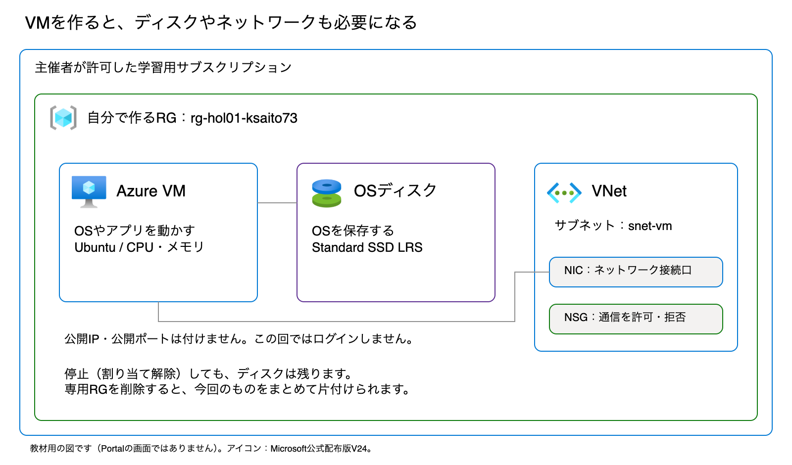

| 用語 | 意味 | この実習で確認すること |
| --- | --- | --- |
| サブスクリプション | Azureの利用料金やリソースを管理する単位 | 主催者が指定したものを使っているか |
| リソースグループ（RG） | 関連するリソースをまとめて管理する単位 | 今回のリソースだけが入っているか |
| リージョン | VMなどを配置する地域 | 指定された地域か。例: Japan East（東日本） |
| VM（仮想マシン） | WindowsやLinuxを動かす仮想的なサーバー | Ubuntuのバージョン、VMのサイズと電源状態 |
| Managed Disk（マネージドディスク） | OSやデータを保存するディスク | VMとは別に作られ、料金も別にかかること |
| NIC（ネットワークインターフェイス） | VMをネットワークにつなぐ接続口 | VNet内のサブネットにつながっていること |
| VNet（仮想ネットワーク）／サブネット | Azure内のネットワークと、それを分けた区画 | 今回用に作ったネットワークであること |
| NSG（ネットワークセキュリティグループ） | 通信を許可・拒否する規則をまとめたもの | SSHやRDPなどをインターネットに公開していないこと |

今回は公開IPを付けず、SSH・RDP、Web公開、Bastion、NAT Gatewayも設定しません。
VMの状態が「実行中」になったことを確認します。アプリの動作や外部との通信は、確認の対象外です。
VM内のOSやアプリは利用者が管理します。これは座学で学んだIaaSの特徴です。

### 入力する名前を先に決める

他の参加者と区別するための**個人識別名**を決め、全5回で使います。例は`ksaito73`です。
英小文字で始まる3〜10文字の英小文字・数字にし、フルネームやメールアドレスは使いません。
下の`ksaito73`を、自分の識別名に置き換えてください。詳しくは[共通の命名ルール](../self-study.md)を見てください。

| 項目 | 例 | 自分の値 |
| --- | --- | --- |
| 個人識別名 | `ksaito73` | __________ |
| RG名 | `rg-hol01-ksaito73` | __________ |
| VM名 | `vm-hol01-ksaito73` | __________ |
| VNet名 | `vnet-hol01-ksaito73` | __________ |
| サブネット名 | `snet-vm` | __________ |
| SSHキー名 | `key-hol01-ksaito73` | __________ |
| 終了時刻（日本時間） | 自分で決める。利用期限内に片付ける | __________ |

同じ名前のRGが見つかったら、そのまま使わず主催者に聞いてください。

## Exercise 1: 作成の準備

### Task 1 — Portalで利用先を確認する（5分）

誤って本番用や個人用の契約にVMを作らないよう、利用するサブスクリプションを確認します。

1. [Azure Portal](https://portal.azure.com/)を開き、Microsoftから案内されたアカウントでサインインします。
2. 右上のアカウント表示で、案内されたアカウントとディレクトリになっていることを確認します。
3. 上部の検索ボックスに `サブスクリプション`（Subscriptions）と入力し、サービスを開きます。
4. Microsoftから付与されたサブスクリプションの名前と、状態が**アクティブ／有効**であることを確認します。「Resource Manager | サブスクリプション」という一覧名で表示される場合もあります。

指定されたサブスクリプションを選べれば、次に進みます。見つからない場合は、別の契約で代用せず主催者に相談してください。
提出物にサブスクリプションIDやメールアドレスは記載しないでください。

### Task 2 — 自分のRGを作り、VMの作成画面を開く（5〜10分）

1. 上部の検索ボックスで **リソースグループ**を検索し、検索結果からサービスを開いて、**作成**をクリックします。
2. 付与されたサブスクリプションを選び、RG名を`rg-hol01-自分の識別名`にします。例は`rg-hol01-ksaito73`です。
3. リージョンは、利用が許可された **Japan East**（東日本）を選びます。別の地域が指定されていれば案内に従います。
4. **タグ**で、次の表のとおり**3つのタグを追加**します。1行につき1つのタグを作り、**名前**と**値**をそれぞれ別の欄に入力します。

   | 名前 | 値 |
   | --- | --- |
   | `Purpose` | `AzureHandsOn` |
   | `Session` | `01` |
   | `Participant` | 自分の個人識別名（例: `ksaito73`） |

5. **レビューと作成**（画面によっては「確認および作成」）をクリックします。名前・リージョン・3つのタグを確認してから **作成**をクリックします。
6. RGの一覧に戻ったら、**最新の情報に更新**を選び、自分のRG名をクリックします。**概要 → リソース**で、まだ中にリソースがないことを確認します。作成直後の一覧は自動で更新されない場合があります。
7. 上部の検索ボックスで **仮想マシン**を検索し、サービスの **仮想マシン**（Virtual machines）を開きます。**「仮想マシン（クラシック）」は選びません。**
8. 一覧画面の **作成→仮想マシン**（画面によっては「Azure仮想マシン」）を選びます。 **仮想マシンスケールセット（VMSS）** や既存のVMは選びません。
9. 「仮想マシンの作成」画面が開いたら、次へ進みます。

タグの名前と値を入力すると、次の空行が自動で現れます。3組がそろえば、最後の空行は埋めなくて構いません。
リソースグループのリージョンは、リソースグループの管理情報を置く地域です。中のVMの配置先は、Task 3で別に選びます。この実習では両方を同じJapan Eastにそろえます。

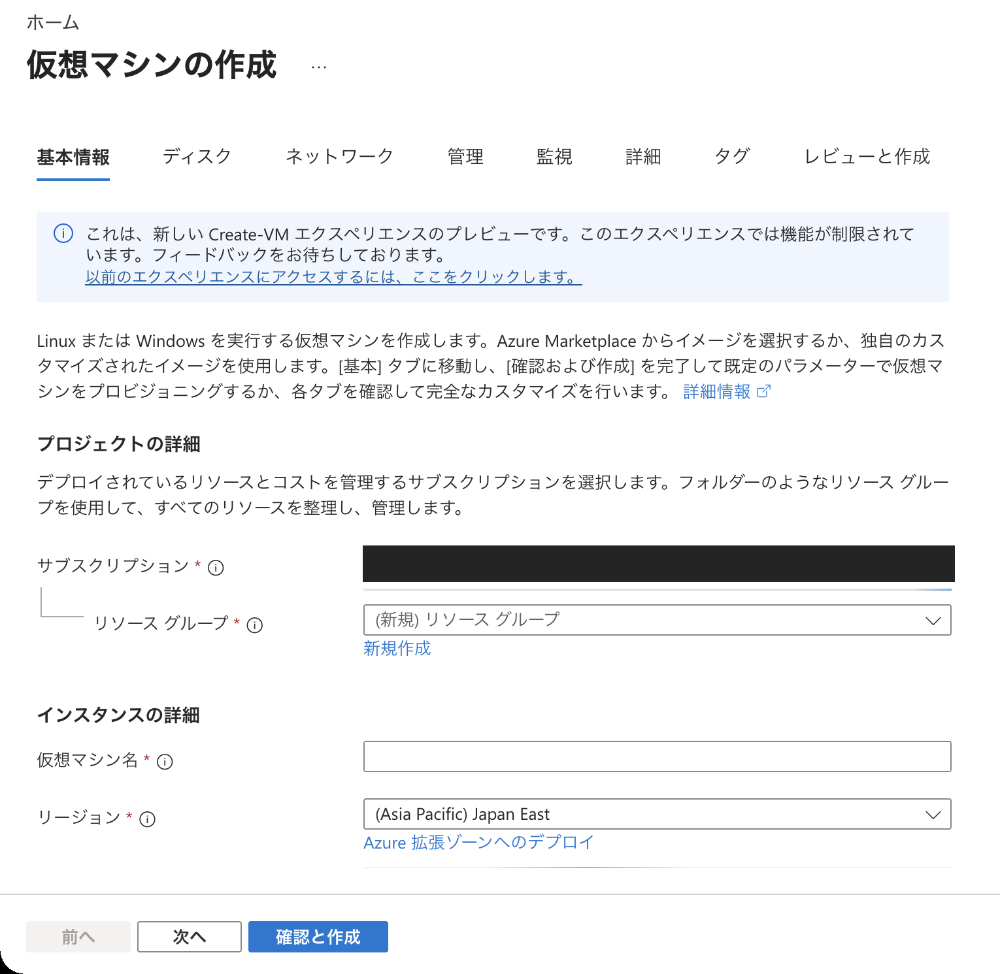

新しいVM作成画面のプレビューが案内されたら、「以前のエクスペリエンスにアクセスするには、ここをクリックします」から従来の画面に戻ります。
この手順は従来の画面で確認しています。戻るためのリンクがなく、同じ項目を見つけられない場合は、そこで止めて主催者に確認してください。
「基本情報／基本」「レビューと作成／確認および作成／確認と作成」など、同じ内容でも表記が異なる場合があります。**検索結果の「仮想マシン（クラシック）」に切り替える意味ではありません。**

作成画面で、次の表に従って基本情報を入力します。

## Exercise 2: VMを作る

### Task 3 — 基本情報を入力する（10分）

ここで、VMを置く場所、OS、VMのサイズを決めます。

| 項目 | 今回の設定 | 理由 |
| --- | --- | --- |
| サブスクリプション | Microsoftから付与されたもの | 個人用や本番用とは分けて使う |
| リソースグループ | **Task 2で自分が作ったRG**を選ぶ | ここで二つ目のRGを作らない |
| 仮想マシン名 | 自分のVM名 | 個人識別名で、他の人のVMと見分ける |
| リージョン | 主催者指定。例: **Japan East** | 主催者が利用できることを調べた地域を使う |
| 可用性オプション | **インフラストラクチャ冗長は必要ありません**。画面によっては「インフラストラクチャの冗長性は必要ありません」 | 学習用に1台だけ作るため。可用性ゾーンやVMSSは選ばない。本番環境で推奨する設定ではない |
| セキュリティの種類 | **トラステッド起動の仮想マシン**（Trusted launch） | Gen2 VMの起動時のセキュリティ機能を使う |
| イメージ | **Ubuntu Server 24.04 LTS、x64、Gen2**。発行元Canonical | Linuxを動かす。Windows、有償サードパーティー製品、Arm64は選ばない |
| VMアーキテクチャ | **x64** | イメージ名のx64と、アーキテクチャの選択欄の両方を確認する |
| サイズ | **Standard_D2alds_v6**（2 vCPU・4 GiB）、または主催者が承認した代替サイズ | 実習で指定したVM。画面の既定サイズはそのまま使わない |
| Azure Spot割引 | **オフ** | Spot VMは実習の途中で回収されることがある |
| 休止状態を有効にする | **オフ**。選択不可ならそのまま | 今回は休止ではなく、最後に停止・割り当て解除を行う |
| 認証の種類 | **SSH公開キー** | パスワードを共有せずに設定できる |
| ユーザー名 | `azureuser` | VM内の管理者の名前。PortalにサインインするIDとは別 |
| SSH公開キーのソース | **新しいキーの組の生成** | あらかじめ鍵を作っておかなくてよい |
| SSHキーの種類 | **RSA SSH形式** | この手順の確認済みの選択肢にそろえる。AzureがEd25519を使えないという意味ではない |
| キーの組名／キーペア名 | 自分のSSHキー名。例: `key-hol01-ksaito73` | 「キーの組の名前」「キー ペア名」と同じ意味。この実習で作った鍵を見分ける |
| パブリック受信ポート | **なし**（None） | SSH・RDP・HTTPをインターネットに公開しない |
| 受信ポートの選択 | **選択不要**。「なし」にすると灰色になる | SSH (22)を追加で選ばない |

**VMサイズは、検索するだけでなく、選択を確定します。**

1. **すべてのサイズを表示**（画面によっては「サイズを選択」）を開きます。
2. 検索欄に`D2alds_v6`を入力します。
3. 結果に「D シリーズ v6」の見出しだけが出たら、左の**展開する矢印**をクリックします。シリーズの見出しは、VMサイズそのものではありません。
4. **D2alds_v6、2 vCPU、4 GiB**の行を選び、画面下の**選択**をクリックします。
5. 基本タブに戻り、サイズ欄が**Standard_D2alds_v6**になったことを確認します。表示が変わるまで待ってください。

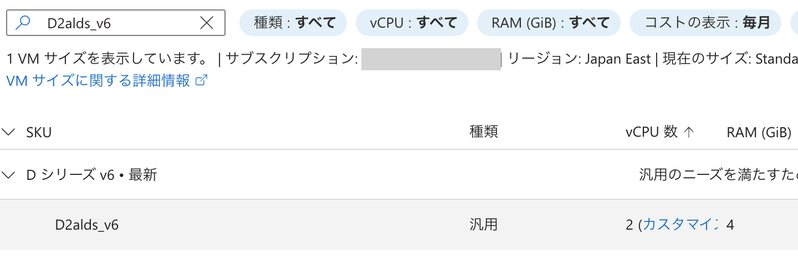

画面の既定サイズはそのまま使いません。検証時には、既定のD2s_v3に「このサブスクリプションでは使用できません」という表示が出ましたが、指定のD2alds_v6へ変更すると解消しました。
指定サイズでも選べない、行が灰色、またはエラーが残る場合は、別のサイズへ勝手に変更せず主催者に相談してください。
互換性のエラーが出た場合も、トラステッド起動を無効にして進めるのではなく、使える組み合わせを主催者と調べます。

**セキュリティ機能の構成**を開き、**セキュアブート＝オン、vTPM＝オン、整合性の監視＝今回は追加しない**を確認して、**OK**で戻ります。
Daldsv6では、高速ネットワークとNVMeを使います。NVMeの案内はエラーではありません。Task 4とTask 5で、必要な設定を無効にしていないことを確認します。
参考: [Daldsv6の仕様と必須機能](https://learn.microsoft.com/ja-jp/azure/virtual-machines/sizes/general-purpose/daldsv6-series)。

ログインしない実習でも、VMを作るときには管理者の認証方法が必要です。
SSHキーの秘密鍵は、後の手順でダウンロードします。鍵の中身は表示・撮影・提出せず、自分だけで保管してください。

**認証欄は、上から次の順で設定します。**

1. **管理者アカウント → 認証の種類**で **SSH公開キー**を選びます。
2. **ユーザー名**に`azureuser`を入力します。
3. **SSH公開キーのソース**を開き、**新しいキーの組の生成**を選びます。「既存の公開キーを使用」「Azureに格納されている既存のキーを使用」は選びません。
4. **SSHキーの種類**で **RSA SSH形式**の丸を選びます。
5. **キーペア名**に、先に決めた自分の`key-hol01-...`を入力します。空欄のままにしません。
6. **パブリック受信ポート**で **なし**を選びます。

この段階では公開キーの文字列を貼り付ける必要はありません。公開キーの入力欄が必須になっていたら、手順3のソースを見直してください。
VM名、Ubuntu x64 Gen2、指定サイズ、SSH公開キー・新規生成・RSA、公開受信ポート「なし」を確認してから進みます。

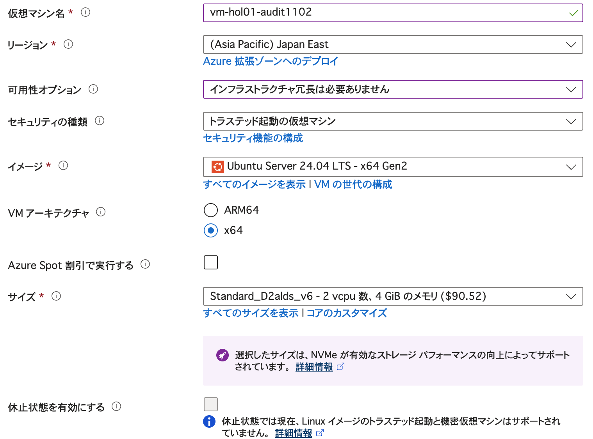

OSは **イメージ（Image）**、CPUとメモリの大きさは **サイズ**で選びます。`x64` と `Gen2` も見てください。
画像は **Standard_D2alds_v6** を選択した作成前の画面です。VM名の`audit1102`は自分の個人識別名に置き換えます。料金も、自分の契約で表示される金額を確認してください。
サイズ選択の「ローカルストレージ110 GiB」は、VMサイズに含まれる一時ストレージです。次のOSディスクの容量とは別で、今回そこへデータを保存する操作は行いません。

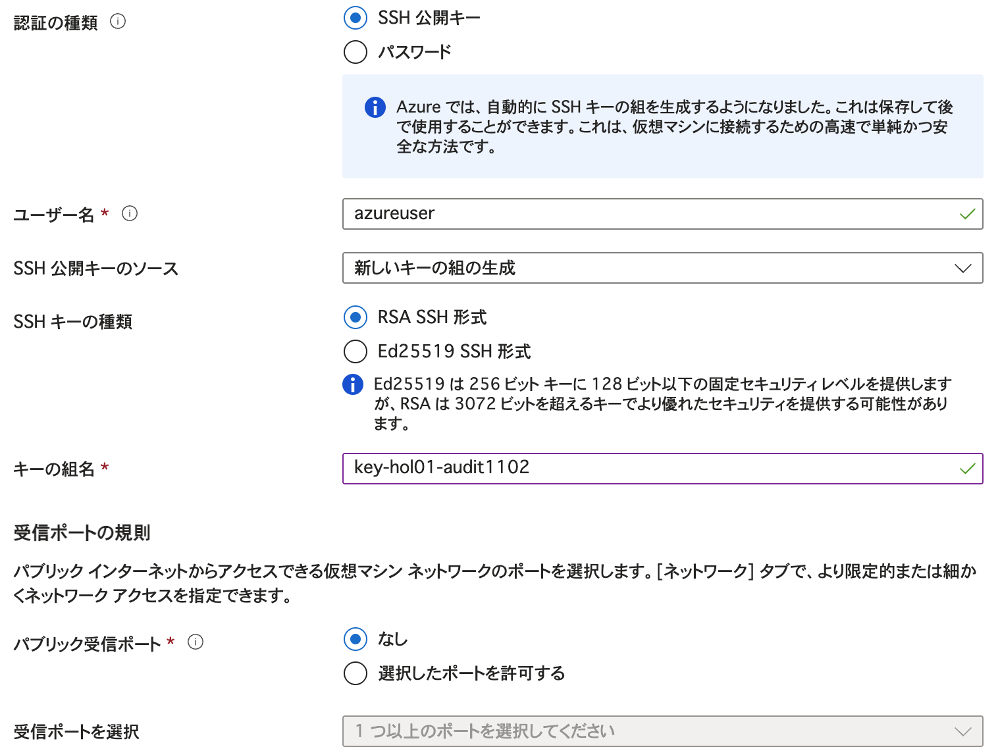

鍵の設定の下に、**パブリック受信ポート**があります。鍵を作ることと、SSHのポートを公開することは別なので、ここは「なし」にします。

### Task 4 — ディスクとネットワークを設定する（8分）

**ディスク（Disks）タブ**

1. 画面下部の **次へ: ディスク**、または上部の **ディスク**タブを選びます。
2. 以下の表に従い、選択値とチェックの有無を確認します。

| 画面の項目名 | 今回の操作・確認値 |
| --- | --- |
| OSディスクのサイズ | **イメージの既定値**。検証時は30 GiB。イメージの容量より小さくしない |
| OSディスクの種類 | **Standard SSD（ローカル冗長ストレージ）**。まとめ画面では**Standard SSD LRS**を確認する |
| VMと共に削除 | **オン**。ただし実習の最後はVM単体でなくRGごと削除する |
| Ultra Diskの互換性を有効にする | **オフ**。選択不可ならそのまま |
| キーの管理 | **プラットフォームマネージドキー**。SSHキーとは別の、ディスク暗号化用の設定 |
| ホストでの暗号化 | 今回は新しく有効にしない。組織で必須なら解除せず主催者に確認する |
| データディスク | **追加しない**。一覧が空であることを確認する |
| ディスクタブ内の「詳細」→エフェメラルOSディスク | **なし**。今回は、停止後も残るマネージドディスクを使う |

Standard SSDを選びます。同じ名前の候補が複数ある場合は、 **ローカル冗長（LRS）** のものを選び、ゾーン冗長（ZRS）やPremium SSDにしないでください。
ディスクはVMを停止しても残り、料金もかかり続けます。停止後の手順で、この点を確認します。

旧版の教材ではStandard HDDを使っていましたが、この版では新規OSディスクの公式推奨に合わせてStandard SSDへ変更しました。
Standard HDDのOSディスクには、2028年9月8日の廃止予定の案内があります。警告を消すために設定を推測するのではなく、上の表のSSDへそろえてください。
参考: [Standard HDD OSディスクの廃止と推奨される移行先](https://learn.microsoft.com/ja-jp/azure/virtual-machines/disks-hdd-os-retirement)。

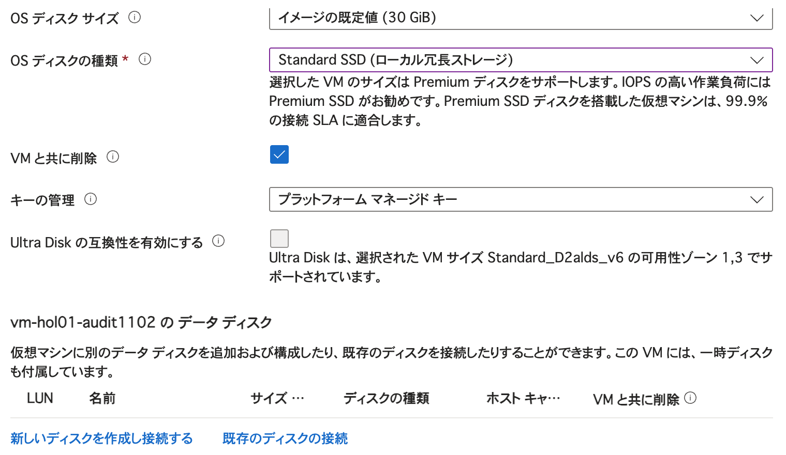

「ホストでの暗号化が登録されていません」という案内だけで、VMの作成に失敗したわけではありません。今回はその追加機能を使わず、プラットフォームマネージドキーによるディスク暗号化を使います。
組織のポリシーが別の暗号化設定を必須にしている場合は、勝手に変更せず主催者に確認します。

**ネットワーク（Networking）タブ**

1. **仮想ネットワーク → 新規作成**を選びます。既存の業務用ネットワークは選びません。
2. 開いた画面の**名前**を、自分の`vnet-hol01-...`に変更します。VM名から自動で入った名前は、そのまま使いません。
3. **アドレス空間**の入力済みの範囲をクリックし、`10.42.0.0/16`へ置き換えます。入力後はTabキー、または別のセルをクリックして確定します。空行へ2つ目の範囲を追加するのではありません。
4. **サブネット**には、名前`snet-vm`、アドレス範囲`10.42.0.0/24`の1組を入れます。アドレス空間を変えると、範囲外になった既定のサブネットが消える場合があります。その場合は空行へ入力します。既定の行が残っている場合は、その行を編集します。
5. 名前と2つのアドレス範囲を確認し、**OK**でVM作成画面へ戻ります。**仮想ネットワーク**に自分の`vnet-hol01-...`、**サブネット**に`snet-vm (10.42.0.0/24)`が表示されるまで待ちます。これは入力内容の確定であり、まだVNetのデプロイは始まりません。
6. **パブリックIP**を開き、**なし**を選びます。最初は「（新規）VM名-ip」などが入っているため、必ず変更します。「パブリック受信ポートなし」とは別の設定です。
7. NICネットワークセキュリティグループは **Basic／基本**、パブリック受信ポートは **なし**にします。
8. **高速ネットワークを有効にする＝オン**を確認します。Daldsv6シリーズでは必須です。**負荷分散のオプション＝なし**とし、ロードバランサー、Bastion、NAT Gatewayは追加しません。
9. **VMが削除されたときにNICを削除する＝オフ**を確認します。今回は最後にRGごと削除して、NICも片付けます。

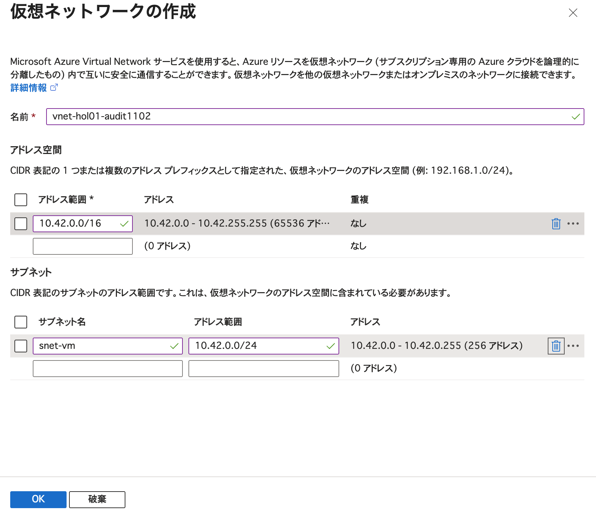

主催者から別のアドレス範囲を指定された場合は、その値を使います。今回は他のVNetと接続しないため、参加者同士で同じ範囲を使っても構いません。
文字だけに見える範囲のセルも、クリックすると編集できます。表の末尾の空行をすべて埋める必要はありません。
「受信ポートを選択」が灰色なのは、パブリック受信ポートが「なし」だからです。ここを有効にする必要はありません。

> **公開IPなしと、外向き通信の禁止は別です。**
> この回はインターネットからVMへの直接接続を設けませんが、VMから外への通信を禁止した構成とは限りません。
> 既定の送信アクセスは、作成経路やAPIバージョンによって異なります。今回の短いVM作成手順では、サブネットの送信アクセスを明示的に無効にする操作は行いません。
> `apt update`、SSH接続、Web表示、外向き通信のテストは課題に含めません。外向き通信の遮断も必須となる環境では、この手順だけで要件を満たすと判断せず、作成前に主催者へ確認してください。

参考: [既定の送信アクセスとプライベートサブネット](https://learn.microsoft.com/ja-jp/azure/virtual-network/ip-services/default-outbound-access)。
「2026年以降なら、どの作成方法でも自動でプライベートになる」という意味ではありません。

次へ進む前に、今回作るVNetが選ばれていることと、データディスク・公開IP・公開ポートを追加していないことを確認してください。
NIC・NSG・OSディスクの名前はPortalが自動で付けます。例と少し違っていても構いません。

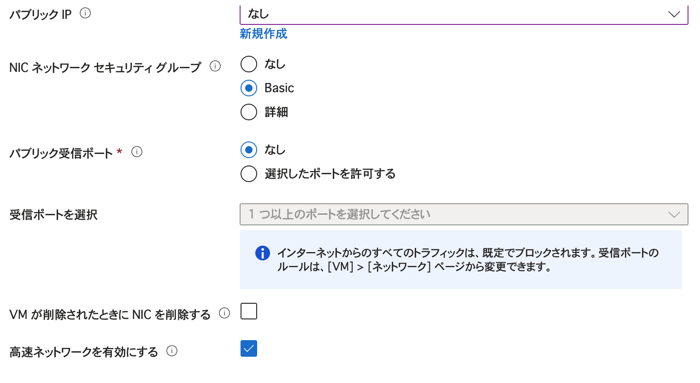

「なし」を選ぶ欄は2つあります。上の**パブリックIP**と、下の**パブリック受信ポート**を両方見てください。
その間にあるNICのNSGは「基本」を選びます。

### Task 5 — 追加サービスと料金を確認する（5分）

1. **管理**（Management）で、バックアップなどの追加サービスを新しく有効にしません。
2. **監視**（Monitoring）で、起動診断は **マネージドストレージアカウントで有効**を選びます。
   診断用のStorageアカウントを別途作成する必要はありません。VM insights、ログ分析、アラートも今回は追加しません。
3. **詳細**（Advanced）で、拡張機能やカスタムデータは追加せず、**NVMeはオンのまま**にします。「追加サービスを使わない」は、すべてのチェックを外すという意味ではありません。
4. **タグ**（Tags）で、Task 2の表と同じ**3つのタグ**を追加します。各行の**名前**と**値**を別々の欄に入力し、画面上で選べる今回のリソースに適用します。
5. **レビューおよび作成**（Review + create。画面によっては「確認および作成」「レビューと作成」）を選びます。

タブごとの確認値は次のとおりです。「追加しない」は、新しいサービスを有効にしないという意味です。
組織によって強制されていて変更できない項目は、勝手に解除せず主催者に確認します。

| タブ | 項目 | 今回の設定 |
| --- | --- | --- |
| 管理 | Microsoft Defender for Cloud | 契約・組織の既存設定を確認。有料プランを新しく追加せず、既存の保護も解除しない |
| 管理 | IMDS／WireServerのメタデータセキュリティプロトコル | 今回は新しく有効にしない。組織で必須なら主催者へ確認する |
| 管理 | システム割り当てマネージドIDの有効化 | **オフ** |
| 管理 | Microsoft Entra IDでログイン | **オフ**。今回はTask 3のSSHキーを使う |
| 管理 | 自動シャットダウンを有効にする | **オフ**。最後に手動で停止・削除する |
| 管理 | バックアップの有効化 | **オフ** |
| 管理 | 定期的な評価を有効にする | **オフ** |
| 管理 | パッチオーケストレーションオプション | **イメージの既定値** |
| 監視 | 推奨されるアラートルールを有効化 | **オフ** |
| 監視 | ブート診断 | **マネージドストレージアカウントで有効にする（推奨）** |
| 監視 | OSのゲスト診断を有効にする | **オフ** |
| 監視 | アプリケーションの正常性監視を有効にする | **オフ** |
| 監視 | VM insights／追加のログ分析 | 新しく有効にしない |
| 詳細 | 拡張機能／VMアプリケーション | 追加しない |
| 詳細 | カスタムデータとcloud-init | **空欄** |
| 詳細 | ユーザーデータの有効化 | **オフ** |
| 詳細 | NVMeを使用してリモートディスクストレージパフォーマンスを高める | **オン**。このサイズでは必須。灰色でオンになっていても、そのまま使う |
| 詳細 | ホストグループ／容量予約／近接配置グループ | **なし**。既存のグループを選ばず、新しく作らない |
| タグ | 名前と値 | Task 2と同じ3行。RGのタグが自動で引き継がれるとは限らない |

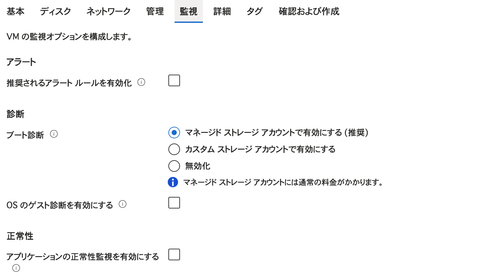

起動診断は、この画面では**ブート診断**と表示されています。一番上の「マネージドストレージアカウントで有効にする」を選びます。
その上のアラートと、下のOSのゲスト診断は追加しません。組織で必須の項目は、解除せず主催者に確認してください。

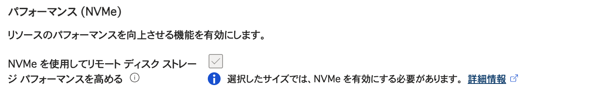

タグのリソース欄に「13項目が選択されました」などと出ても、それはタグの適用先の候補数です。13個のリソースを作るという意味ではありません。
最終確認のタグ欄に、使わないサービスの種類が出る場合もあります。バックアップなどが無効であることは、上の設定のまとめで確認し、実際に作られたものはTask 8で確かめます。

**「作成」を選ぶ前のチェック**

- [ ] サブスクリプションとRGが指定どおりで、控えておいたVM名で1台だけ作る。
- [ ] Ubuntu x64 Gen2と承認済みの小型サイズを選び、Spotはオフにした。
- [ ] 認証はSSH公開キー、`azureuser`、新しいキーの組の生成、RSA SSH形式。自分のキーペア名を入力した。
- [ ] Standard SSD LRS、追加データディスクなし、エフェメラルOSディスクなし。
- [ ] 高速ネットワークとNVMeはオン、セキュアブートとvTPMもオンにした。
- [ ] 公開IP・公開受信ポートなし。Bastion/NAT/バックアップを追加していない。
- [ ] 検証に成功し、**表示されたVMの料金を確認した**。
- [ ] 表示されたVMの料金とは別に、ディスクなどの費用がかかることを確認した。

「月額」の表示は、1か月動かした場合の目安です。1時間の料金や、今回の実習の請求額ではありません。
最終確認では「USD/時間」のように時間単価が表示される場合もあります。通貨と単位を読み、月額と時間単価を取り違えないでください。
実習では「VMの時間単価 × 実行時間」に、ディスクや追加サービスの料金も足して見積もります。主催者が決めた上限を超える場合は、作成前に相談してください。
「サブスクリプションクレジット適用可能」と出ても、実習全体が無料になる保証ではありません。

予算アラートは費用を通知するだけで、課金は止めません。自動シャットダウンでも、ディスクなどの料金は残ります。
どちらを設定していても、終了時にはリソースを削除してください。

**最終確認で「検証に失敗しました」と出たとき**

まだ「作成」は押しません。赤いメッセージや**詳細**を開き、次の順に調べます。

| 表示された内容・状態 | 戻る場所と確認すること |
| --- | --- |
| 公開キーが未入力／無効 | **基本情報 → 管理者アカウント**。ソースが「新しいキーの組の生成」か確認。既存キー用の欄に名前や`.pem`の中身を貼らない |
| キーペア名の未入力・名前のエラー | **基本情報 → キーペア名**。今回の`key-hol01-...`を入力し、欄の直下のエラーを解消。同名の既存キーは自己判断で削除しない |
| キーの種類が手順と違う | **基本情報 → SSHキーの種類**を**RSA SSH形式**にそろえる。種類の違いだけがエラー原因とは限らないため、表示されたエラー文も確認する |
| サイズ・クォータ・ポリシーなど、認証以外のエラー | 認証を変更しても解決しない。エラーの項目を「困ったときの確認順」と照合する |
| どの欄の問題か分からない | Task番号、項目名、秘密情報を除いたエラー文を控えて主催者に相談する |

修正後にもう一度**レビューおよび作成**を開き、検証が成功したことを確認します。
**エラーを回避するためにパスワードへ切り替えたり、別のVMを追加で作ったりはしません。**
`InvalidTemplateDeployment`などの大きな見出しだけで原因を判断せず、**詳細の中のエラーコードと項目名**を確認します。
具体的な調べ方と参考Docsは、後半の[困ったときの確認順](#困ったときの確認順)にまとめています。

### Task 6 — 作成して完了を待つ（5〜10分）

1. 最終チェックが済んだら **作成**を選びます。
2. キーのダウンロード案内で **秘密キーのダウンロードとリソースの作成**を選びます。画面によっては「秘密キーをダウンロードしてリソースを作成」という表記です。
3. 今回の実習用の `.pem` ファイルが、安全な場所に保存されたことを確認します。
   秘密鍵の内容や、保存先に含まれる個人名をスクリーンショットに写さないでください。
4. デプロイ画面で完了を待ちます。「作成」を繰り返し押す必要はありません。
5. **デプロイが完了しました**（Your deployment is complete）が表示されたら、**リソースに移動する／リソースに移動**を選びます。

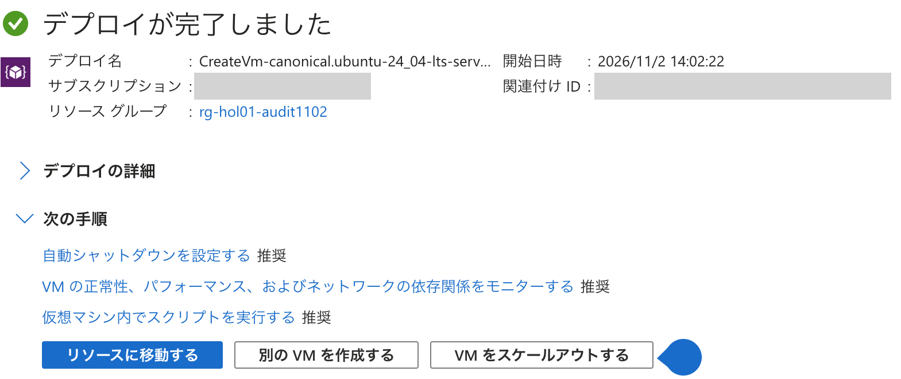

完了画面には、自動シャットダウン、監視、スクリプト実行などの「推奨」や、「別のVMを作成する」「VMをスケールアウトする」も出る場合があります。**この回では選びません。**
ボタンの説明用の吹き出しで操作しにくい場合は、Escキーで吹き出しを閉じます。
また、このデプロイ画面の上部にある**削除**は、デプロイの履歴を削除する操作です。VMの片付けには使わず、Task 10で専用RGを削除します。

ダウンロードは**自分のPCのブラウザー**で行われます。Windowsはエクスプローラー、macOSはFinderの「ダウンロード」など、ブラウザーで指定した保存先を確認してください。
ファイル名の例は`key-hol01-ksaito73.pem`です。ファイルを開かず、**今回のキー名・拡張子`.pem`・保存先**だけを手元に控えます。
ブラウザーに保存先の確認が出たら、自分だけが使える場所を選びます。共有フォルダーやチャットには置きません。
Azureの**SSHキー**リソースに保存される公開キーと、PCへ保存する**秘密キー**は別です。秘密キーは作成時に保存します。同じ秘密キーを後から再ダウンロードすることはできません。

自分のVMの概要画面が開いたら、次のTaskで実行状態も確認します。概要を開けたことだけで、VMの起動まで成功したとは判断しません。
10分ほど待っても進まないときは、通知やデプロイの詳細を開いて主催者に相談してください。
作成が途中で失敗しても、ディスクなどが残ることがあります。最後の片付けは省略しないでください。

## Exercise 3: 作られたものを確かめる

### Task 7 — VMの概要を読む（5分）

作成が終わったら、VMの電源状態と設定を見てみます。

1. 画面タイトルが自分のVM名であることを確認します。
2. **概要**（Overview）で、状態が **実行しています／実行中**（Running）になっていることを確認します。まだ反映されていない場合は**最新の情報に更新**を選びます。
3. OSがLinux/Ubuntuで、サイズとリージョンが指定どおりになっていることを確認します。
4. **プライマリNICパブリックIP／パブリックIPアドレス**が「なし／未構成／-」であることを確認します。
5. リソースグループのリンクを開きます。

「実行中」はVMの電源が入っている状態です。アプリが正常に動くかどうかは、これだけでは分かりません。
この回ではログインしないので、「接続」からSSH・RDP・Bastionを設定する必要はありません。
概要ではサイズが`Standard D2alds v6`のように、アンダースコアではなく空白を使って表示される場合があります。2 vCPU・4 GiBも一緒に確認してください。

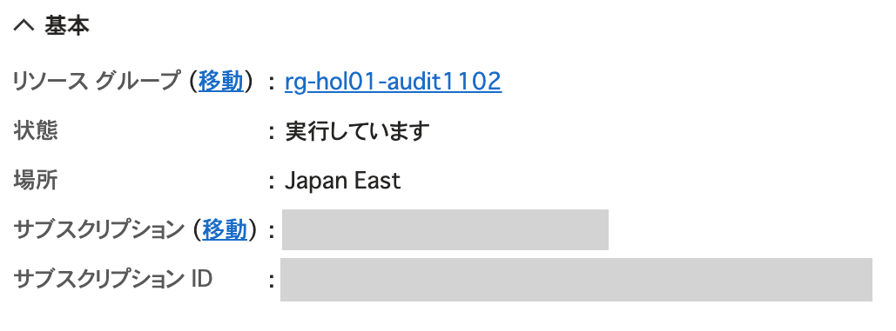

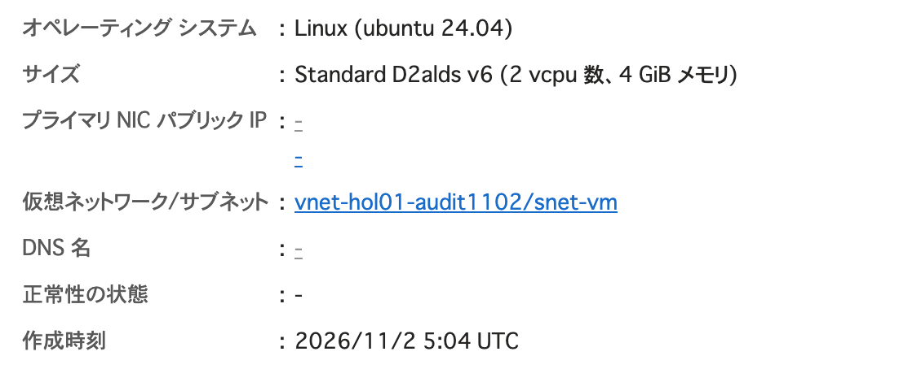

**「VMに既定の送信IPがあります」と表示された場合**

検証した作成経路でも、この警告が表示されました。これは作成失敗の通知ではなく、VMの**外向き通信**の構成についての警告です。
NICに公開IPを付けないこととは両立します。つまり、「プライマリNICパブリックIP＝-」でも、既定の送信IPを使える場合があります。
この回は外向き通信を禁止した構成とはしていません。警告を消すために、NAT Gatewayや公開IPを追加しないでください。
外向き通信の遮断が必要なら、Task 4の注意に従い主催者へ確認します。参考: [既定の送信アクセス](https://learn.microsoft.com/ja-jp/azure/virtual-network/ip-services/default-outbound-access)。

### Task 8 — VM以外のリソースを見る（5分）

1. 今回のRGの**概要 → リソース**を開きます。
2. **VM、ディスク、ネットワークインターフェイス、NSG、仮想ネットワーク**を探します。
3. 新しいキーを生成した場合は、**SSHキー**のリソースも確認します。
4. **ディスク**の行の名前を開き、**概要 → 要点／基本**で、**ストレージの種類＝Standard SSD LRS**、 **ディスクサイズ＝イメージの既定容量（検証時は30 GiB）** を確認します。上部のパンくずにある自分のRG名から、一覧へ戻ります。
5. **ネットワークインターフェイス**の行の名前を開き、**概要 → 要点／基本**で、**仮想ネットワークまたはサブネット**が自分の`vnet-hol01-.../snet-vm`、**高速ネットワーク＝有効**、 **パブリックIPv4アドレス＝-** であることを確認します。自分のRGへ戻ります。

「要点」「基本」「Essentials」などの見出しが折りたたまれている場合は、見出しをクリックして展開します。ここでは読むだけで、**編集・移動・ディスクの追加・スナップショットの作成**は行いません。

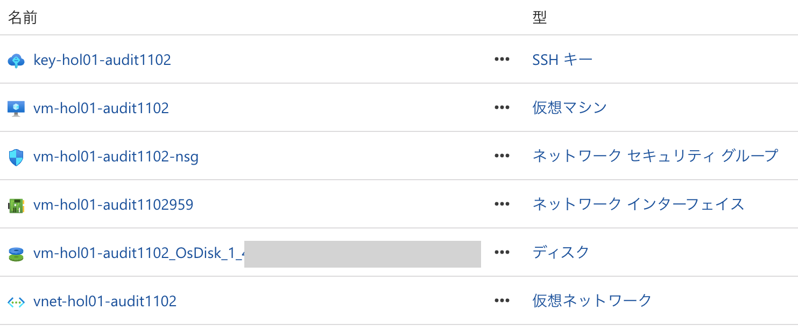

VM・ディスク・ネットワークが、それぞれ独立したリソースとして並んでいることを確認してください。
それぞれが今回のRGにまとまっていれば、最後に一緒に削除できます。
見覚えのない業務用リソースがRGに入っている場合は、削除せず主催者に相談します。
Network Watcherなどが別のRGに自動作成されていても、そのRGは削除しません。

| 確認する項目 | 自分の記録（実際のID・IP・メールアドレスは不要） |
| --- | --- |
| VMのOSとサイズ | __________ |
| VMの状態 | __________ |
| ディスクの種類・容量 | __________ |
| NIC、NSG、VNetを見つけた | はい／未確認 |
| 公開IPがない | はい／未確認 |
| SSHキーリソースの有無 | あり／なし／未確認 |

## Exercise 4: 停止と削除を体験する

### Task 9 — VMを停止する（3〜5分）

1. 今回のRGから自分のVMを開き、**概要 → 停止**（Stop）を選びます。
2. **この仮想マシンの停止**の確認画面でVM名を確かめ、**はい**を選びます。
3. **最新の情報に更新**を選び、**停止済み（割り当て解除）**（Stopped (deallocated)）になるまで待ちます。「停止済み（割り当て解除済み）」という表記の場合もあります。
   「停止中」や「割り当て解除中」の間は、まだ処理が終わっていません。
4. RGのリソース一覧を開き、VMやディスクが残っていることを確認します。VMを再起動する必要はありません。

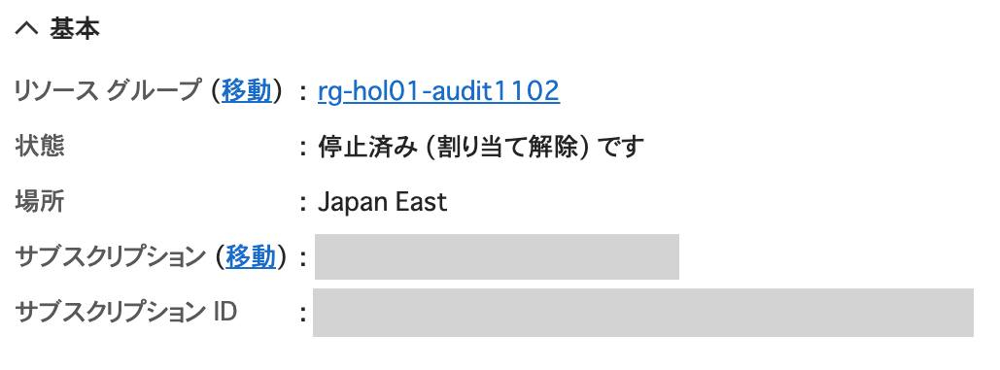

停止の確認画面には、通常1〜2分で終わるものの、さらに時間がかかる場合があると案内されています。待ち時間の目安を過ぎても、停止ボタンを繰り返し押さず、通知と現在の状態を確認してください。

| 状態 | VMの計算料金 | ディスク等 |
| --- | --- | --- |
| 実行中（Running） | 発生する | 残る。料金が発生するものもある |
| 停止済み・割り当てあり（Stopped） | 発生する | 残る |
| **停止済み（割り当て解除）** | VMの計算料金は止まる | **残る。ディスク等の料金は続く** |
| 今回のRGと関連リソースを削除した後 | 今回のVMは削除されている | 今回の対象リソースも削除されている |

OS内でシャットダウンするだけだと、計算資源の割り当てが残ります。Portalで「停止済み（割り当て解除）」になったことを見てください。
ただし、停止してもディスクなどは残っています。次の手順でRGを削除して片付けます。

### Task 10 — 自分の専用RGを削除する（5〜10分）

> **削除は取り消せません。**
> 今回の専用RG以外では操作しないでください。共有用・本番用・他の人のRGは削除しません。

1. VMの概要からRGのリンクを開きます。画面上部の名前が、**控えておいた自分のRG名**と一致することを確認します。
2. サブスクリプションが、最初に確認したものと一致することを確認します。
3. リソース一覧を見て、**今回のリソースだけ**が入っていることを確認します。
   **概要のEssentials／基本**を展開するか、左メニューの**タグ**を開き、`Participant`も自分の識別名と一致するかを見ます。名前だけで削除対象を判断しません。
4. 自分のRGの画面で、**リソースグループの削除**（Delete resource group）を選びます。画面が狭くて見つからない場合は、上部の **…／その他** も確認します。**VM単体やデプロイ履歴の「削除」ではありません。**
5. 削除確認画面で、対象のRG名と削除予定のリソースをもう一度確認します。
6. 確認用の欄に**自分のRG名をそのまま**入力し、画面の注意事項を読んで **削除**を選びます。
7. さらに**削除の確認**というダイアログが出た場合は、「元に戻すことはできません」という注意を読み、今回のRGから開いた確認であることを確かめて、もう一度**削除**を選びます。まだ削除しない場合は**戻る**を選びます。
8. 通知を確認し、削除の完了を待ちます。

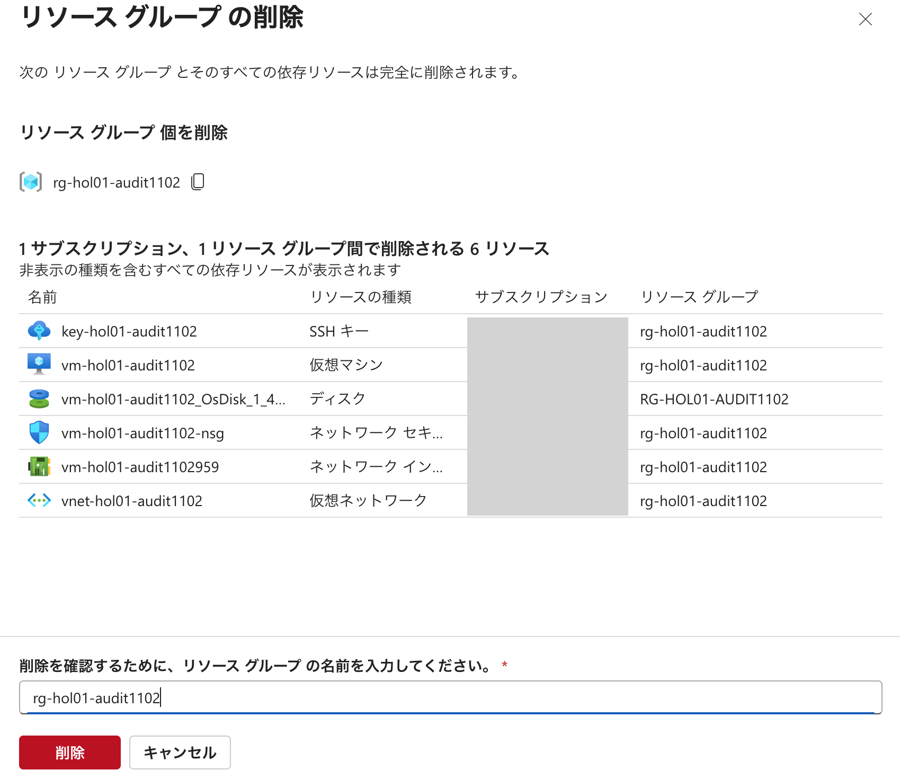

VMだけを削除すると、ディスクなどが残ることがあります。ここでは専用RGを削除し、中のディスク・NIC・VNet・SSHキーもまとめて片付けます。
RGの外にあるものは消えないので、この実習では既存リソースの再利用や、RGの外への追加は行いません。
「削除を受け付けました」の表示だけでは完了ではありません。次の手順で、削除後の一覧を確認します。

### Task 11 — 削除完了を確かめる（3分）

1. 上部の検索欄から **リソースグループ**（Resource groups）を開き、実習に使ったサブスクリプションを選びます。
2. **最新の情報に更新**を選び、自分のRG名で絞り込みます。**RGが表示されない**ことを確認します。
3. **仮想マシン**一覧も更新し、自分のVM名が表示されないことを確認します。
4. 通知に削除失敗が出ていないことを確認します。画面を閉じるだけでは、削除完了の確認にはなりません。
5. PCのエクスプローラー／Finderで保存先を開き、今回の実習用の `.pem` ファイルだけを削除します。
   加工前のスクリーンショットも、不要になったものは削除してください。
   他の実習や業務で使う鍵は残します。

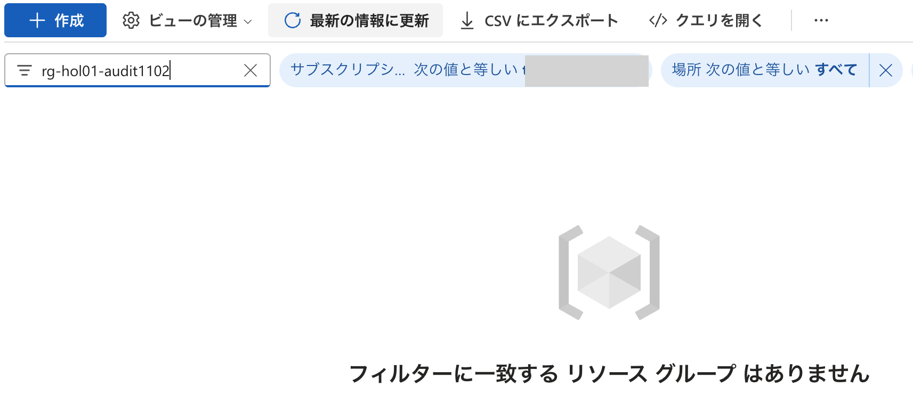

**名前を検索して0件になっても、別のサブスクリプションを見ていては削除の確認になりません。**
一覧の**サブスクリプション**フィルターが付与された契約になっていること、**場所や種類などに意図しない絞り込みがないこと**も確認します。
「最近使ったリソース」の履歴に名前が残ることがあります。削除確認には、更新したRG一覧とVM一覧を使ってください。

ロックや権限、ポリシーで削除できなかったときは、**未完了**と記録して主催者に引き継ぎます。
できる範囲でVMを割り当て解除し、付与元にRG名とエラーコードを伝えてください。
原因が解消したら削除を再開してください。利用期限に間に合わない場合は、支援担当者と削除完了を確認する日時を決めてください。

請求データには反映の遅れがあります。削除前の利用分が、あとから表示されることもあります。
片付けが終わったかどうかは、費用画面の0円表示ではなく、リソースが削除されたかで確認してください。

## 完了チェックと振り返り

- [ ] 自分のVMを1台作り、実行中を確認した。
- [ ] 自分の識別名を使ってRGを作り、Participantタグを付けた。
- [ ] ディスク・NIC・NSG・VNetが、VMとは別のリソースであることを確認した。
- [ ] 公開IP・公開受信ポートを追加しなかった。
- [ ] 停止済み（割り当て解除）でもディスクは残ることを確認した。
- [ ] 自分の専用RGを削除し、一覧を更新してRGとVMが表示されないことを確認した。
- [ ] 実習の秘密鍵ファイルを片付けた。

**主催者が指定した提出先に、次の3点を提出してください。**
実際のリソースID・IP・秘密鍵は含めないでください。

1. 実施結果（完了／途中まで／未実施）。未完了の場合は、止まったTaskとその理由。
2. 「VMを停止する」と「専用RGを削除する」はどう違うか、自分の言葉で1文。
3. 一番迷った画面と、その画面にどんな説明があると助かるか。

<details>
<summary>振り返りの解答例</summary>

VMを割り当て解除すると、VMの計算料金は止まりますが、ディスクなどは残って課金も続きます。
専用RGを削除すると、その中のVMと関連リソースをまとめて片付けられます。
Azureが管理するのは物理設備です。VM内のOS更新、アプリ、データ、権限、費用は、使う側で管理します。

</details>

## 困ったときの確認順

エラーが出ても、最初から作り直す必要があるとは限りません。**止まったTaskと、自分のRGに何が残っているか**を確認します。
別のVMの追加、公開ポートの開放、認証方式の変更、組織の保護設定の解除で回避しないでください。

### 最初にエラーの詳細を開く

1. **まだ作成前**なら、赤いメッセージや**詳細**を開き、項目名とエラーコードを確認します。入力欄の直下にも赤い説明がないか見ます。
2. **作成を始めた後**なら、Portal上部の **通知（ベル）** を開き、失敗した操作の詳細を見ます。
3. それでも分からなければ、**自分のRG → 設定 → デプロイ**を開き、今回の作成時刻のデプロイを選び、**エラーの詳細**を開きます。作成前の検証で止まった場合は、デプロイ履歴がないこともあります。その場合は**RGのアクティビティログ**も確認します。
4. `DeploymentFailed`や`InvalidTemplateDeployment`という見出しだけでなく、**内側のエラーコード・対象の項目・メッセージ**を読みます。原因の違うエラーが同じ見出しにまとめられるためです。

参考: [エラーコードの探し方（Portalの手順あり）](https://learn.microsoft.com/ja-jp/azure/azure-resource-manager/troubleshooting/find-error-code) ／ [よくあるデプロイエラー](https://learn.microsoft.com/ja-jp/azure/azure-resource-manager/troubleshooting/common-deployment-errors)。

**主催者へ伝えるメモの例**

```text
第1回・Task 5で停止
操作: 確認および作成
エラーコード: 画面に出たものを記入
対象の項目: サイズ、キー名など
状況: 作成前／作成中／失敗／削除中
自分のRG: 空／一部のリソースあり／削除済み
確認したこと: 手順書のどこを見直したか
```

秘密鍵・公開キー全文・パスワード・認証コード・トークン・全ログは送らないでください。
契約ID、IP、アカウント、関係のない人のリソース名が含まれる部分は伏せます。正式なサポート窓口から追加情報を求められた場合だけ、指定された安全な方法で共有します。

### サインイン・サブスクリプション・権限で止まったとき

| 表示・症状 | 確認することと、次に進める条件 |
| --- | --- |
| サブスクリプションが見えない | Portal右上のアカウントとディレクトリを確認します。**サブスクリプション**一覧のフィルターに付与された契約が含まれているかも見ます。案内された契約を確認できなければ、別の契約を使わず付与元へ相談します。 |
| `AuthorizationFailed`／作成・削除ボタンを使えない | サインインできることと、作成権限があることは別です。エラーの**操作名と対象範囲**を確認します。RG内の権限だけでは、新しいRGを作れない場合があります。自分でOwnerを追加せず、付与元に必要な範囲の許可を確認します。 |
| `530035`／`AADSTS530035` | **セキュリティの既定値による拒否**です。VMのサイズやSSHキーのエラーではありません。通常のブラウザーで案内されたアカウントを使い、MFAが求められたら完了します。それでも拒否される場合は、コードと発生時刻を付与元へ伝えます。保護設定やMFAを無効にしません。 |

参考: [自分のアクセス権を確認する](https://learn.microsoft.com/ja-jp/azure/role-based-access-control/check-access) ／ [Azure RBACのトラブルシューティング](https://learn.microsoft.com/ja-jp/azure/role-based-access-control/troubleshooting) ／ [Microsoft Entraのエラーコード](https://learn.microsoft.com/ja-jp/entra/identity-platform/reference-error-codes)。

**検証担当者向けの補足:** 第1回の参加者にAzure CLIは不要です。CLIの`az login --use-device-code`中に530035が出た場合は、セキュリティの既定値でデバイスコード方式が拒否されている可能性があります。
保護を解除するのではなく、`az login`による通常のブラウザー認証を使います。これはVMへSSH接続するための認証とは別です。
参考: [セキュリティの既定値](https://learn.microsoft.com/ja-jp/entra/fundamentals/security-defaults) ／ [Azure CLIのブラウザー認証](https://learn.microsoft.com/ja-jp/cli/azure/authenticate-azure-cli-interactively)。

### キー・イメージ・必須設定の確認で止まったとき

| 表示・症状 | 自分で見直す場所 |
| --- | --- |
| SSH公開キーが未入力／無効 | **基本 → 管理者アカウント**で、**SSH公開キー → 新しいキーの組の生成 → RSA SSH形式 → 自分のキー名**を順に確認します。キー名や秘密鍵の`.pem`を、公開キーの入力欄へ貼りません。設定が正しくても失敗する場合は、表示されたコードと項目名を主催者へ伝えます。 |
| キー名が未入力／同名キーに関するエラー | 今回の`key-hol01-自分の識別名`を確認します。既存のキーを勝手に削除しません。前の作成が途中まで進んでいる場合は、RG一覧とデプロイの状態を確認してから再開します。 |
| イメージや世代が合わない | CanonicalのUbuntu 24.04 LTS、**x64、Gen2**と、指定サイズを確認します。Arm64や別の有償イメージに変えず、Trusted launchも無効にしません。 |
| 高速ネットワーク／NVMeが必要と言われる | **ネットワーク → 高速ネットワーク＝オン**、**詳細 → NVMe＝オン**を確認します。画面上でオンにできない場合は、イメージとサイズの組み合わせを主催者に調べてもらいます。 |
| 「受信ポートを選択」が灰色 | **パブリック受信ポート＝なし**なら、選択不要の状態です。SSH (22)を選ぶために公開設定を有効にしません。 |

AzureではRSAとEd25519の両方を利用できます。この教材のRSA指定は、確認した手順をそろえるためのもので、「すべてのキーのエラーがRSAの選択で直る」という意味ではありません。
参考: [PortalでのSSHキーの生成](https://learn.microsoft.com/ja-jp/azure/virtual-machines/ssh-keys-portal) ／ [Daldsv6の必須機能](https://learn.microsoft.com/ja-jp/azure/virtual-machines/sizes/general-purpose/daldsv6-series)。

### サイズ・クォータ・ポリシー・プロバイダーで止まったとき

**サイズの利用可否、在庫、クォータは、それぞれ別の条件です。** サイズが一覧に出ても、必ず割り当てられるとは限りません。

| コード・症状 | 意味と対処方法 |
| --- | --- |
| `SkuNotAvailable`／`NotAvailableForSubscription` | その契約・リージョン・ゾーンでサイズを使えない場合があります。Task 3の**指定サイズ**と**冗長性なし**へそろえ、なお選べなければ主催者へ相談します。灰色の行を無理に選ぼうとしません。[SKUの利用可否](https://learn.microsoft.com/ja-jp/azure/azure-resource-manager/troubleshooting/error-sku-not-available) |
| `AllocationFailed`／`ZonalAllocationFailed` | 実際にVMを置く容量などの条件で、割り当てに失敗しています。クォータを増やすだけで直るとは限りません。主催者に在庫と承認済みの代替サイズ・地域を確認してもらいます。別名のVMを次々に追加しません。[VMの割り当て失敗（Linux／Windows共通）](https://learn.microsoft.com/ja-jp/troubleshoot/azure/virtual-machines/windows/allocation-failure) |
| `QuotaExceeded`／`ResourceQuotaExceeded` | 利用上限を超える要求です。詳細の「上限・現在使用中・追加で必要な数」を控えます。VMでは、リージョン全体とVMファミリーのvCPUクォータを主催者に確認してもらいます。Daldsv6のファミリー名がDaldv6と表示される場合もあります。[クォータのエラー](https://learn.microsoft.com/ja-jp/azure/azure-resource-manager/troubleshooting/error-resource-quota) |
| `OperationNotAllowed` | コードだけで原因を決めません。詳細が「vCPUなどのクォータを超える」という内容なら上の行を使います。それ以外は、実際のメッセージを主催者へ伝えます。[エラーコードの一覧](https://learn.microsoft.com/ja-jp/azure/azure-resource-manager/troubleshooting/common-deployment-errors) |
| `RequestDisallowedByPolicy` | 組織のルールに合わない設定です。地域・サイズ・タグ・公開IPなど、拒否された項目を設定表と照合します。設定表どおりでも拒否される場合は、ポリシーを解除せず付与元へ相談します。[ポリシーによる拒否](https://learn.microsoft.com/ja-jp/azure/azure-resource-manager/troubleshooting/error-policy-requestdisallowedbypolicy) |
| `MissingSubscriptionRegistration`／`MissingRegistrationForResourceProvider`／`NoRegisteredProviderFound` | 詳細に出たプロバイダー名を確認します。**サブスクリプション → 付与された契約 → リソースプロバイダー**で、今回使う`Microsoft.Compute`と`Microsoft.Network`の状態を確認します。登録が必要なら、付与元の許可がある担当者が必要なものだけ登録し、登録済みになってから再開します。地域やAPIの対応が原因の場合もあるので、登録済みでも進めなければ詳細を主催者に渡します。[登録エラー](https://learn.microsoft.com/ja-jp/azure/azure-resource-manager/troubleshooting/error-register-resource-provider) |

### 作成待ち・ダウンロード・案内表示で迷ったとき

| 状態・症状 | 次にすること |
| --- | --- |
| 「検証に成功しました」の後で作成に失敗した | 作成前の検証は、在庫の予約や作成成功の保証ではありません。通知・デプロイの詳細を開き、実際の失敗コードを上の表と照合します。残ったリソースの片付けも必要です。 |
| 作成が10分程度進まない | 同じ作成ボタンを押さず、**通知 → 今回のデプロイ**で処理中か失敗かを確認します。エラーがないまま長く続く場合も、現在の状態とTask番号を主催者へ伝えます。別のVMを並行して作りません。 |
| `.pem`が見つからない／ダウンロードが止まった | ブラウザーのダウンロード一覧、実際の保存先、今回のキー名を確認します。作成前なら主催者へ相談してから進めます。既に作成が始まっていれば、今回はログインしないため、そのまま状態確認・停止・片付けまで進み、保存できなかったことを記録します。同じ秘密キーを後から再ダウンロードすることはできません。 |
| NVMeの案内、休止状態やパッチの一部機能が使えないという案内 | この回で使わない機能の案内と、赤い入力エラーを区別します。NVMeはオン、休止状態・定期的な評価は追加せず、イメージの既定値を使います。必須の項目が表と合わない場合は止めて確認します。 |
| 「VMに既定の送信IPがあります」 | 外向き通信の構成に関する警告です。「公開IPなし」だけでは外向き通信は禁止されません。Task 4とTask 7の説明を読み、勝手にNATや公開IPを追加しません。組織の要件と合わなければ主催者へ相談します。 |
| VMに接続できない | 第1回では接続しません。作成の完了と実行状態を確認できれば進められます。SSH・RDP・Bastionは追加しません。 |

Copilotの提案や「推奨」は、それだけで操作に失敗したという通知ではありません。一方、実際の警告や必須項目のエラーを、単なるおすすめだと決めつけて無視しないでください。

### 停止・削除・料金で止まったとき

| 状態・症状 | 次にすること |
| --- | --- |
| 「停止済み」だけで、割り当て解除にならない | Task 9の**VM概要 → 停止 → はい**を使ったか確認します。状態が変わるまで待ち、更新します。処理中に再起動や停止を繰り返しません。長く止まる場合は通知の状態を主催者へ伝えます。 |
| 停止後も料金が発生する | **割り当て解除**でもディスク等は残ります。Task 10〜11で専用RGを削除します。費用画面には削除前の利用分が遅れて表示されることもあるため、0円になるまで待つのではなく、リソースの削除を確認します。[VMの状態と課金](https://learn.microsoft.com/ja-jp/azure/virtual-machines/states-billing) |
| 「削除」を押したのにVMやディスクが残る | **デプロイの履歴の削除**と、**RGの削除**を取り違えていないか確認します。履歴を消してもリソースは消えません。正しいRGなら、通知で処理中か失敗かを確認し、一覧を更新します。[履歴の削除とリソースの違い](https://learn.microsoft.com/ja-jp/azure/azure-resource-manager/templates/deployment-history-deletions) |
| 削除の確認ダイアログがもう一度出る | Task 10では、RG名を入力して削除した後、不可逆の操作であることを確認するダイアログが追加で出る場合があります。自分のRGから開いたことを確認し、続ける場合だけ2回目の**削除**を選びます。 |
| `ScopeLocked`／ロックがある／削除に失敗する | 共有のロックやポリシーを自分で解除しません。可能なら今回のVMを割り当て解除し、**未完了**として付与元へ対象とエラーを伝えます。支援担当者と削除の再開・確認時刻を決めます。[削除の要件と失敗時の確認](https://learn.microsoft.com/ja-jp/azure/azure-resource-manager/management/delete-resource-group) |

### 途中から再開する場所

| 現在の状態 | 再開するTask |
| --- | --- |
| RGが空で、VMの作成をまだ始めていない | Task 3から設定を確認する。RGは作り直さない |
| デプロイ中／作成に失敗した | 通知とデプロイの詳細、RG内の残存リソースを確認する。再作成や削除は主催者と対象を確認してから行う |
| VMが実行中 | Task 7の状態確認から進める |
| VMが停止済み（割り当て解除） | Task 10の専用RGの削除へ進む |
| RGを削除中 | Task 11で、完了まで確認する |
| RGとVMの削除を確認済み | 振り返りだけを行う。VMを作り直さない |

## Microsoft公式の補足

- [PortalでLinux VMを作成する](https://learn.microsoft.com/ja-jp/azure/virtual-machines/linux/quick-create-portal)
  — 公式の手順にはSSHやWebの公開も含まれます。**この実習では公開せず、VMへの接続やWebサーバーの導入は行いません。**
- [PortalでSSHキーを作成する](https://learn.microsoft.com/ja-jp/azure/virtual-machines/ssh-keys-portal)
  — 公開キーと秘密キーの違い、生成・ダウンロードを理解するときに使います。この実習ではTask 3のVM作成画面から生成します。
- [Daldsv6の仕様](https://learn.microsoft.com/ja-jp/azure/virtual-machines/sizes/general-purpose/daldsv6-series)
  — 2 vCPU・4 GiB、必須の高速ネットワーク、NVMe対応イメージの条件を確認できます。
- [Azureのディスクの種類](https://learn.microsoft.com/ja-jp/azure/virtual-machines/disks-types)
  — Standard SSD、Standard HDD、Premium SSDの用途を比較できます。
- [VMの状態と課金](https://learn.microsoft.com/ja-jp/azure/virtual-machines/states-billing)
  — 「停止済み」と「割り当て解除済み」の課金の違いを確認できます。
- [リソースグループの削除](https://learn.microsoft.com/ja-jp/azure/azure-resource-manager/management/delete-resource-group)
  — 削除の順序、必要な権限、ロックなどで失敗する場合の説明があります。
- [既定の送信アクセスとプライベートサブネット](https://learn.microsoft.com/ja-jp/azure/virtual-network/ip-services/default-outbound-access)
  — 公開IPを付けないことと、外向き通信を無効にすることの違いを確認できます。
- [Trusted launch](https://learn.microsoft.com/ja-jp/azure/virtual-machines/trusted-launch)
  — セキュアブートとvTPMの役割を学べます。
- [公式アイコンの出典・利用条件](https://learn.microsoft.com/en-us/azure/architecture/icons/)

DocsにはCLIやPowerShellなど別の操作方法も載っていますが、この回ではPortalの手順を使います。
Docsのサンプルへ途中で切り替えて、別のRG・VM・公開ポートを追加しないでください。
