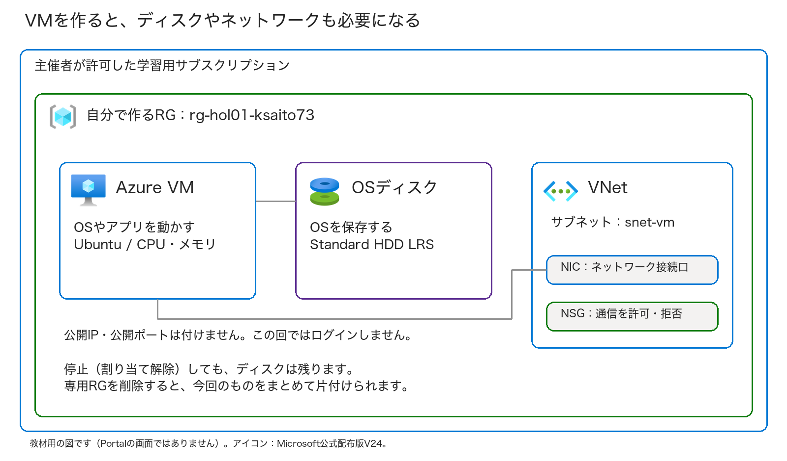
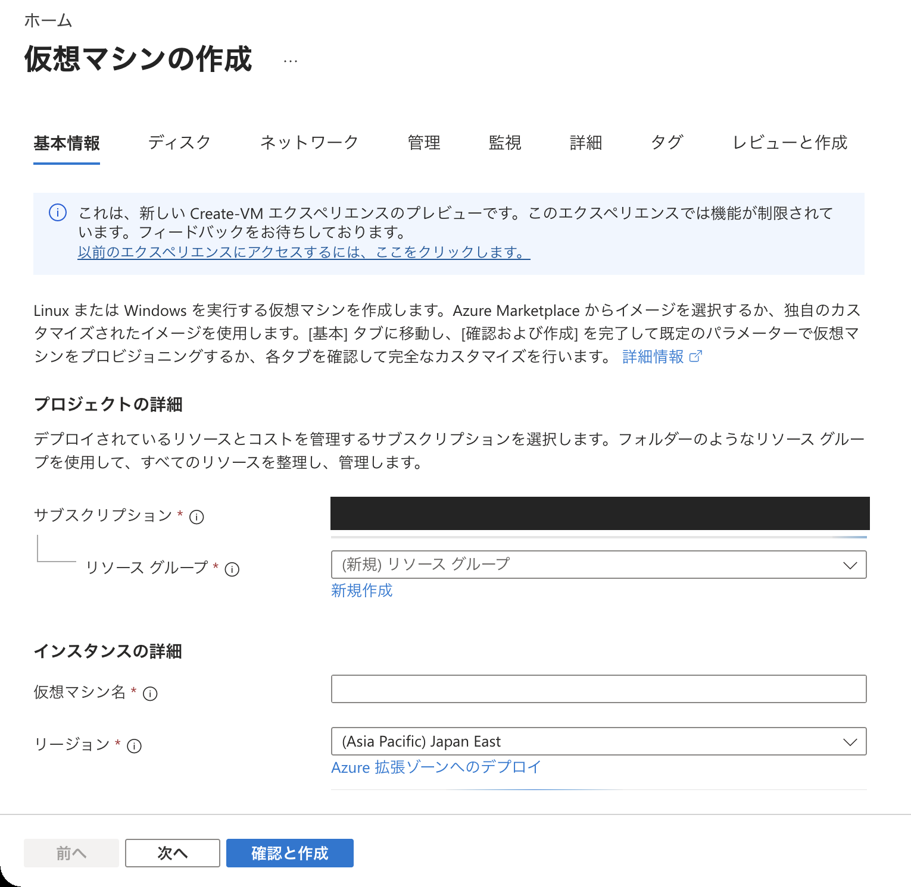
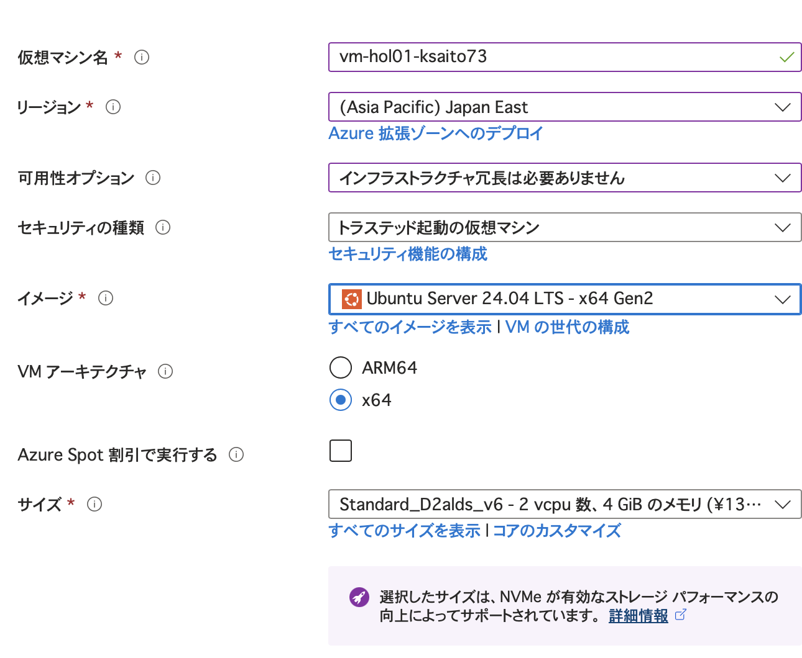
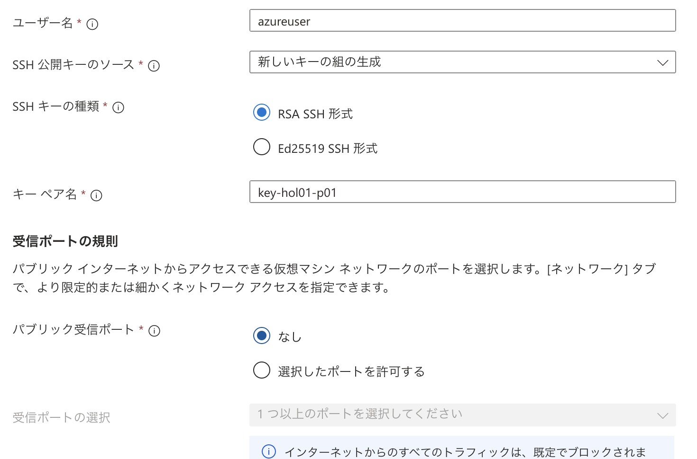
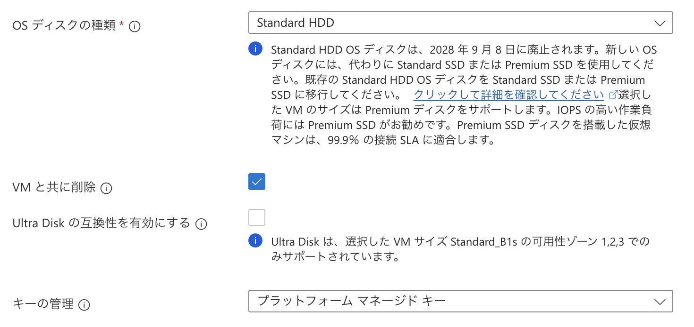
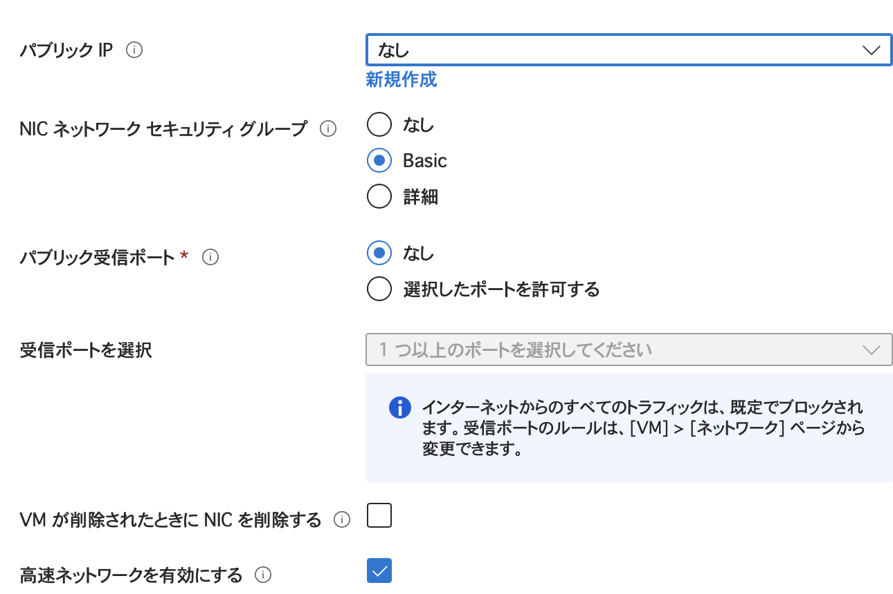
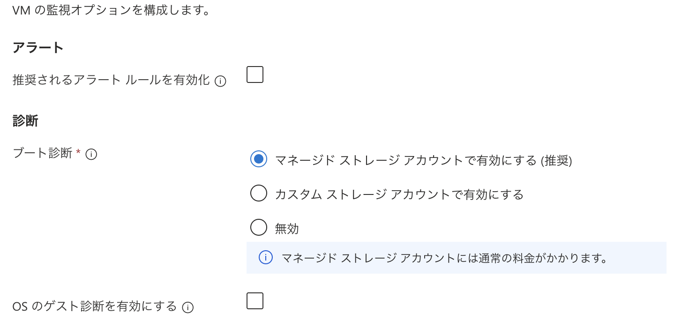

# 第1回 — VMを作って、Azureの基本操作を覚える

Azure PortalでUbuntuのVM（仮想マシン）を1台作り、作成・確認・停止・削除の基本操作を学びます。
VMと一緒に作られるディスクやネットワークも確認します。VMへのログインやアプリの設定は行いません。

**第1回の座学後に取り組む自習用の手順書です。** Microsoftから付与されたAzureサブスクリプションを使ってください。
リソースグループ（以下、RG）から作成し、実習で使うリソースをその中にまとめます。講師による環境の事前準備はありません。
終了時には、このRGごと削除します。

対象: Azureを初めて操作する人  
目安: 60分（作成・削除の待ち時間を含む）。予備時間は15分程度  
操作: ブラウザーでAzure Portalを使います。コマンド入力やソフトのインストールは不要です  
更新日: 2026-10-28 ／ [全回共通の始め方と名前](../self-study.md) ／ [実施記録](run-through.md)

> **この実習には料金がかかります。** 無料アカウントを使っていても、すべて無料とは限りません。
> 利用するサブスクリプション、費用の扱い、利用期限は、Microsoftからの案内を確認してください。
> 最後に削除するのは、**今回の実習用に用意した、自分専用のRGだけ**です。

## 目次

- [始める前の準備](#始める前の準備)
- [今日作るものと覚える言葉](#今日作るものと覚える言葉)
- [Exercise 1: 作成の準備](#exercise-1-作成の準備)
- [Exercise 2: VMを作る](#exercise-2-vmを作る)
- [Exercise 3: 作られたものを確かめる](#exercise-3-作られたものを確かめる)
- [Exercise 4: 停止と削除を体験する](#exercise-4-停止と削除を体験する)
- [完了チェックと振り返り](#完了チェックと振り返り)
- [困ったときの確認順](#困ったときの確認順)

## 始める前の準備

次の項目を確認してから始めてください。

- [ ] Microsoftから付与されたサブスクリプションを使い、費用と利用期限を確認した。
- [ ] Portalにサインインでき、指定されたサブスクリプションが表示される。
- [ ] RG・VM・ディスク・ネットワークを作成し、学習用RGを削除する許可がある。
- [ ] 利用できるリージョンとVMサイズを主催者に確認した。
- [ ] 自分の個人識別名と終了時刻を決め、実習用の秘密鍵をPCに安全に保存できる。
- [ ] 本番用や他の人のRGを使わないことを確認した。

Reader（閲覧者）権限では、リソースの作成・削除はできません。
RGに対するContributor権限があれば、その中のリソースを作成・削除できますが、新しいRGを作るにはサブスクリプション側の許可も必要です。
権限が足りない場合は、付与元の問い合わせ先に相談してください。
業務用のアクセス権限（IAM）や組織のポリシーは変更しないでください。

画面例は日本語のPortalです。英語で表示された場合に備えて、英語の名前も添えています。
Portalは更新されるため、ボタンの位置や名前が画像と少し違うことがあります。入力する値は、画像ではなく本文の設定表を使ってください。
撮影した画面の一覧と出典は、[画面資料](screenshots.md)にまとめています。

Portalの画像は「作成」を押す前の設定画面です。入力欄や選択肢の位置を確認するために使ってください。
作成や削除の完了は、手元のPortalで確認します。

## 今日作るものと覚える言葉

図は今回の構成を示す説明用の図です。Portalの画面や実際の本番環境を示したものではありません。
製品アイコンはMicrosoftの公式配布版を、形や色を変えずに使っています。

| 用語 | 意味 | この実習で確認すること |
| --- | --- | --- |
| サブスクリプション | Azureの利用料金やリソースを管理する単位 | 主催者が指定したものを使っているか |
| リソースグループ（RG） | 関連するリソースをまとめて管理する単位 | 今回のリソースだけが入っているか |
| リージョン | VMなどを配置する地域 | 指定された地域か。例: Japan East（東日本） |
| VM（仮想マシン） | WindowsやLinuxを動かす仮想的なサーバー | Ubuntuのバージョン、VMのサイズと電源状態 |
| Managed Disk（マネージドディスク） | OSやデータを保存するディスク | VMとは別に作られ、料金も別にかかること |
| NIC（ネットワークインターフェイス） | VMをネットワークにつなぐ接続口 | VNet内のサブネットにつながっていること |
| VNet（仮想ネットワーク）／サブネット | Azure内のネットワークと、それを分けた区画 | 今回用に作ったネットワークであること |
| NSG（ネットワークセキュリティグループ） | 通信を許可・拒否する規則をまとめたもの | SSHやRDPなどをインターネットに公開していないこと |

今回は公開IPを付けず、SSH・RDP、Web公開、Bastion、NAT Gatewayも設定しません。
VMの状態が「実行中」になったことを確認します。アプリの動作や外部との通信は、確認の対象外です。
VM内のOSやアプリは利用者が管理します。これは座学で学んだIaaSの特徴です。

### 入力する名前を先に決める

他の参加者と区別するための**個人識別名**を決め、全5回で使います。例は`ksaito73`です。
英小文字で始まる3〜10文字の英小文字・数字にし、フルネームやメールアドレスは使いません。
下の`ksaito73`を、自分の識別名に置き換えてください。詳しくは[共通の命名ルール](../self-study.md)を見てください。

| 項目 | 例 | 自分の値 |
| --- | --- | --- |
| 個人識別名 | `ksaito73` | __________ |
| RG名 | `rg-hol01-ksaito73` | __________ |
| VM名 | `vm-hol01-ksaito73` | __________ |
| VNet名 | `vnet-hol01-ksaito73` | __________ |
| サブネット名 | `snet-vm` | __________ |
| SSHキー名 | `key-hol01-ksaito73` | __________ |
| 終了時刻（日本時間） | 自分で決める。利用期限内に片付ける | __________ |

同じ名前のRGが見つかったら、そのまま使わず主催者に聞いてください。

## Exercise 1: 作成の準備

### Task 1 — Portalで利用先を確認する（5分）

誤って本番用や個人用の契約にVMを作らないよう、利用するサブスクリプションを確認します。

1. [Azure Portal](https://portal.azure.com/)を開き、Microsoftから案内されたアカウントでサインインします。
2. 右上のアカウント表示で、案内されたアカウントとディレクトリになっていることを確認します。
3. 上部の検索欄に `サブスクリプション`（Subscriptions）と入力し、サービスを開きます。
4. Microsoftから付与されたサブスクリプションを選べることを確認します。

指定されたサブスクリプションを選べれば、次に進みます。見つからない場合は、別の契約で代用せず主催者に相談してください。
提出物にサブスクリプションIDやメールアドレスは記載しないでください。

### Task 2 — 自分のRGを作り、VMの作成画面を開く（5〜10分）

1. 上部で **リソースグループ**を検索し、**作成**をクリックします。
2. 付与されたサブスクリプションを選び、RG名を`rg-hol01-自分の識別名`にします。例は`rg-hol01-ksaito73`です。
3. リージョンは、利用が許可された **Japan East**（東日本）を選びます。別の地域が指定されていれば案内に従います。
4. **タグ**で`Purpose=AzureHandsOn`、`Session=01`、`Participant=自分の識別名`を入れます。
5. **確認および作成→作成**をクリックし、自分のRGの概要を開きます。最初は中にリソースがないことを確認します。
6. 上部で **仮想マシン**を検索し、サービスから**作成→Azure仮想マシン**を選びます。既存のVMは開きません。
7. 「仮想マシンの作成」画面が開いたら、次へ進みます。

新しいVM作成画面のプレビューが案内されたら、「以前のエクスペリエンスにアクセスするには、ここをクリックします」から従来の画面に戻ります。
戻れない場合も、設定する値は同じです。「基本情報／基本」「レビューと作成／確認および作成」など、同じ内容のタブを探して進めてください。

作成画面で、次の表に従って基本情報を入力します。

## Exercise 2: VMを作る

### Task 3 — 基本情報を入力する（10分）

ここで、VMを置く場所、OS、VMのサイズを決めます。

| 項目 | 今回の設定 | 理由 |
| --- | --- | --- |
| サブスクリプション | Microsoftから付与されたもの | 個人用や本番用とは分けて使う |
| リソースグループ | **Task 2で自分が作ったRG**を選ぶ | ここで二つ目のRGを作らない |
| 仮想マシン名 | 自分のVM名 | 個人識別名で、他の人のVMと見分ける |
| リージョン | 主催者指定。例: **Japan East** | 主催者が利用できることを調べた地域を使う |
| 可用性オプション | **インフラストラクチャの冗長性は必要ありません** | 学習用に1台だけ作るため。本番環境で推奨する設定ではない |
| セキュリティの種類 | **トラステッド起動の仮想マシン**（Trusted launch） | Gen2 VMの起動時のセキュリティ機能を使う |
| イメージ | **Ubuntu Server 24.04 LTS、x64、Gen2**。発行元Canonical | Linuxを動かす。Windows、有償サードパーティー製品、Arm64は選ばない |
| サイズ | **Standard_D2alds_v6**（2 vCPU・4 GiB）、または主催者が承認した代替サイズ | 実習で指定したVM。画面の既定サイズはそのまま使わない |
| Azure Spot割引 | **オフ** | Spot VMは実習の途中で回収されることがある |
| 認証の種類 | **SSH公開キー** | パスワードを共有せずに設定できる |
| ユーザー名 | `azureuser` | VM内の管理者の名前。PortalにサインインするIDとは別 |
| SSH公開キーのソース | **新しいキーの組の生成** | あらかじめ鍵を作っておかなくてよい |
| キーの組の名前 | 自分のSSHキー名 | この実習で作った鍵を見分ける |
| パブリック受信ポート | **なし**（None） | SSH・RDP・HTTPをインターネットに公開しない |

「サイズを選択」や「すべてのサイズを表示」を開き、`D2alds_v6` を検索してください。
画面の既定サイズはそのまま使わず、`Standard_D2alds_v6` を選びます。見つからない、または作成できないときは、そのまま別のサイズで進めず主催者に相談してください。
互換性のエラーが出た場合も、Trusted launchを無効にして進めるのではなく、使える組み合わせを主催者と調べます。

ログインしない実習でも、VMを作るときには管理者の認証方法が必要です。
SSHキーの秘密鍵は、後の手順でダウンロードします。鍵の中身は表示・撮影・提出せず、自分だけで保管してください。

次に進む前に、VM名、Ubuntu x64 Gen2、小型サイズ、公開受信ポート「なし」の4点を見直します。

OSは **Image**、CPUとメモリの大きさは **サイズ**で選びます。`x64` と `Gen2` も見てください。
画像は **Standard_D2alds_v6** を選択した作成前の画面です。VM名の `ksaito73` は自分の個人識別名に置き換えます。料金も、自分の契約で表示される金額を確認してください。

鍵の設定の下に、**パブリック受信ポート**があります。鍵を作ることと、SSHのポートを公開することは別なので、ここは「なし」にします。

### Task 4 — ディスクとネットワークを設定する（8分）

**ディスク（Disks）タブ**

1. OSディスクの種類を **Standard HDD LRS** にします。
2. OSディスクの容量は、イメージの既定値（目安30〜32 GiB）を使います。縮小できない場合は、そのままにします。
3. データディスクは追加しません。

短時間の実習にはStandard HDDを使います。本番では必要な性能に合わせて選びます。
ディスクはVMを停止しても残り、料金もかかり続けます。停止後の手順で、この点を確認します。

**OSディスクのサイズ**はイメージの既定値、**OSディスクの種類**はStandard HDDを選びます。
この画面ではLRSが名前に出ていないため、作成前の設定のまとめでも確認してください。廃止予定などの案内が出た場合は、主催者が開催時に使える設定を確認します。

**ネットワーク（Networking）タブ**

1. 仮想ネットワークは **新規作成**を選び、今回用のVNet名を入力します。既存の業務用ネットワークは選びません。
2. アドレス空間は例として `10.42.0.0/16`、サブネット `snet-vm` は `10.42.0.0/24` にします。
   主催者から別の値を指定された場合は、その値を使います。今回は他のVNetと接続しないため、参加者同士で同じ範囲を使っても構いません。
3. **パブリックIP**を「なし」にします。「パブリック受信ポートなし」とは別の設定なので、両方を確認します。
4. NICネットワークセキュリティグループは **基本**（Basic）とし、パブリック受信ポートは **なし**にします。
5. ロードバランサー、Bastion、NAT Gatewayは追加しません。**高速ネットワーク（Accelerated networking）は有効**にします。Daldsv6シリーズでは必須なので、無効にしないでください。
6. 「プライベートサブネット」「既定の送信アクセス」の項目がある場合は、プライベート／無効のままにします。
   今回の実習では、VMからインターネットに接続する必要はありません。

> 2026年のPortalでは、サブネットがプライベートになる場合があります。
> 今回は公開IPやNATを付けないので、VMからインターネットへ接続する経路は用意しません。
> `apt update`、SSH接続、Web表示はこの回の課題ではありません。できなくても作成失敗とは限らないため、公開IPや公開ポートを追加せず、そのまま手順を進めてください。

次へ進む前に、今回作るVNetが選ばれていることと、データディスク・公開IP・公開ポートを追加していないことを確認してください。
NIC・NSG・OSディスクの名前はPortalが自動で付けます。例と少し違っていても構いません。

「なし」を選ぶ欄は2つあります。上の**パブリックIP**と、下の**パブリック受信ポート**を両方見てください。
その間にあるNICのNSGは「基本」を選びます。

### Task 5 — 追加サービスと料金を確認する（5分）

1. **管理**（Management）で、バックアップなどの追加サービスを新しく有効にしません。
2. **監視**（Monitoring）で、起動診断は **マネージドストレージアカウントで有効**を選びます。
   診断用のStorageアカウントを別途作成する必要はありません。VM insights、ログ分析、アラートも今回は追加しません。
3. **詳細**（Advanced）で、拡張機能やカスタムデータを追加しません。
4. **タグ**（Tags）に `Purpose` = `AzureHandsOn`、`Session` = `01`、
   `Participant` = 自分の個人識別名を付けます。画面上で選べる今回のリソースに適用します。
5. **確認および作成／レビューと作成**（Review + create）を選びます。

起動診断は、この画面では**ブート診断**と表示されています。一番上の「マネージドストレージアカウントで有効にする」を選びます。
その上のアラートと、下のOSのゲスト診断は追加しません。組織で必須の項目は、解除せず主催者に確認してください。

**「作成」を選ぶ前のチェック**

- [ ] サブスクリプションとRGが指定どおりで、控えておいたVM名で1台だけ作る。
- [ ] Ubuntu x64 Gen2と承認済みの小型サイズを選び、Spotはオフにした。
- [ ] Standard HDD LRS、追加データディスクなし。
- [ ] 公開IP・公開受信ポートなし。Bastion/NAT/バックアップを追加していない。
- [ ] 検証に成功し、**表示されたVMの料金を確認した**。
- [ ] 表示されたVMの料金とは別に、ディスクなどの費用がかかることを確認した。

「月額」の表示は、1か月動かした場合の目安です。1時間の料金や、今回の実習の請求額ではありません。
実習では「VMの時間単価 × 実行時間」に、ディスクや追加サービスの料金も足して見積もります。主催者が決めた上限を超える場合は、作成前に相談してください。

予算アラートは費用を通知するだけで、課金は止めません。自動シャットダウンでも、ディスクなどの料金は残ります。
どちらを設定していても、終了時にはリソースを削除してください。

エラーが出たら、その項目に戻って設定を直します。別のVMを何台も作り直す必要はありません。

### Task 6 — 作成して完了を待つ（5〜10分）

1. 最終チェックが済んだら **作成**を選びます。
2. キーのダウンロード案内で **秘密キーをダウンロードしてリソースを作成**を選びます。
3. 今回の実習用の `.pem` ファイルが、安全な場所に保存されたことを確認します。
   秘密鍵の内容や、保存先に含まれる個人名をスクリーンショットに写さないでください。
4. デプロイ画面で完了を待ちます。「作成」を繰り返し押す必要はありません。
5. **デプロイが完了しました**（Your deployment is complete）が表示されたら、**リソースに移動**を選びます。

自分のVMの概要画面が開いたら、作成は完了です。
10分ほど待っても進まないときは、通知やデプロイの詳細を開いて主催者に相談してください。
作成が途中で失敗しても、ディスクなどが残ることがあります。最後の片付けは省略しないでください。

## Exercise 3: 作られたものを確かめる

### Task 7 — VMの概要を読む（5分）

作成が終わったら、VMの電源状態と設定を見てみます。

1. 画面タイトルが自分のVM名であることを確認します。
2. **概要**（Overview）で、状態が **実行中**（Running）になっていることを確認します。まだ反映されていない場合は更新します。
3. OSがLinux/Ubuntuで、サイズとリージョンが指定どおりになっていることを確認します。
4. パブリックIPアドレスが「なし／未構成／-」であることを確認します。
5. リソースグループのリンクを開きます。

「実行中」はVMの電源が入っている状態です。アプリが正常に動くかどうかは、これだけでは分かりません。
この回ではログインしないので、「接続」からSSH・RDP・Bastionを設定する必要はありません。

### Task 8 — VM以外のリソースを見る（5分）

1. 今回のRGの**概要 → リソース**を開きます。
2. **VM、ディスク、ネットワークインターフェイス、NSG、仮想ネットワーク**を探します。
3. 新しいキーを生成した場合は、**SSHキー**のリソースも確認します。
4. ディスクの種類と容量、NICの接続先となるVNetとサブネットを確認します。設定は変更しません。

VM・ディスク・ネットワークが、それぞれ独立したリソースとして並んでいることを確認してください。
それぞれが今回のRGにまとまっていれば、最後に一緒に削除できます。
見覚えのない業務用リソースがRGに入っている場合は、削除せず主催者に相談します。
Network Watcherなどが別のRGに自動作成されていても、そのRGは削除しません。

| 確認する項目 | 自分の記録（実際のID・IP・メールアドレスは不要） |
| --- | --- |
| VMのOSとサイズ | __________ |
| VMの状態 | __________ |
| ディスクの種類・容量 | __________ |
| NIC、NSG、VNetを見つけた | はい／未確認 |
| 公開IPがない | はい／未確認 |
| SSHキーリソースの有無 | あり／なし／未確認 |

## Exercise 4: 停止と削除を体験する

### Task 9 — VMを停止する（3〜5分）

1. 今回のRGから自分のVMを開き、**概要 → 停止**（Stop）を選びます。
2. 確認画面でVM名を確かめ、停止します。
3. 画面を更新し、**停止済み（割り当て解除）**（Stopped (deallocated)）になるまで待ちます。
   「停止中」や「割り当て解除中」の間は、まだ処理が終わっていません。
4. RGのリソース一覧を開き、VMやディスクが残っていることを確認します。VMを再起動する必要はありません。

| 状態 | VMの計算料金 | ディスク等 |
| --- | --- | --- |
| 実行中（Running） | 発生する | 残る。料金が発生するものもある |
| 停止済み・割り当てあり（Stopped） | 発生する | 残る |
| **停止済み（割り当て解除）** | VMの計算料金は止まる | **残る。ディスク等の料金は続く** |
| 今回のRGと関連リソースを削除した後 | 今回のVMは削除されている | 今回の対象リソースも削除されている |

OS内でシャットダウンするだけだと、計算資源の割り当てが残ります。Portalで「停止済み（割り当て解除）」になったことを見てください。
ただし、停止してもディスクなどは残っています。次の手順でRGを削除して片付けます。

### Task 10 — 自分の専用RGを削除する（5〜10分）

> **削除は取り消せません。**
> 今回の専用RG以外では操作しないでください。共有用・本番用・他の人のRGは削除しません。

1. VMの概要からRGのリンクを開きます。画面上部の名前が、**控えておいた自分のRG名**と一致することを確認します。
2. サブスクリプションが、最初に確認したものと一致することを確認します。
3. リソース一覧を見て、**今回のリソースだけ**が入っていることを確認します。
   **タグ**の`Participant`も自分の識別名と一致するかを見ます。名前だけで削除対象を判断しません。
4. **リソースグループの削除**（Delete resource group）を選びます。
5. 削除確認画面で、対象のRG名と削除予定のリソースをもう一度確認します。
6. 確認用の欄に**自分のRG名をそのまま**入力し、画面の注意事項を読んで **削除**を選びます。
7. 通知を確認し、削除の完了を待ちます。

VMだけを削除すると、ディスクなどが残ることがあります。ここでは専用RGを削除し、中のディスク・NIC・VNet・SSHキーもまとめて片付けます。
RGの外にあるものは消えないので、この実習では既存リソースの再利用や、RGの外への追加は行いません。
「削除を受け付けました」の表示だけでは完了ではありません。次の手順で、削除後の一覧を確認します。

### Task 11 — 削除完了を確かめる（3分）

1. 上部の検索欄から **リソースグループ**（Resource groups）を開き、実習に使ったサブスクリプションを選びます。
2. **最新の情報に更新**を選び、自分のRG名で絞り込みます。**RGが表示されない**ことを確認します。
3. **仮想マシン**一覧も更新し、自分のVM名が表示されないことを確認します。
4. 通知に削除失敗が出ていないことを確認します。画面を閉じるだけでは、削除完了の確認にはなりません。
5. PCのエクスプローラー／Finderで保存先を開き、今回の実習用の `.pem` ファイルだけを削除します。
   加工前のスクリーンショットも、不要になったものは削除してください。
   他の実習や業務で使う鍵は残します。

ロックや権限、ポリシーで削除できなかったときは、**未完了**と記録して主催者に引き継ぎます。
できる範囲でVMを割り当て解除し、付与元にRG名とエラーコードを伝えてください。
原因が解消したら削除を再開してください。利用期限に間に合わない場合は、支援担当者と削除完了を確認する日時を決めてください。

請求データには反映の遅れがあります。削除前の利用分が、あとから表示されることもあります。
片付けが終わったかどうかは、費用画面の0円表示ではなく、リソースが削除されたかで確認してください。

## 完了チェックと振り返り

- [ ] 自分のVMを1台作り、実行中を確認した。
- [ ] 自分の識別名を使ってRGを作り、Participantタグを付けた。
- [ ] ディスク・NIC・NSG・VNetが、VMとは別のリソースであることを確認した。
- [ ] 公開IP・公開受信ポートを追加しなかった。
- [ ] 停止済み（割り当て解除）でもディスクは残ることを確認した。
- [ ] 自分の専用RGを削除し、一覧を更新してRGとVMが表示されないことを確認した。
- [ ] 実習の秘密鍵ファイルを片付けた。

**主催者が指定した提出先に、次の3点を提出してください。**
実際のリソースID・IP・秘密鍵は含めないでください。

1. 実施結果（完了／途中まで／未実施）。未完了の場合は、止まったTaskとその理由。
2. 「VMを停止する」と「専用RGを削除する」はどう違うか、自分の言葉で1文。
3. 一番迷った画面と、その画面にどんな説明があると助かるか。

振り返りの解答例

VMを割り当て解除すると、VMの計算料金は止まりますが、ディスクなどは残って課金も続きます。
専用RGを削除すると、その中のVMと関連リソースをまとめて片付けられます。
Azureが管理するのは物理設備です。VM内のOS更新、アプリ、データ、権限、費用は、使う側で管理します。

## 困ったときの確認順

うまく進まないときは、サブスクリプション、リソース名、設定値、通知のエラーを順に見直します。
別のVMを作ったり、公開ポートを開けたりする前に、まず主催者へ相談してください。この実習では、どちらも追加しません。

| 困っていること | 確認すること・対処方法 |
| --- | --- |
| サブスクリプションが見えない | アカウント、ディレクトリ、Portalのフィルターを確認し、主催者に相談してください。 |
| 作成や削除の権限がない | Readerは閲覧用です。必要な範囲の権限を主催者に用意してもらってください。自分でIAMは変更しません。 |
| RequestDisallowedByPolicy | 指定されたリージョンやSKUに戻っているか見直します。組織のポリシーは無効にせず、エラーの項目を主催者に伝えてください。 |
| D2alds_v6が選べない／SkuNotAvailable／AllocationFailed | 在庫や利用制限を主催者に調べてもらいます。代替サイズは、承認されたものだけを使ってください。 |
| QuotaExceeded／OperationNotAllowed | リージョン全体とVMファミリーのvCPUクォータを主催者に調べてもらいます。別のVMを追加で作ることは避けてください。 |
| イメージ／セキュリティ種類が合わない | Ubuntu x64 Gen2とサイズの組み合わせを見直します。Trusted launchを無効にせず、主催者に相談してください。 |
| 秘密鍵を保存できない | 作成前なら、そこで止めて相談してください。作成済みの場合は、今回はログインしないため、そのまま片付けまで進めます。 |
| 作成が遅い・失敗した | 通知やデプロイの詳細を開いて、止まった項目を見ます。一部だけ作られているものも、終了時には削除してください。 |
| VMに接続できない | この回ではログインしません。接続できなくても課題は進められるので、公開IPやSSH・RDPは追加しないでください。 |
| 停止後も料金が発生している | ディスクなどの料金は、VMを停止しても続きます。Task 10〜11で専用RGを削除してください。 |
| 削除後も一覧に表示される | 一覧を更新し、サブスクリプションとフィルターを見直します。通知で、まだ処理中なのかエラーになったのかを調べてください。 |
| 削除ロックがある／削除に失敗した | 自分でロックを解除せず、可能であればVMを割り当て解除して主催者に引き継ぎます。削除が終わるまでは未完了として記録してください。 |

## Microsoft公式の補足

- [PortalでLinux VMを作成する](https://learn.microsoft.com/ja-jp/azure/virtual-machines/linux/quick-create-portal)
  — 公式の手順にはSSHやWebの公開も含まれます。**この実習では公開せず、VMへの接続やWebサーバーの導入は行いません。**
- [VMの状態と課金](https://learn.microsoft.com/en-us/azure/virtual-machines/states-billing)
- [リソースグループの削除](https://learn.microsoft.com/ja-jp/azure/azure-resource-manager/management/delete-resource-group)
- [既定の送信アクセスとプライベートサブネット](https://learn.microsoft.com/en-us/azure/virtual-network/default-outbound-access)
- [Trusted launch](https://learn.microsoft.com/en-us/azure/virtual-machines/trusted-launch)
- [公式アイコンの出典・利用条件](https://learn.microsoft.com/en-us/azure/architecture/icons/)
