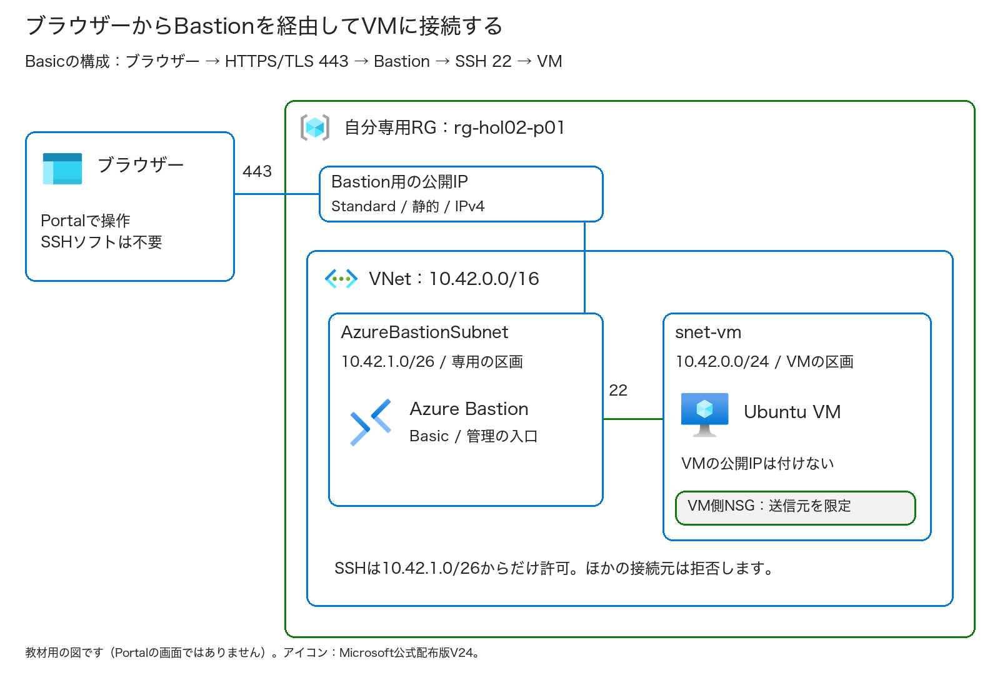
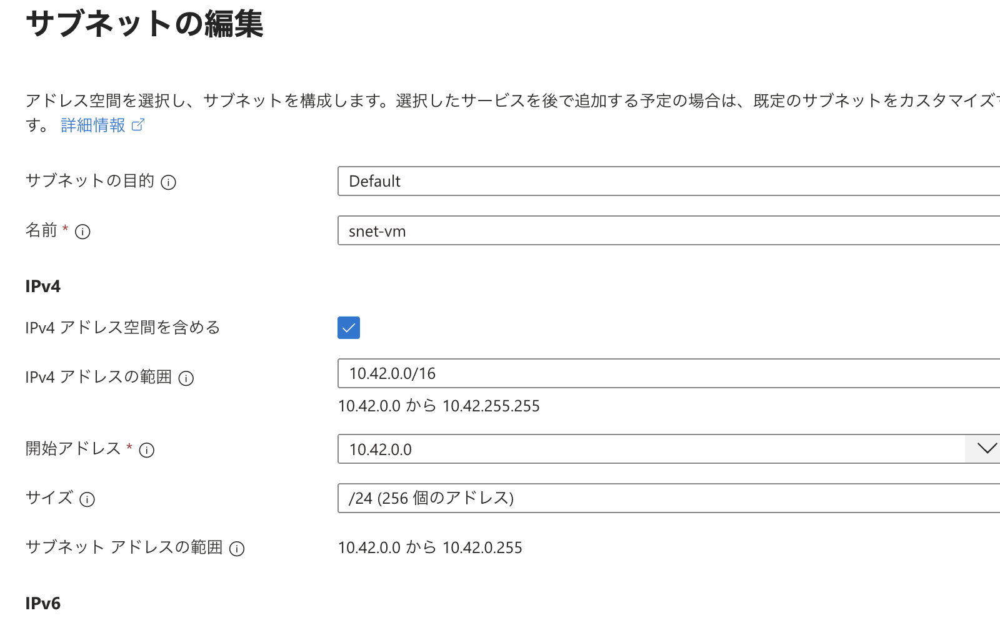
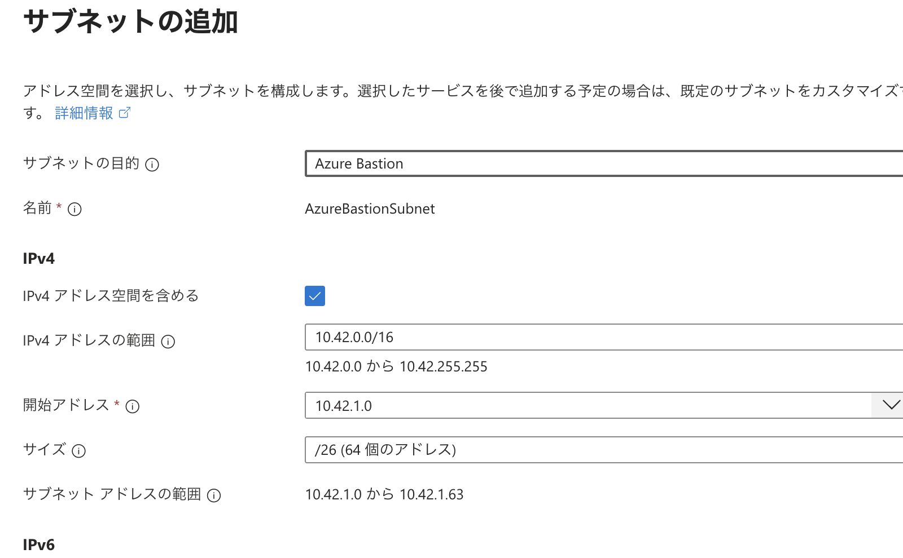
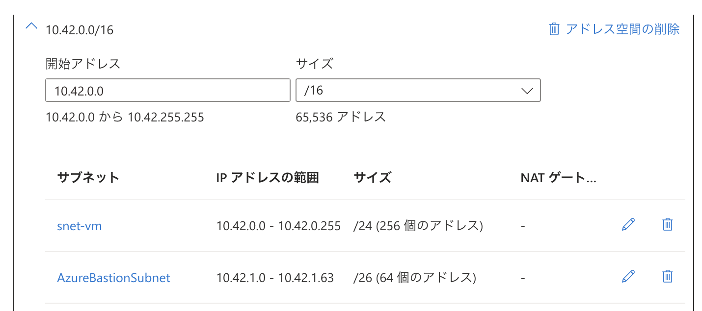
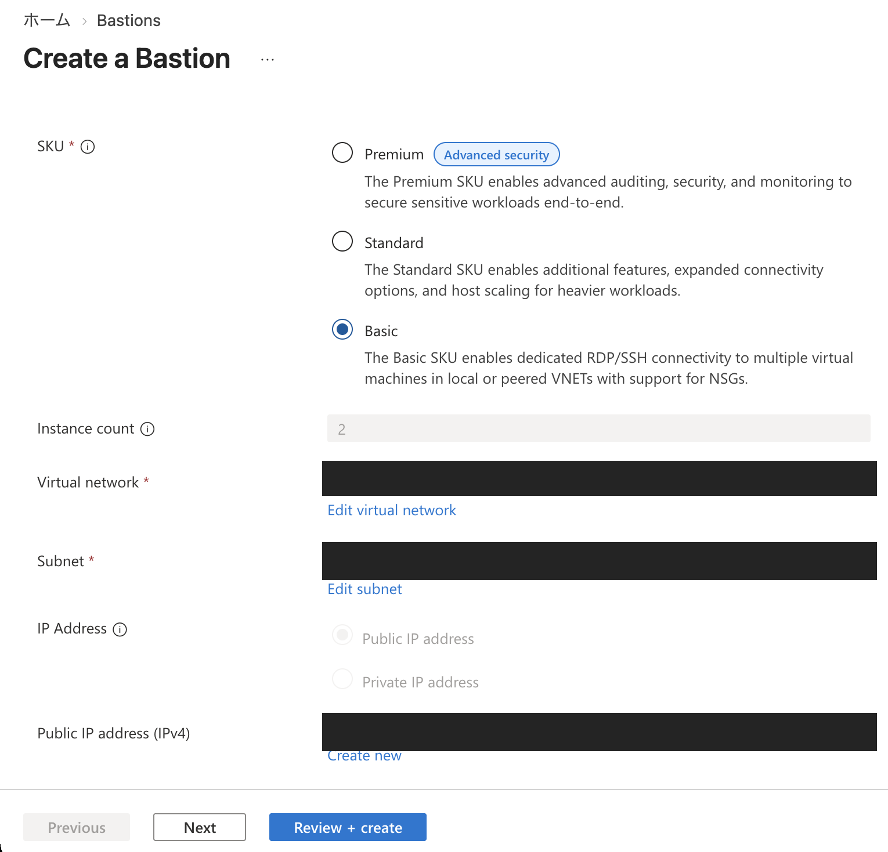

# 第2回 — Bastionを使ってVMにログインする

Azure Bastionを使い、ブラウザーからUbuntuのVMにログインします。
VMには公開IPを付けず、Bastion経由で接続します。接続後はコマンドを入力して、ユーザー名・VM名・OSを確認します。

**第2回の座学後に取り組む自習用の手順書です。** Microsoftから付与されたAzureサブスクリプションを使ってください。
リソースグループ（以下、RG）、ネットワーク、VM、Bastionを新しく作ります。第1回のリソースや、講師が用意した環境は使いません。
終了時には専用RGを削除し、VMとBastionをまとめて片付けます。

対象: Azureを初めて操作する人。第1回を実施していなくても、この手順から始められます  
目安: **75〜90分＋予備15分**（VM・Bastionの作成、削除の待ち時間を含む）  
操作: Azure Portalと、Bastionで接続したVMのLinux画面を使います。PCへのAzure CLI・SSHソフトのインストールは不要です  
更新日: 2026-10-13 ／ [共通の始め方と名前](../self-study.md) ／ [実施記録](run-through.md)

> **Bastion Basicは、接続していなくても料金がかかります。**
> VMを停止したり、ブラウザーを閉じたりしても、Bastionの課金は止まりません。
> 終わったら専用RGを削除し、VM・Bastion・公開IP・ディスクをまとめて片付けます。

Portalの画像は作成前の設定画面です。入力欄の位置を確認するために使い、作成の完了は手元のPortalで確認してください。

## 目次

- [始める前の準備と費用](#始める前の準備と費用)
- [今日の接続経路と名前](#今日の接続経路と名前)
- [Exercise 1: 専用ネットワークとVMを作る](#exercise-1-専用ネットワークとvmを作る)
- [Exercise 2: Bastionを用意する](#exercise-2-bastionを用意する)
- [Exercise 3: ブラウザーからVMへ接続する](#exercise-3-ブラウザーからvmへ接続する)
- [Exercise 4: 切断して全リソースを削除する](#exercise-4-切断して全リソースを削除する)
- [完了チェックと振り返り](#完了チェックと振り返り)
- [困ったとき](#困ったとき)

## 始める前の準備と費用

次の項目を確認してから始めてください。

- [ ] Microsoftから付与されたサブスクリプションと、費用・利用期限を確認した。
- [ ] 自分専用RGを作成・削除し、VM・ネットワーク・NSG・Bastion・公開IPを作成する許可がある。
- [ ] リージョン、VMサイズ、Bastion Basicの利用可否、同時参加人数分のクォータを主催者が確認した。
- [ ] ブラウザーからPortalとBastionにHTTPS（TCP 443）で接続でき、組織のプロキシなどで遮断されない。
- [ ] 実習用のSSH秘密鍵をPCに安全に保存し、接続時にファイルを選択できる。
- [ ] 自分の個人識別名、終了時刻、付与元の問い合わせ先を控えた。

Reader（閲覧者）権限では、リソースを作成できません。RGの新規作成にも権限が必要です。
本番用のリソースや共有RG・共有Bastionは使わず、実習用のものを新しく作ってください。
権限・ポリシー・ロックに関するエラーは、設定を変更せず主催者に相談してください。

**費用の目安:** 2026-10-12に確認したJapan Eastの公開小売価格（USD）では、
Bastion Basicが **$0.19/時**、Linux B1sが **$0.0136/時**、Standard IPv4公開IPが **$0.005/時**でした。
この3つを2時間ずつ使うと、単純計算で **$0.4172 ＋ ディスク・転送・追加サービス・税など**です。
実際の請求額は、契約、通貨、利用時間、課金単位によって変わります。この計算例は上限額ではありません。
予算には、接続していない時間や作成・削除の待ち時間も含める必要があります。主催者に確認してください。

Bastionには複数のプランがありますが、この手順で使うのは**Basic**です。
無料のDeveloperは共有型で、専用サブネットや公開IPを使わない別の構成です。Standard・Premiumも機能が違うので、途中でプランを変えないでください。
今回はBasicのブラウザー接続を使います。PCのSSHクライアントで接続する操作は行いません。

## 今日の接続経路と名前



図は今回の接続経路を示す説明用の図です。Portalの画面や実際の本番環境を示したものではありません。

PCからBastionまではHTTPS/TLSの443番ポートを使います。BastionからLinux VMまでは、VMのプライベートIPにSSHの22番ポートで接続します。
公開IPを付けるのはBastion Basicだけです。VMをインターネットに直接公開せずに接続できますが、PCからBastionまではインターネットを経由します。
VPN、Private Endpoint、ハブ＆スポーク構成は、この回では作りません。

VNetはAzure内の仮想ネットワークで、サブネットはその中を分けた区画です。
今回は、VM用とBastion用の2つのサブネットを作ります。

| 項目 | 例（`ksaito73`を自分の個人識別名に置き換えてください） |
| --- | --- |
| リソースグループ | `rg-hol02-ksaito73` |
| 仮想ネットワーク | `vnet-hol02-ksaito73`、`10.42.0.0/16` |
| VM用サブネット | `snet-vm`、`10.42.0.0/24` |
| Bastion専用サブネット | **`AzureBastionSubnet`**、`10.42.1.0/26` |
| VM | `vm-hol02-ksaito73` |
| VM用NSG（ネットワークセキュリティグループ） | Portalが自動で付ける名前。自分のVMに対応するものを控える |
| OSディスク | Portalが自動で付ける名前。Task 5で自分のVMのディスク名を控える |
| SSHキー | `key-hol02-ksaito73`。第1回の鍵は再利用しない |
| Bastion | `bas-hol02-ksaito73` |
| Bastion用公開IP | `pip-bas-hol02-ksaito73` |

CIDRの`/`以降の数字が大きいほど、アドレスの範囲は小さくなります。たとえば、`/26`は`/24`より小さい範囲です。
Bastionには`/26`以上の広さが必要です。`/26`・`/25`・`/24`は使えますが、`/27`・`/28`では足りません。
サブネット名の `AzureBastionSubnet` は、大文字・小文字も含めて表のとおりに入力してください。
リソース名には実名やメールアドレスを使いません。第1回のRGや既存のネットワークも再利用しません。
個人識別名は英小文字で始まる3〜10文字の英小文字・数字です。[全回共通の命名ルール](../self-study.md)で決めたものを使います。
`AzureBastionSubnet`は指定名なので個人識別名を足しません。自分のVNetの中に置くことで見分けます。

## Exercise 1: 専用ネットワークとVMを作る

### Task 1 — 利用先を確認し、自分のRGを作る（5〜10分）

1. [Azure Portal](https://portal.azure.com/)へサインインします。
2. アカウント、ディレクトリ、サブスクリプションが、Microsoftからの案内と一致することを確認します。
3. 表の`ksaito73`を自分の個人識別名に置き換え、今回使う名前を控えます。
4. 同じ名前のRGがすでにある場合は、そのまま使わず主催者に確認します。
5. **リソースグループ→作成**を開き、付与サブスクリプション、`rg-hol02-自分の識別名`、許可されたJapan Eastを入力します。
6. **タグ**に`Purpose=AzureHandsOn`、`Session=02`、`Participant=自分の識別名`を入れ、**確認および作成→作成**をクリックします。
7. 自分のRGの概要を開き、中が空であることを確認します。

控えたサブスクリプションとRG名は、最後に削除対象を確認するときにも使います。

### Task 2 — VNetと2つのサブネットを作る（10分）

1つのVNetの中に、VM用とBastion用のサブネットを作ります。

1. 上部の検索欄から **仮想ネットワーク**（Virtual networks）を開き、**作成**を選びます。
2. **基本**でサブスクリプションを確認し、**Task 1で自分が作ったRG**を選びます。ここで別のRGは作りません。
3. 自分のVNet名を入力し、主催者が指定したリージョン（例: Japan East／東日本）を選びます。
4. **セキュリティ**では、Firewall、DDoSの有料プラン、Bastionなどを追加しません。Bastionは後の手順で、Basicを選んで作ります。
5. **IPアドレス**で、IPv4のアドレス空間を `10.42.0.0/16` にします。IPv6は追加しません。
6. 作成画面に `default` サブネットがある場合は、その項目を編集または削除して、次の2つにします。
   ここで編集するのは、これから作るVNetの設定です。既存VNetのサブネットを削除しないでください。

| サブネット | 目的の選択肢がある場合 | 開始アドレス | サイズ | CIDR |
| --- | --- | --- | --- | --- |
| `snet-vm` | Default／既定 | `10.42.0.0` | `/24` | `10.42.0.0/24` |
| `AzureBastionSubnet` | **Azure Bastion** | `10.42.1.0` | `/26` | `10.42.1.0/26` |



VM用サブネットの目的はDefault、名前は `snet-vm` です。VNet全体には `/16`、サブネットには `/24` を指定します。



**目的にAzure Bastionを選ぶと、専用の名前と `/26` が入ります。** 開始アドレスを `10.42.1.0` にし、表の値と照合してください。
画像は入力例です。この時点ではBastionもVNetも作成されていません。

7. `snet-vm` の既定の送信アクセスは、無効／プライベートのままにします。
   `AzureBastionSubnet`には**目的「Azure Bastion」の既定設定**を使います。VM用の設定やNSGはコピーしません。
8. タグ`Purpose=AzureHandsOn`、`Session=02`、`Participant=自分の個人識別名`を付けてレビューします。
9. サブネットのアドレス範囲が重なっていないことと、今回用のVNetだけを作成することを確認して **作成**を選びます。



作成前に、一覧に2つのサブネットがあることを確認します。`snet-vm` は `10.42.0.0`、`AzureBastionSubnet` は `10.42.1.0` から始まり、範囲は重なりません。

作成したVNetに `snet-vm` と `AzureBastionSubnet` があることを確認し、次のVM作成に進みます。
Bastion専用サブネットにはVMや他のリソースを入れず、今回はNSGやルートテーブルも付けません。

### Task 3 — Ubuntu VMの基本情報を入力する（10分）

上部の検索欄から **仮想マシン → 作成 → Azure仮想マシン**を開き、以下の表に従って入力します。
新しいVM作成画面のプレビューが表示された場合も、設定値は同じです。

| 項目 | 設定 |
| --- | --- |
| サブスクリプション／RG | Task 2と同じ、自分の専用RG |
| VM名／リージョン | 自分のVM名／VNetと同じリージョン |
| 可用性オプション | インフラストラクチャの冗長性は必要ありません。今回は学習用に1台だけ作る |
| セキュリティの種類 | トラステッド起動の仮想マシン（Trusted launch） |
| イメージ | **Ubuntu Server 24.04 LTS、x64、Gen2、発行元Canonical** |
| サイズ | **Standard_B1s**、または主催者が事前承認したサイズ |
| Azure Spot | オフ |
| 認証の種類／ユーザー名 | **SSH公開キー**／`azureuser` |
| SSH公開キーのソース | 新しいキーの組の生成 |
| SSHキーの種類 | **RSA**。今回はEd25519を選ばない |
| キーの名前 | 自分のSSHキー名 |
| パブリック受信ポート | **なし（None）** |

SSHで接続しますが、ここでSSH (22)をインターネットに公開する必要はありません。
あとでNSGを設定し、SSHの接続元をBastion専用サブネットだけに絞ります。
`azureuser` はVMの中で使うユーザー名です。PortalのサインインIDとは別なので、この名前を使ってください。
サイズやイメージが選べないときは、主催者に相談します。大型の既定VMや有償製品には置き換えません。


RSAと受信ポートの欄は、第1回と同じです。画像は第1回の作成前の画面なので、キー名は今回用の `key-hol02-...` に読み替えてください。
第1回のキーを選び直すのではなく、新しく生成します。

### Task 4 — VMのディスク・ネットワークを設定して作成する（8分）

1. **ディスク**で、OSディスクを **Standard HDD LRS**にします。容量はイメージの既定値（30〜32 GiB程度）を使い、データディスクは追加しません。
2. **ネットワーク**で、Task 2で作った**自分のVNet**と、サブネット **`snet-vm`** を選びます。
   **VMの配置先に `AzureBastionSubnet` を選ばないでください。**
3. **パブリックIP**を「なし」にします。パブリック受信ポート「なし」とは別の設定です。
4. NIC（ネットワークインターフェイス）のネットワークセキュリティグループは **基本（Basic）**、パブリック受信ポートは **なし**にします。
   この画面では、ロードバランサー・Bastion・NAT Gatewayは追加しません。
5. **管理／監視／詳細**では、バックアップ・VM insights・Log Analytics・拡張機能・カスタムデータを新しく追加しません。
   起動診断にはマネージドストレージを使います。組織で必須となっている設定は解除しないでください。
6. Task 2と同じ実習タグを付け、**確認および作成**を選びます。


この2つの「なし」も第1回と同じです。VNetとサブネットは、今回はTask 2で作ったものを選びます。
BastionからはプライベートIPに接続するため、VMに公開IPは不要です。SSHを許可する規則はTask 6で設定します。

**「作成」を選ぶ前のチェック**

- [ ] 今回の専用RGに、Ubuntu x64 Gen2と承認済みの小型サイズを使って、VMを1台だけ作る。
- [ ] VMのサブネットに `snet-vm` を選び、Bastion専用サブネットは選んでいない。
- [ ] **VMの公開IPなし、公開受信ポートなし**。
- [ ] 管理者は `azureuser`、新規の **RSA** キーを使う。
- [ ] 料金と終了時刻を確認し、必要のない有料サービスを追加していない。

検証に成功したことを確認し、**作成 → 秘密キーをダウンロードしてリソースを作成**を選びます。

### Task 5 — 鍵の保存とVM作成完了を確認する（5〜10分）

1. 自分のキー名の `.pem` ファイルがPCに保存されたことを確認します。
2. 秘密鍵はログインに使います。自分だけで保管し、中身を画面に出したり、メール・チャット・提出物に貼り付けたりしないでください。
3. デプロイが完了したら、**リソースに移動**を選びます。
4. VMの**概要**で、自分のVM名、**実行中**の状態、指定したOSとサイズ、**パブリックIPなし**を確認します。
5. **ネットワーク設定**で、このVMのNICに対応するNSGのリンクと名前を確認します。
6. RGのリソース一覧で、自分のVMの**OSディスク名**を控えます。後で、削除できたか確認するときに使います。

VMが実行中になり、このVMの秘密鍵を保存できたら、Bastionの準備に進みます。
鍵を保存できなかった場合は、ここで止めて主催者に相談してください。第1回の鍵は使えません。別の鍵で接続を試したり、VMを繰り返し作り直したりしないでください。

## Exercise 2: Bastionを用意する

### Task 6 — VM側でBastionからのSSHだけを許可する（5分）

ここでは、SSHの接続元をBastion専用サブネットに絞ります。

1. 自分のVMのNICに関連付けられている**NSG**を開きます。Bastion専用サブネットにNSGを付ける操作ではありません。
2. **受信セキュリティ規則 → 追加**で、以下の順に2つの規則を作ります。

| 項目 | BastionからのSSHを許可する規則 | それ以外からのSSHを拒否する規則 |
| --- | --- | --- |
| 名前 | `AllowSshFromBastion` | `DenyOtherSsh` |
| 優先度 | **300** | **310** |
| ソース | IP Addresses | Any |
| ソースIP／CIDR | **`10.42.1.0/26`** | 指定不要 |
| ソースポート | `*` | `*` |
| 宛先 | Any | Any |
| サービス／宛先ポート | Custom／**22** | Custom／**22** |
| プロトコル | **TCP** | **TCP** |
| アクション | **Allow** | **Deny** |

NSGは、優先度の数字が小さい規則から調べます。300でBastionからのSSHを許可し、310でそれ以外のSSHを拒否します。
既定のAllowVnetInBound規則はVNet内の通信を広く許可するため、310の拒否規則も必要です。この2つの規則が制限するのは22番ポートだけです。
ソースポートは送信側が使う一時ポートなので `*` にします。SSHの22を入れるのは、宛先ポートの方です。

VM側のNSGに、優先度300のAllowと310のDenyがあることを確認してください。InternetやAnyからのSSHは許可しません。
BastionサブネットのCIDRを変えた場合は、300の規則も同じ範囲に合わせます。
AzureBastionSubnetにNSGを付ける設計では、Bastionが必要とする規則を別途すべて用意する必要があります。この実習では付けずに進めます。

### Task 7 — Bastion Basicを作る（10〜15分）

1. 上部の検索欄から **Bastions／Bastion** を開き、**作成**を選びます。
   VMの画面から開く場合は、**接続 → Bastion → 手動で構成／カスタム設定**を選びます。
2. 自動作成の「Bastionのデプロイ」は使わず、手動で設定します。最初に選ばれているSKUがBasicとは限らないためです。
3. 次の値を入力します。

| 項目 | 設定 |
| --- | --- |
| サブスクリプション／RG | VM・VNetと同じ、自分の専用RG |
| Bastion名 | `bas-hol02-自分の識別名` |
| リージョン | 自分のVNetと同じ |
| SKU／レベル | **Basic** |
| 仮想ネットワーク | 自分の `vnet-hol02-...` |
| サブネット | **AzureBastionSubnet、10.42.1.0/26** |
| パブリックIP | **新規作成**、`pip-bas-hol02-...` |
| 公開IPの種類 | **Standard、静的（Static）、IPv4** |
| 可用性ゾーン／追加機能 | 追加指定なし。Standard・Premium専用の機能は有効にしない |



画像は、Basicを選んだ作成前の画面です。個人情報や、実習とは異なる設定値を隠しているので、入力には上の表を使ってください。
日本語のPortalでも `Create a Bastion / Basics / SKU` と表示されることがあります。Premiumなどが選ばれていたら、作成前にBasicへ変えます。
「Basicへアップグレードする」と出た場合は、新規作成ではなく既存リソースの変更画面です。そこで止めて主催者に相談してください。

4. 実習タグを付け、**確認および作成 → 作成**を選びます。
5. デプロイの完了を待ちます。10分程度かかることがあるため、待っている間に別のBastionを作らないでください。
6. RGの一覧に **VM、ディスク、NIC、NSG、VNet、SSHキー、Bastion、Bastion用公開IP**が入っていることを確認します。

Bastionの作成が終わったら、SKUがBasicになっていることを見ます。Bastion用の公開IPは、VMのNICには付けません。
Basicで表示される「2インスタンス」はサービス内部の構成です。自分でVMを2台作る必要はありません。

## Exercise 3: ブラウザーからVMへ接続する

### Task 8 — Bastion経由でSSHログインする（5分）

1. **自分のVM → 概要 → 接続 → Bastion経由で接続**を選びます。
   左側のメニューの **接続 → Bastion** から開ける場合もあります。
2. 作成したBastionが表示されることを確認します。新しいデプロイやアップグレードを求められた場合は、そこで止めて主催者に相談してください。
3. 以下の表に従って、認証の設定を入力します。

| 項目 | 設定 |
| --- | --- |
| 認証の種類 | **ローカルファイルからのSSH秘密キー**（SSH Private Key from Local File） |
| ユーザー名 | **`azureuser`** |
| ローカルファイル | Task 5で保存した、このVMのキー名の `.pem` |
| SSHパスフレーズ | 鍵にパスフレーズを設定した場合だけ入力。VMやPortalのパスワードを入れる欄ではない |
| 新しいブラウザータブで開く | オンにする場合は、Portalのポップアップを許可する |

4. Basicでは、接続ポートを変更する欄が表示されないことがあります。LinuxへのSSH接続には、既定の22番ポートが使われます。
5. **接続**（Connect）を選びます。ブラウザー内にターミナルが開き、コマンドを入力できるようになるまで待ちます。

`azureuser@vm-hol02-...:~$` のような入力待ちの行が出たら、VMにログインできています。名前の部分は自分のVM名によって変わります。
今回はLinuxなので、Windowsのデスクトップではなく文字を入力する画面が開きます。PortalのCloud Shell（`>_`）とは別です。
VMの「実行中」やBastionの「Succeeded」は、接続成功を示すものではありません。ターミナルが開くところまで確認してください。

ローカルファイル認証にはRSAのPEM形式を使います。
形式のエラーが出たら主催者に相談してください。秘密鍵をオンラインの変換サイトへ送ったり、中身をコピー・撮影したりしないでください。

### Task 9 — VM内でユーザー名・VM名・OSを確認する（5分）

**コマンドは、Bastionで開いたVMのターミナルに入力します。PCのターミナルやCloud Shellには入力しません。**
以下を1行ずつ入力し、Enterを押してください。コピーできない場合は、手入力でも構いません。

```bash
whoami
hostname
grep '^PRETTY_NAME=' /etc/os-release
```

| コマンド | 確認すること | 表示される結果の例 |
| --- | --- | --- |
| `whoami` | ログインしているユーザー名 | `azureuser` |
| `hostname` | 接続しているVMの名前 | 自分のVM名。付けた名前によって表示が異なることがある |
| `grep '^PRETTY_NAME=' /etc/os-release` | OSの名前とバージョン | `PRETTY_NAME="Ubuntu 24.04... LTS"`。細かなバージョンは更新によって変わる |

3つとも、情報を表示するだけのコマンドです。`sudo`やパッケージの追加、鍵の表示は行いません。
このVMにはインターネットへ出る経路を作っていないので、`apt update`や外部サイトへのアクセスを試す必要はありません。
Bastionからログインできることと、VMからインターネットやPrivate Endpointへつながることは別です。

**ログインユーザー名、自分のVM名と一致したか、Ubuntu 24.04系だったかを記録してください。**
IP、実際のリソースID、秘密鍵、メールアドレスは提出しません。

## Exercise 4: 切断して全リソースを削除する

### Task 10 — 接続を終了する（3分）

1. Bastionのターミナルで、次を入力します。

```bash
exit
```

2. 接続が終了したことを確認し、Bastionのタブまたは接続画面を閉じます。
3. VMの概要から **停止**を選び、**停止済み**（割り当て解除）になるまで待ちます。

`exit`で終わるのはSSH接続だけです。VMやBastionは残っています。
VMを割り当て解除すると計算料金は止まりますが、ディスク・Bastion・公開IPの料金は続きます。次の手順で削除してください。
途中で作成や接続に失敗した場合も、作られたリソースの片付けは必要です。

### Task 11 — 自分の専用RGを削除する（5〜15分）

> **削除は取り消せません。** 今回の自分の `rg-hol02-...` 以外では操作しないでください。
> 共有Bastionや業務用リソースが入っている場合は、削除せず主催者に相談します。

1. VMの概要から**RGのリンク**を開きます。
2. **サブスクリプションとRG名**が、最初に控えたものと一致することを確認します。
3. 一覧に今回のリソースだけがあることを確認します。特に、**BastionとBastion用公開IP**が同じRGに入っているか確かめてください。
   RGの`Participant`タグが自分の個人識別名と一致するかも見ます。
4. **リソースグループの削除**を選びます。
5. 削除予定のリソースとRG名をもう一度確認し、確認用の欄に**自分のRG名**を入力して **削除**を選びます。
6. 通知を確認し、削除の完了を待ちます。「削除を受け付けました」と表示されても、まだ完了ではありません。

専用RGを削除すると、関連するリソースが適切な順序でまとめて削除されます。
VMだけでなく、Bastionと公開IPの削除も確認してください。RGの外のリソースや、自動作成された共有のNetwork Watcherは削除しません。

### Task 12 — 削除漏れを確認し、PCの秘密鍵を削除する（3分）

1. **リソースグループ**の一覧で、実習に使ったサブスクリプションを選びます。一覧を更新し、自分のRG名を検索します。
   **RGが表示されない**ことを確認します。
2. **仮想マシン**一覧と **Bastions**一覧も更新し、**自分のVM名・Bastion名が表示されない**ことを確認します。
3. **パブリックIPアドレス**と**ディスク**の一覧でも、控えておいたBastion用IP名とVMのOSディスク名が残っていないことを確認します。
4. 通知に削除失敗が出ていないことを確認します。
5. PCのエクスプローラー／Finderで、**今回の実習用の `.pem` ファイルだけ**を削除します。
   加工前のスクリーンショットも、不要になったものは削除してください。他の実習や業務で使う鍵は残します。

ロックや権限、ポリシーで削除できなければ、実習は未完了です。
できる範囲でVMを割り当て解除し、RG名と、秘密情報を含まないエラーコードを主催者に伝えてください。
Bastionは停止して課金を止めることができないので、削除担当・期限も決めて引き継ぎます。自分でロックやポリシーを変更しないでください。
請求データはすぐに反映されません。費用画面が0円かではなく、リソースが削除されたかで片付けの完了を確認します。

## 完了チェックと振り返り

- [ ] 同じVNet内で、VMを `snet-vm`、Bastionを `AzureBastionSubnet` に分けて配置した。
- [ ] 自分の識別名でRGを作り、名前とParticipantタグで対象を確認した。
- [ ] **VMの公開IPなし、Bastion用公開IPはStandard・静的**になっていることを確認した。
- [ ] Bastion Basicを選び、VMへのSSH接続をBastionサブネットからだけ許可した。
- [ ] **Bastionのブラウザー画面でログイン**し、`whoami`の結果が`azureuser`になった。
- [ ] VM内でVM名とOSを確認した。Cloud Shellでは実行していない。
- [ ] `exit`で切断し、VMを割り当て解除した。
- [ ] **専用RG・VM・Bastion・今回の公開IP・OSディスクが削除済み**。
- [ ] 今回の秘密鍵ファイルをPCから削除した。

**実施結果（完了／途中まで／未実施）と、以下の問いへの回答を提出してください。**
回答は、自分の言葉でそれぞれ1文にまとめます。未完了の場合は、止まったTaskとその理由も記載してください。
まだ操作していない場合は「未実施」として提出してください。資料で読んだ内容と、実際にできたことを分けて記録します。

**問い1:** VMに公開IPがなくても接続できたのは、なぜですか。  
**問い2:** `exit`とVMの停止だけでは、片付けが終わらないのはなぜですか。  
**問い3:** 443番ポートと22番ポートは、それぞれどの区間で使いますか。

<details>
<summary>解答例</summary>

ブラウザーからはBastionに接続し、BastionがVMのプライベートIPへSSH接続するので、VM自身に公開IPは要りません。
`exit`やVMの割り当て解除ではBastion・公開IP・ディスクが残り、課金も続くので、専用RGの削除まで行います。
PCからBastionまでは443番ポート、BastionからLinux VMまでは22番ポートを使います。

</details>

## 困ったとき

| 困っていること | 確認すること・対処方法 |
| --- | --- |
| RGやBastionを作れない | サブスクリプション、作成権限、ポリシーを主催者に調べてもらいます。Readerは閲覧用なので作成はできません。 |
| /26や専用サブネットのエラー | 名前を **AzureBastionSubnet**、範囲を `10.42.1.0/26` にします。VMと同じVNet内で、ほかのリソースが入っていないかも見直してください。 |
| Basicが選ばれていない | 作成前ならBasicに戻します。Standard・Premiumで作成済みの場合は、ダウングレードできないため主催者に相談してください。 |
| VMの接続画面でBastionが見えない | 同じVNet・リージョンか、デプロイが終わっているかを見ます。閲覧権限とフィルターも主催者に聞き、別のBastionは追加しないでください。 |
| ネイティブCLI接続が使えない | Basicではブラウザーから接続します。この実習のためにStandardにアップグレードしないでください。 |
| 接続がタイムアウトする | VMが実行中か、Bastionの状態は正常かを見ます。NSGの300・310、サブネットのCIDR、ブラウザーからの443番ポートも調べてください。 |
| 別の拒否規則がある | NIC側とサブネット側のNSG・優先度を、主催者に調べてもらいます。組織の規則は自分で解除しません。 |
| Permission denied／鍵のエラー | ユーザー名が`azureuser`で、このVMの作成時に生成したRSA秘密鍵を選んでいるか確認します。認証方法と鍵の形式も見直してください。相談する際も秘密鍵は共有しないでください。 |
| .pemをダウンロードできない | 接続に進まず、主催者に相談してください。別の鍵で接続を繰り返したり、VMを何度も作り直したりしないでください。 |
| 新しいタブが開かない | Portalのポップアップだけを許可するか、同じ画面内での接続を使います。ブラウザーの安全設定をすべて解除しないでください。 |
| VMから外部に通信できない | この構成には送信経路がありません。Bastionからログインする操作はできるので、NATや公開IPを追加せず進めてください。 |
| VMを止めたのにBastionが残る | VMを停止してもBastionは残ります。Task 11〜12で専用RGを削除してください。 |
| 削除できない | 一覧を更新し、通知と操作対象を確認します。Bastionが残っている間は課金が続くため、主催者に削除の担当者と期限を確認して引き継いでください。 |

## Microsoft公式の補足

- [PortalでBastionを作成する](https://learn.microsoft.com/ja-jp/azure/bastion/quickstart-host-portal)
- [Linux VMへのブラウザーSSHとRSA鍵の要件](https://learn.microsoft.com/en-us/azure/bastion/bastion-connect-vm-ssh-linux)
- [Bastionの専用サブネットと公開IP](https://learn.microsoft.com/en-us/azure/bastion/configuration-settings)
- [BastionのNSG規則](https://learn.microsoft.com/en-us/azure/bastion/bastion-nsg)
- [SKU・機能・リージョンの違い](https://learn.microsoft.com/en-us/azure/bastion/bastion-sku-comparison)
- [VMの状態と課金](https://learn.microsoft.com/en-us/azure/virtual-machines/states-billing)
- [Bastionの価格](https://azure.microsoft.com/pricing/details/azure-bastion/)
- [公式Azureアイコンと利用条件](https://learn.microsoft.com/en-us/azure/architecture/icons/)
