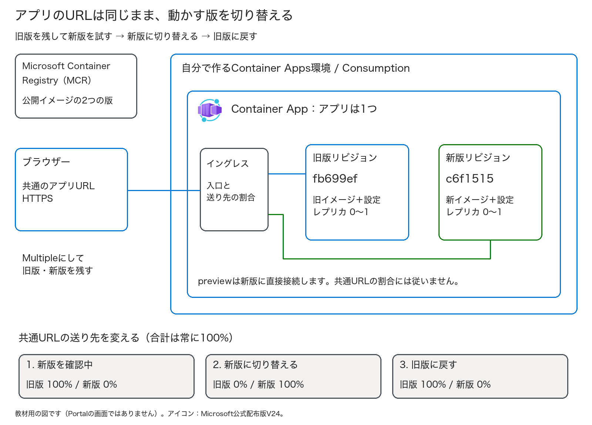
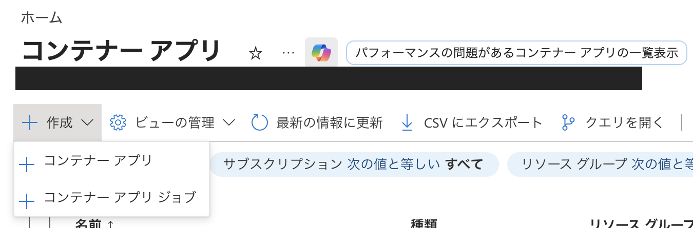
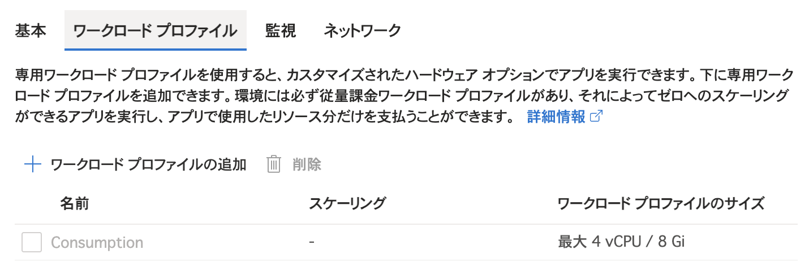
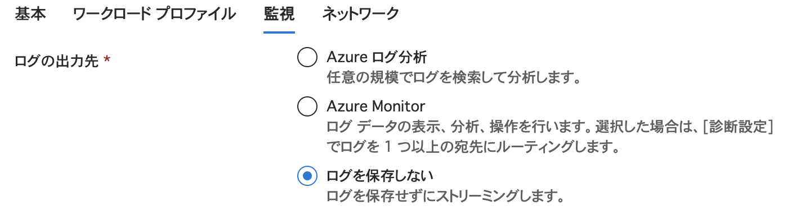
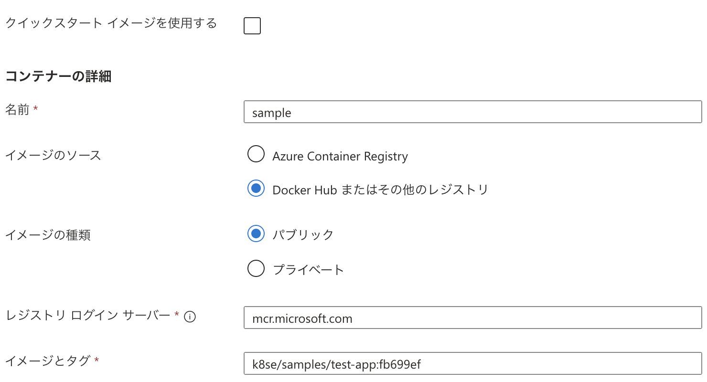
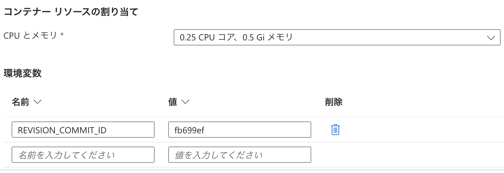
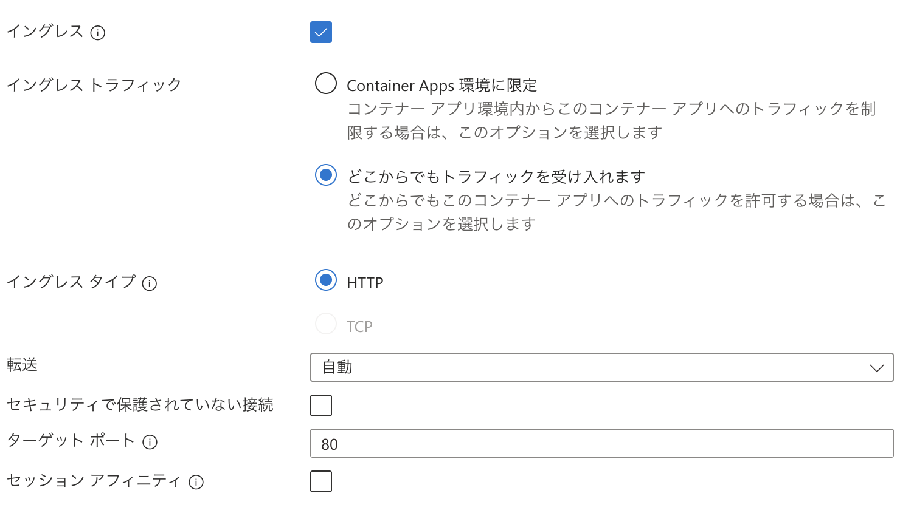
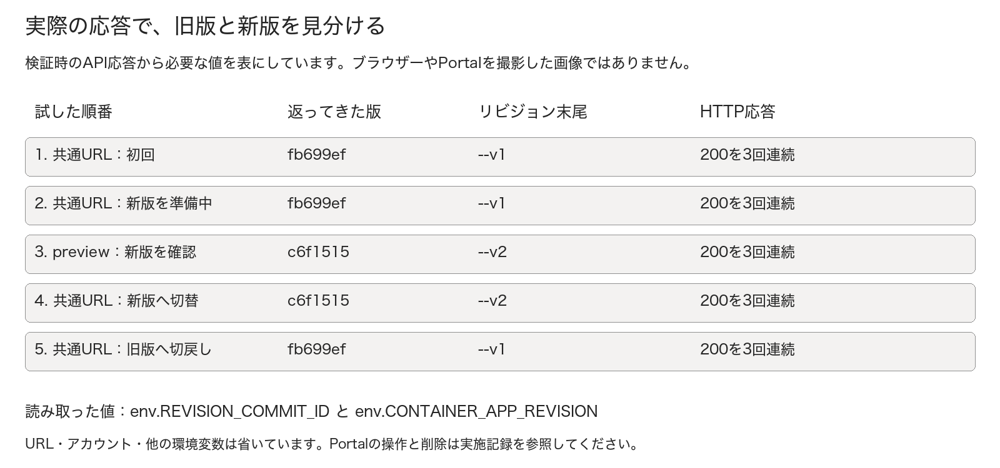

# 第3回 — 新しい版を試してから、アプリを切り替える

Container Appsで、アプリの旧版を残したまま新版を作成します。
新版を別のURLで動作確認してから、利用者向けのURLの接続先を切り替えます。その後、旧版に戻す「切り戻し」も試します。

利用者向けのURLは変えず、応答する版を「旧版 → 新版 → 旧版」と切り替える実習です。
Microsoftの公開サンプルを使うため、Dockerの操作やコードのビルドは不要です。

**第3回の座学後に取り組む自習用の手順書です。** Microsoftから付与されたAzureサブスクリプションを使ってください。
RG、Container Apps環境、アプリを新しく作り、終了時には削除します。講師による環境の事前準備はありません。

対象: Azureを初めて操作する人。第1・2回のVMやBastionは不要  
目安: **60〜75分＋予備15分**（初回デプロイ・起動・削除の待ち時間を含む）  
操作: Azure Portalとブラウザー。Docker、プログラミング、手元のAzure CLIは不要  
更新日: 2026-10-13 ／ [共通の始め方と名前](../self-study.md) ／ [実施記録](run-through.md)

**教材の確認状況（制作版）:** ARM／CLIで構築し、実際のURLで旧版・新版の応答と切り戻しを確認済みです。検証用RGも削除しています。
Portalで最初から最後まで操作する確認、残りの画面撮影、初学者による確認は未完了です。詳細は[実施記録](run-through.md)を参照してください。

Portalの画像は作成前の設定画面です。環境・イメージ・公開方法を選ぶ欄の位置を確認するために使ってください。
作成後のリビジョンや切り替えの結果は、手元のPortalとアプリの応答で確認します。

> **このサンプルには環境変数を表示する機能があります。** 鍵、パスワード、業務データ、個人情報は入れないでください。
> 実習用として短時間だけ公開し、この機能を業務アプリにそのまま使うことは避けます。
> 終わったら専用RGを削除し、アプリと環境を片付けます。

## 目次

- [始める前の準備と費用](#始める前の準備と費用)
- [今日作るものと版の見分け方](#今日作るものと版の見分け方)
- [Exercise 1: 旧版をデプロイする](#exercise-1-旧版をデプロイする)
- [Exercise 2: 新版を作り、先に確かめる](#exercise-2-新版を作り先に確かめる)
- [Exercise 3: 切り替えて、切り戻す](#exercise-3-切り替えて切り戻す)
- [Exercise 4: 片付ける](#exercise-4-片付ける)
- [完了チェックと振り返り](#完了チェックと振り返り)
- [困ったとき](#困ったとき)

## 始める前の準備と費用

- [ ] Microsoftから付与されたサブスクリプション、費用と利用期限、自分の終了時刻を確認した。
- [ ] 自分の専用RG、Container Apps環境、アプリを作成・更新・削除できる。
- [ ] 主催者がMicrosoft.Appの登録、リージョンとConsumptionのクォータを確認した。
- [ ] 一時的なサンプルの外部HTTPS公開が許可され、MCRの公開イメージを利用できる。
- [ ] ブラウザーからPortalと学習用のHTTPS URLへアクセスできる。
- [ ] 自分の個人識別名、付与元の問い合わせ先を控えた。

Reader（閲覧者）権限では、リソースの作成・更新はできません。
権限、組織のポリシー、プロキシに関するエラーは、設定を変更せず主催者に相談してください。

今回は **Consumption**を使い、1レプリカを **0.25 vCPU / 0.5 GiB**、各リビジョンを **最小0・最大1**にします。
「最大1」はリビジョンごとの上限です。旧版と新版が1レプリカずつ動くと、アプリ全体では合計2レプリカになります。
無料枠はサブスクリプション全体で月ごとに共有するため、今回の実習が必ず無料になるとは限りません。

費用の例: 2026-10-12のJapan East公開小売価格（USD）では、active vCPUが$0.000024/vCPU秒、
activeメモリが$0.000003/GiB秒、要求は$0.40/100万件でした。
上のサイズで2レプリカが1時間ずつactiveなら、計算・メモリは単純計算で **$0.054＋要求・追加サービス・税など**です。
無料枠を差し引く前の計算例で、請求額や上限額ではありません。スケールゼロやidleの条件でも金額は変わります。

ログの保存先は **ログを保存しない**（Don't save logs）を選びます。ACR、DB、専用ワークロード、VNet、Private Endpoint、Jobsは作りません。
今回は切り替えの操作に絞った学習用の構成です。本番では監視や認証も含めて設計してください。

## 今日作るものと版の見分け方

図は今回のリソースとURLの関係を示す説明用の図です。Portalの画面や実際の本番環境を示したものではありません。
1つの環境に1つのアプリを作り、その中に旧版・新版の2つのリビジョンを用意します。

| 用語 | この実習での意味 |
| --- | --- |
| コンテナーイメージ | アプリと実行に必要なものをまとめた配布物 |
| レジストリ | イメージを置く場所。今回はMicrosoft Container Registry（MCR）の公開サンプル |
| Container Apps環境 | アプリを配置する実行基盤のまとまり。アプリ本体とは別のリソース |
| Container App | 利用者向けのアプリ。入口のURLやリビジョンの切替を管理する |
| リビジョン | イメージや環境変数、スケール設定をひとまとめにした版。旧版を直接書き換えず、新しい版を作る |
| レプリカ | リビジョンを実際に動かすコピー。負荷や設定に応じて増減する |
| イングレス | ブラウザーからの要求を受け、アプリへ渡す入口 |
| トラフィック割合 | アプリの共通URLへ来た要求を、どのリビジョンへ渡すかの比率 |
| ラベル | 特定のリビジョンを直接開くための別URL。共通URLのトラフィック割合には従わない |

### リソースに付ける名前を決める

全回で使う個人識別名を、今回の名前にも入れます。例の`ksaito73`を自分の識別名に置き換え、控えてください。
英小文字で始まる3〜10文字の英小文字・数字にし、実名やメールアドレスは使いません。[共通の命名ルール](../self-study.md)も参照できます。

| 項目 | 例 |
| --- | --- |
| RG | `rg-hol03-ksaito73` |
| Container Apps環境 | `cae-hol03-ksaito73` |
| アプリ | `ca-hol03-ksaito73` |
| コンテナー | `sample` |
| 新版のリビジョンサフィックス | `v2` |
| 新版確認用ラベル | `preview` |

### 使用する2つのイメージ

Microsoft Learnの[ブルーグリーン用サンプル](https://learn.microsoft.com/en-us/azure/container-apps/blue-green-deployment)を使います。
コードのビルドやACRへのpushは不要です。

| 項目 | 旧版 | 新版 |
| --- | --- | --- |
| イメージ | `mcr.microsoft.com/k8se/samples/test-app:fb699ef` | `mcr.microsoft.com/k8se/samples/test-app:c6f1515` |
| レジストリサーバー | `mcr.microsoft.com` | 同じ |
| イメージ名 | `k8se/samples/test-app` | 同じ |
| イメージタグ | **`fb699ef`** | **`c6f1515`** |
| 環境変数の名前 | `REVISION_COMMIT_ID` | 同じ |
| 環境変数の値 | **`fb699ef`** | **`c6f1515`** |
| ターゲットポート | **80** | **80** |

イメージタグは、サンプルのコードの版を表します。Gitのコミットを作成する必要はありません。
新版では、イメージタグと表示用の環境変数の両方を変更します。環境変数だけを変えても、アプリのコードは更新されません。
`latest`や別のhello-worldイメージには置き換えず、この2つを使ってください。取得できない場合は主催者に相談します。

## Exercise 1: 旧版をデプロイする

### Task 1 — 自分のRGを作り、アプリ作成画面を開く（5〜10分）

1. [Azure Portal](https://portal.azure.com/)へサインインし、Microsoftから案内されたアカウント・ディレクトリ・サブスクリプションを確認します。
2. **リソースグループ→作成**を開き、RG名を`rg-hol03-自分の識別名`にします。例は`rg-hol03-ksaito73`です。同名のRGがある場合は、利用せず主催者に確認してください。
3. 許可されたJapan Eastを選び、**タグ**に`Purpose=AzureHandsOn`、`Session=03`、`Participant=自分の識別名`を入れます。
4. **確認および作成→作成**をクリックし、空の自分のRGを確認します。
5. 上部検索で **Container Apps／コンテナー アプリ**を開きます。
6. **作成→コンテナー アプリ**を選びます。**コンテナー アプリ ジョブ**ではありません。

画像ではメニューの位置を確認してください。サブスクリプションやリソース名は画像から転記せず、本文で指定した値を使います。

### Task 2 — 自分の環境を新しく作る（5分）

1. **基本**で、付与されたサブスクリプションと**Task 1で自分が作ったRG**を選びます。
2. アプリ名は自分の `ca-hol03-...`、デプロイ元は **コンテナーイメージ**を選びます。
3. Azure Functions最適化、ソースコード、GitHub連携は今回選びません。
4. **Container Apps環境 → 新しい環境を作成**で、自分の `cae-hol03-...` を指定します。
5. 主催者が指定したリージョン（例: Japan East／東日本）を選びます。
6. ワークロードプロファイルは **Consumptionのみ**にします。Dedicated/D/Eなどの専用プロファイルは追加しません。
7. ログの送信先は **ログを保存しない**を選びます。VNet統合、可用性ゾーン、Private Endpointは追加しません。
8. 環境の作成設定を確定してアプリ作成画面へ戻ります。

今回作成するRGと環境が選ばれていることを確認し、次へ進みます。既存の共有環境は使いません。
組織でログ保存が必須の場合は解除せず、主催者に設定と費用を確認してもらってください。

**ワークロードプロファイル**では、Consumptionだけを使います。「追加」から専用プロファイルを足す必要はありません。
画像の「最大4 vCPU / 8 Gi」はプロファイルの上限です。今回のコンテナーへの割り当ては、後の手順で0.25 vCPU／0.5 GiBに設定します。

ログの保存先は、環境の**監視**タブにあります。この実習では「ログを保存しない」を選び、Log Analyticsの保存先は作りません。
組織で保存が必須なら、主催者の案内に従います。

### Task 3 — 旧版イメージ・公開方法・サイズを設定する（8分）

**コンテナー**で「クイックスタートイメージを使う」をオフにし、カスタムの公開イメージを指定します。

| 項目 | 今回の設定 |
| --- | --- |
| コンテナー名 | `sample` |
| イメージのソース | Docker Hubまたは他のレジストリ／Other registries |
| イメージ種類 | **Public／公開** |
| レジストリ | `mcr.microsoft.com` |
| イメージ／タグ | `k8se/samples/test-app`／**`fb699ef`** |
| レジストリ認証／アプリID | 不要。レジストリ資格情報・マネージドIDを追加しない |
| 環境変数 | `REVISION_COMMIT_ID` = **`fb699ef`** |
| CPU／メモリ | **0.25 vCPU／0.5 GiB** |
| コマンド／引数 | 指定しない。イメージの既定を使う |
| イングレス | **有効** |
| イングレスの範囲 | **すべての場所からのトラフィック／外部**。学習用の一時公開 |
| イングレス種類 | HTTP |
| ターゲットポート | **80**。利用者向けURLのHTTPS 443とは別 |
| 安全でない接続（HTTP）を許可 | **オフ**。HTTPSを使う |
| ワークロード | Consumption |
| 最小／最大レプリカ | **0／1** |

レジストリは「Docker Hubまたはその他のレジストリ」、種類は「パブリック」を選びます。
**イメージとタグが1つの入力欄になっている場合**は、`k8se/samples/test-app:fb699ef` とまとめて入れてください。レジストリの `mcr.microsoft.com` は、その上の別の欄に入ります。

CPU・メモリと環境変数の入力欄は、コンテナー設定画面の下部にあります。
`REVISION_COMMIT_ID` の値は、旧版イメージのタグと同じ `fb699ef` です。これは表示用の値で、鍵やパスワードを入れる欄ではありません。

**イングレス**では「どこからでもトラフィックを受け入れます」を選び、ターゲットポートは80にします。
イングレスタイプのHTTPはアプリへの渡し方です。「セキュリティで保護されていない接続」はオフにし、ブラウザーからはHTTPSで開きます。

作成画面に最小・最大の欄がなければ、作成後の **スケール**で設定します。
その変更でリビジョンが増えた場合は、変更後のものを「旧版」としてTask 4で控えてください。
一覧に非アクティブな古い行が残っていても構いません。アプリをもう1つ作る必要はありません。

タグ`Purpose=AzureHandsOn`、`Session=03`、`Participant=自分の個人識別名`を付け、レビューします。

- [ ] 自分の専用RG・環境・アプリで、Jobを選んでいない。
- [ ] 旧版タグと`REVISION_COMMIT_ID`がどちらも`fb699ef`。
- [ ] Consumption、0.25 vCPU／0.5 GiB、最小0・最大1を確認する。
- [ ] 外部HTTPS、ターゲット80、安全でないHTTP許可はオフ。
- [ ] 新しいACR、秘密値、DB、ログ保存先、専用ワークロードを追加していない。

**確認および作成 → 作成**を選び、完了まで待ちます。同じ作成ボタンを繰り返して押す必要はありません。
10分程度進まない場合は、通知・デプロイ詳細と主催者の案内を確認します。

### Task 4 — 旧版の応答とリビジョン名を控える（5分）

1. **リソースに移動**で自分のアプリの概要を開きます。
2. **アプリケーションURL**のHTTPSリンクを別タブで開き、サンプル画面を確認します。
   トップの **Hello Worldは両版で同じ**です。見た目だけで版を判定せず、次のAPIの値を使います。
3. 同じURLの末尾に **`/api/env?check=old`** を付けて開きます。
   例: アプリの共通URLが `https://自分のホスト名` なら `https://自分のホスト名/api/env?check=old`。
4. JSONの `env` を開き、`REVISION_COMMIT_ID` の値が `fb699ef` になっているか見ます。
   検索にはブラウザーのCtrl+F／⌘Fを使えます。全JSONを提出する必要はありません。
5. Portalの **リビジョンとレプリカ／リビジョン管理**を開き、今応答している旧版のリビジョン名を控えます。
6. JSON内の `CONTAINER_APP_REVISION` が、その旧版名に対応しているか見ます。

初回のリビジョン名は自動生成されたものを使えます。この資料ではそれを「旧版」と呼びます。名前が `--v1` で終わっている必要はありません。
レプリカが0の状態からは、最初のアクセスで起動を待つことがあります。少し待って再読み込みしてください。
作成の完了に加えて、実際のURLで旧版が応答することまで確認してください。

| 記録するもの | 自分の値（提出時は仮名で可） |
| --- | --- |
| 共通のアプリURL | 手元に控える。実URLは配布資料へ転載しない |
| 旧版リビジョン名 | __________ |
| 旧版の版表示 | `fb699ef`を確認／未確認 |

## Exercise 2: 新版を作り、先に確かめる

### Task 5 — Multipleにし、旧版へ100%を固定する（5分）

1. **リビジョン管理**で **リビジョンモードの選択**（Choose revision mode）を開きます。
2. **Multiple／複数のリビジョンを同時にアクティブ**を選び、**適用**します。
3. 更新後にモードが **Multiple**になったことを確認します。
4. 送り先に、Task 4で控えた旧版の具体的なリビジョン名を指定し、100%にして **保存**します。
5. 「最新／Latest」に100%を付けていないか見直します。Latestを選ぶと、新版を作った時点で送り先が変わることがあります。
6. 共通URLの`/api/env?check=pinned`を再読み込みし、旧版の`fb699ef`が返ることを確認します。

Task 4で控えたリビジョン名に100%を割り当ててから、新版を作ります。
今回は2つの版を残して切り替えるので、SingleではなくMultipleを使います。モードを変えただけでは、新しいリビジョンは作られません。

### Task 6 — 新版を新しいリビジョンとしてデプロイする（5〜10分）

1. **新しいリビジョンの作成**（Create new revision）、または **編集してデプロイ**を開きます。
2. 今の旧版の設定を元に、次の3点だけを変更します。

| 項目 | 新版の値 |
| --- | --- |
| イメージタグ | **`c6f1515`**。イメージ全体なら `mcr.microsoft.com/k8se/samples/test-app:c6f1515` |
| 環境変数`REVISION_COMMIT_ID` | **`c6f1515`** |
| 名前／サフィックス | **`v2`**。既に使った場合は主催者へ相談 |

3. CPU、メモリ、最小0・最大1、ターゲット80が旧版と同じであることを確認します。
4. **作成／デプロイ**を選び、成功・準備完了まで待ちます。
5. 一覧に旧版と新版の行があり、新版がアクティブであることを確認します。
6. 旧版100%・新版0%のままかを見ます。変わっていたら旧版100%に戻して保存します。

新版を追加しても、共通URLの接続先は旧版のままです。旧版を上書きするのではなく、別のリビジョンとして新版を保持しています。
起動やイメージ取得に失敗したら、旧版100%のまま原因を調べます。動いていない新版には切り替えません。

### Task 7 — 新版だけのURLで確認する（5分）

1. 新版に `preview` ラベルを付けます。行のメニューか、リビジョン詳細からラベルを設定します。
2. 新版の詳細から**ラベルURL**をコピーし、別タブで開きます。URLを推測して手入力しません。
3. そのラベルURLに`/api/env?check=preview`を付け、**`env`内の`c6f1515`と新版のリビジョン名**を確認します。
4. もとの**共通アプリURL**の`/api/env?check=still-old`を開き、**`fb699ef`と旧版名**のままであることを確認します。

| 開くURL | 表示される版 |
| --- | --- |
| アプリ概要の**共通URL** | **旧版 `fb699ef`** |
| 新版の**previewラベルURL** | **新版 `c6f1515`** |

新版へのトラフィック割合が0%でも、ラベルURLからはアクセスできます。0%は「共通URLの要求を新版に送らない」という設定であり、アクセス制限ではありません。
ラベルURLにも秘密情報を置かないでください。
この時点では、新版を試せるようになっただけです。共通URLの切り替えは、次の手順で行います。

## Exercise 3: 切り替えて、切り戻す

### Task 8 — 共通URLを新版へ切り替える（5分）

1. Portalの **リビジョン管理**へ戻ります。
2. 旧版0%・新版100%に変えます。合計は100%にします。
3. **保存**を選び、反映を待ちます。
4. **Task 4と同じ共通URL**の`/api/env?check=new`を開きます。
5. `REVISION_COMMIT_ID`が **`c6f1515`**、`CONTAINER_APP_REVISION`が**新版名**であることを確認します。

同じ共通URLで `c6f1515` が返れば、新版への切り替えは成功です。
Portalの設定値だけでなく、実際の応答も確認してください。
古い表示が残る場合は、更新、別タブ、プライベートウィンドウで試します。必要なら `check=new2` などに変え、キャッシュの影響を避けます。

### Task 9 — 同じURLを旧版へ切り戻す（5分）

1. 旧版がアクティブであることを確認します。非アクティブなら、**控えた旧版名だけ**をアクティブにして準備完了を待ちます。
2. 旧版100%・新版0%に戻して **保存**します。
3. 同じ共通URLの`/api/env?check=rollback`を開きます。
4. **`fb699ef`と旧版のリビジョン名**に戻ったことを確認します。

切り戻しでは、要求の送り先を残しておいた旧版に戻します。旧イメージで新たにv3を作る操作ではありません。
この操作で戻るのはアプリの版だけです。DBや保存済みデータ、外部サービスの状態は戻りません。今回はDBを使いませんが、本番での切り戻しでは注意が必要です。

### Task 10 — 変更の違いを振り返る（3分）

| 操作 | 新しいリビジョン | 今回確認したこと |
| --- | --- | --- |
| イメージ・環境変数を更新 | 作られる | 新版が別の行になった |
| トラフィックを100%に切替 | 作られない | 入口の送り先が変わった |
| ラベルを付ける | 作られない | 新版専用の別URLができた |
| Multipleへ変更 | 作られない | 複数リビジョンを保持・操作できた |

旧版の詳細を開き、イメージタグと環境変数が変わっていないことも確認してください。
Activeは、そのリビジョンが利用可能な状態を表します。トラフィック割合が0%でも、レプリカの稼働やラベルURLからのアクセスは可能です。
50%ずつに分ける操作は、この実習には含めていません。試す場合も、数回のブラウザー更新で必ず半数ずつになるわけではありません。

| 観察段階 | 共通URL | preview URL |
| --- | --- | --- |
| 新版作成後、切替前 | 旧版 | 新版 |
| 新版100%に切替後 | 新版 | 新版 |
| 旧版100%へ切戻し後 | 旧版 | 新版のまま。ラベルは独立 |

上の図は、検証時のAPI応答から版とリビジョン名を抜き出して表にしたものです。Portalやブラウザーを撮影した画像ではありません。
共通URLとpreviewで、それぞれどの版が返ったかを並べています。

## Exercise 4: 片付ける

### Task 11 — 自分の専用RGを削除する（5〜30分）

> **削除は取り消せません。** 自分の`rg-hol03-...`だけを対象にします。
> 共有環境・他人のアプリ・業務リソースがあれば削除せず、主催者へ相談します。

1. 自分のアプリの概要から **RGのリンク**を開きます。
2. サブスクリプション・RG名を控えと照合します。
   RGの`Participant`タグも自分の個人識別名と一致するか確認します。
3. 今回のアプリと環境だけが入っていることを確認します。ログ保存先を主催者の指示で追加した場合は、その管理・削除方針も確認します。
4. **リソースグループの削除**を選び、削除対象とRG名を再確認します。
5. 自分のRG名を要求された欄へ入力し、**削除**を選びます。
6. 通知で削除完了を待ちます。削除受付だけでは完了ではありません。

環境の削除は20分以上かかることがあります。時間内に終わらなければ「削除中」と伝え、主催者と担当者・確認期限を決めてください。
処理中に同名のものを作り直したり、別の共有RGを削除したりはしません。

リビジョンの停止やスケールゼロでは、環境は残ります。今回は専用環境なので、RGごと片付けます。
サービスが作った管理用RGが表示されても、直接削除しません。自分の環境の削除に伴って片付いたかを確認し、残れば付与元へ相談します。

### Task 12 — 削除完了を確認する（3分）

1. **リソースグループ**一覧を、対象サブスクリプションで更新し、自分のRGを検索します。
   **RGが表示されない**ことを確認します。
2. **Container Apps**一覧と **Container Apps環境**一覧も更新し、**自分のアプリ名・環境名が表示されない**ことを確認します。
3. 通知に削除失敗がないことを確認します。
4. 学習用URL、不要な未加工スクリーンショット、確認タブを片付けます。今回、SSH秘密鍵は作りません。

ロックや権限の問題で削除できない場合は、未完了と記録し、対象RGと秘密情報を含まないエラーを主催者に伝えます。
アプリやリビジョンを停止できても、すべての費用が止まるわけではありません。削除担当・期限を決めて引き継ぎ、ポリシー・ロック・IAMは自分で変更しないでください。
請求データは遅れて反映されるので、片付けの完了は0円表示ではなく、リソースが消えたかで確認します。

## 完了チェックと振り返り

- [ ] 旧版アプリを作り、HTTPSの実応答で`fb699ef`を確認した。
- [ ] 個人識別名を使ってRG・環境・アプリを作り、Participantタグを付けた。
- [ ] Multipleにし、Latestではなく旧版の具体名へ100%を固定した。
- [ ] イメージと環境変数を両方更新し、新版を別のリビジョンとして作った。
- [ ] **共通URLは旧版、preview URLは新版**を同時に確認した。
- [ ] **同じ共通URL**を新版100%へ切り替え、`c6f1515`を確認した。
- [ ] **同じ共通URL**を旧版100%へ切り戻し、`fb699ef`を確認した。
- [ ] トラフィック切替は新しいリビジョン作成と別だと説明できる。
- [ ] **専用RG・アプリ・環境が削除済み**。

実施結果（完了／途中まで／未実施）と、次の問いへの回答を提出してください。回答はそれぞれ、自分の言葉で1文にまとめます。
途中で止まった場合は、Taskの番号も書いてください。アプリURL、実際のリソースID、全環境変数、個人情報は提出しません。
作成まで完了したのか、URLでの切り替え確認まで完了したのかが分かるように記録してください。

**問い1:** アプリ、リビジョン、レプリカは、それぞれ何を表していますか。  
**問い2:** 新版が0%なのに、preview URLからは開けるのはなぜですか。  
**問い3:** 旧版に切り戻しても、自動では元に戻らないものは何ですか。

解答例

アプリはURLと版を管理する単位、リビジョンはイメージや設定の版、レプリカはその版を実際に動かすコピーです。
割合が適用されるのは共通URLです。ラベルURLは特定のリビジョンに直接つながるので、新版が0%でも開けます。
切り戻しで戻るのはアプリの送り先で、DBや保存済みデータ、外部サービスの状態は別に確認する必要があります。

## 困ったとき

| 困っていること | 確認すること・対処方法 |
| --- | --- |
| 作成・更新できない | アカウント、サブスクリプション、権限の範囲、Microsoft.Appの登録、ポリシーを主催者に調べてもらいます。 |
| クイックスタート画面しか出ない | この実習とは別のイメージです。指定したMCRの公開イメージとタグを選び直してください。 |
| イメージを取得できない | レジストリ、パス、タグ、外向き通信の制限を見直します。ACRの管理パスワードや別のlatestで代用しないでください。 |
| URLが404／502／タイムアウト | イングレス、ターゲット80、アクティブなリビジョン、準備状態、起動ログを調べます。 |
| 最初のアクセスが遅い | 最小0からの起動を待っている場合があります。少し待って再読み込みし、Dedicatedには変更しません。 |
| 新版を作ったら共通URLも変わった | SingleやLatest100%を選んでいないか見ます。Multipleにし、旧版の具体名を100%に固定してください。 |
| トラフィックを保存できない | 指定したリビジョンがアクティブで準備完了か、合計が100%か、具体名を選んでいるか見直します。 |
| previewは新版だが、共通URLは旧版 | 切り替え前なら、その状態で正しく動いています。開いているURLを見分けてください。 |
| 切り替え後も旧版が見える | 共通URLを開いているか、割合を保存したかを見ます。更新・別窓・異なるcheck値も試して、キャッシュの影響を調べてください。 |
| 旧版が非アクティブ | 控えた旧版だけをアクティブにして、準備完了を待ちます。別のアプリは作りません。 |
| v2という名前がすでにある | リビジョン名は再利用できません。作成済みのものを調べ、主催者に相談してください。 |
| 0%の版がActiveのまま | 0%は共通URLから送らないという設定です。停止ではなく、ラベルURLからは開けます。 |
| ログ画面が使えない | ログを保存しない設定ではLog Analyticsで検索できません。**ログストリーム**で現在の起動状況を見てください。 |
| 削除できない | 一覧を更新し、通知と対象RGを見直します。主催者と削除担当・期限を決め、未完了として引き継いでください。 |

## Microsoft公式の補足

- [PortalでContainer Appを作成](https://learn.microsoft.com/ja-jp/azure/container-apps/quickstart-portal)
- [今回使用するブルーグリーンサンプル](https://learn.microsoft.com/en-us/azure/container-apps/blue-green-deployment)
- [リビジョンの変更範囲](https://learn.microsoft.com/en-us/azure/container-apps/revisions)
- [Portalでのトラフィック割合](https://learn.microsoft.com/en-us/azure/container-apps/traffic-splitting)
- [リビジョン管理](https://learn.microsoft.com/en-us/azure/container-apps/revisions-manage)
- [ログを保存しない設定](https://learn.microsoft.com/en-us/azure/container-apps/log-options)
- [Consumptionの課金](https://learn.microsoft.com/en-us/azure/container-apps/billing)
- [公式Azureアイコンと利用条件](https://learn.microsoft.com/en-us/azure/architecture/icons/)
