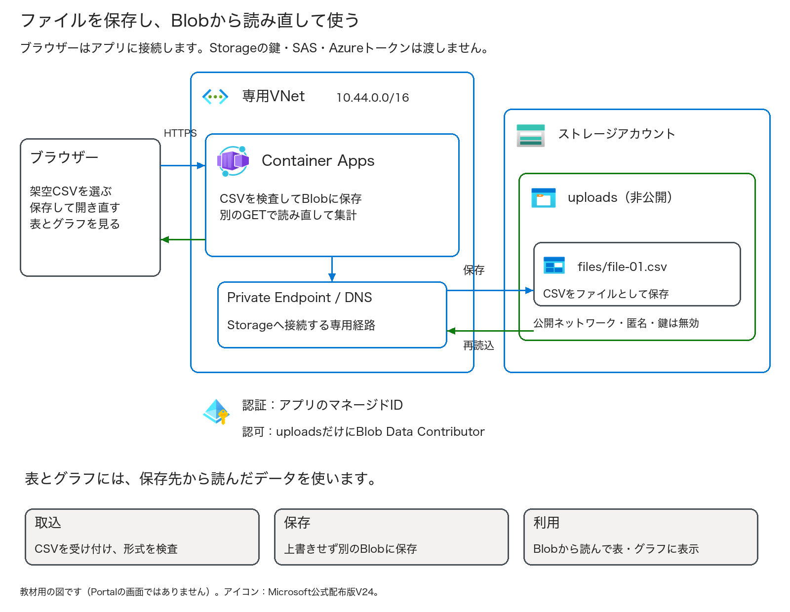
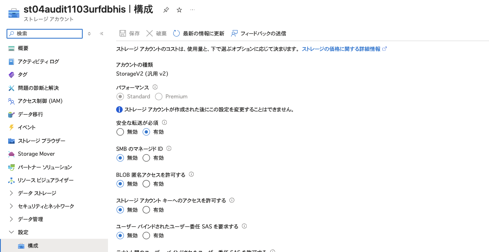
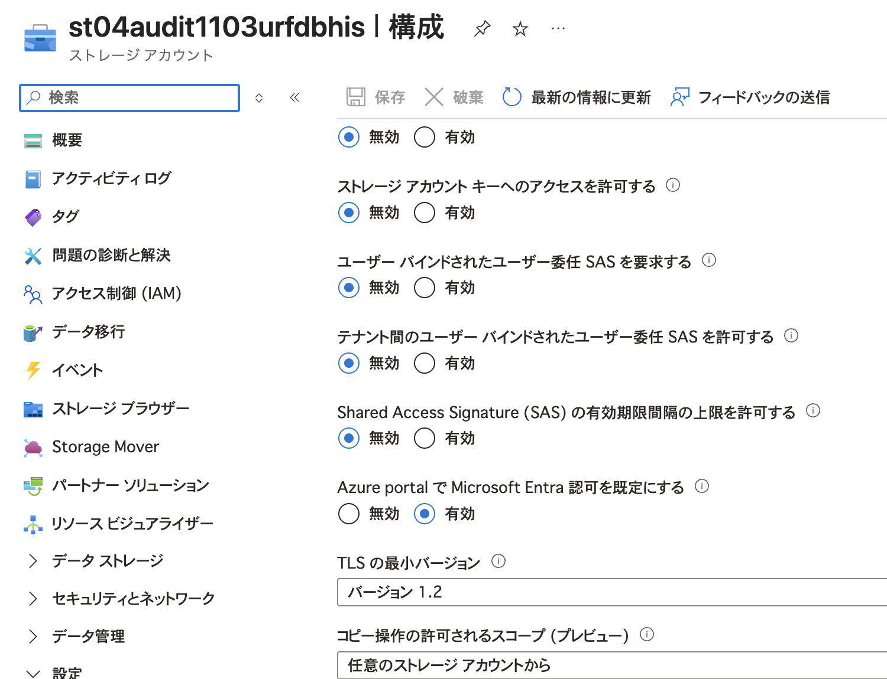
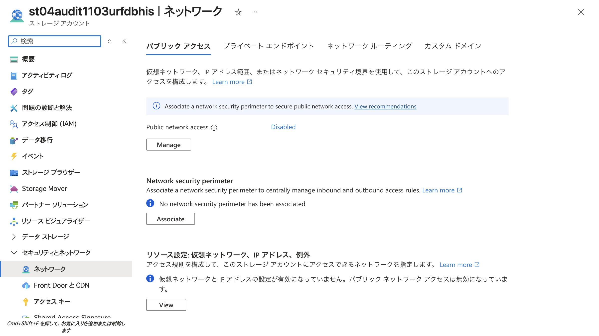
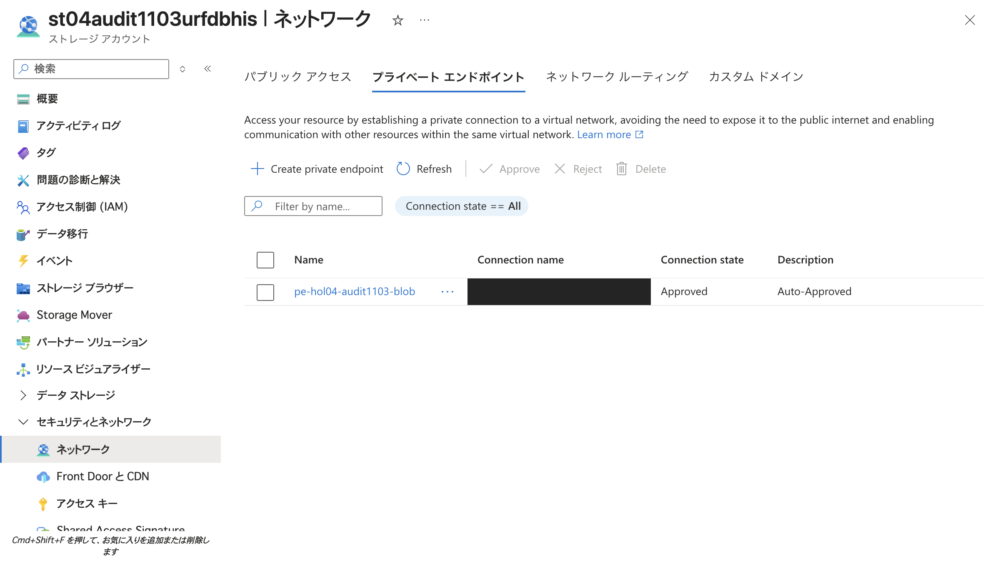
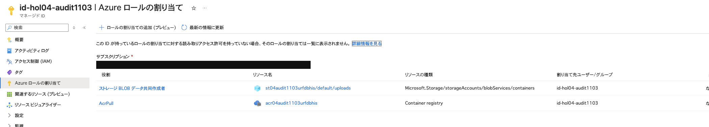
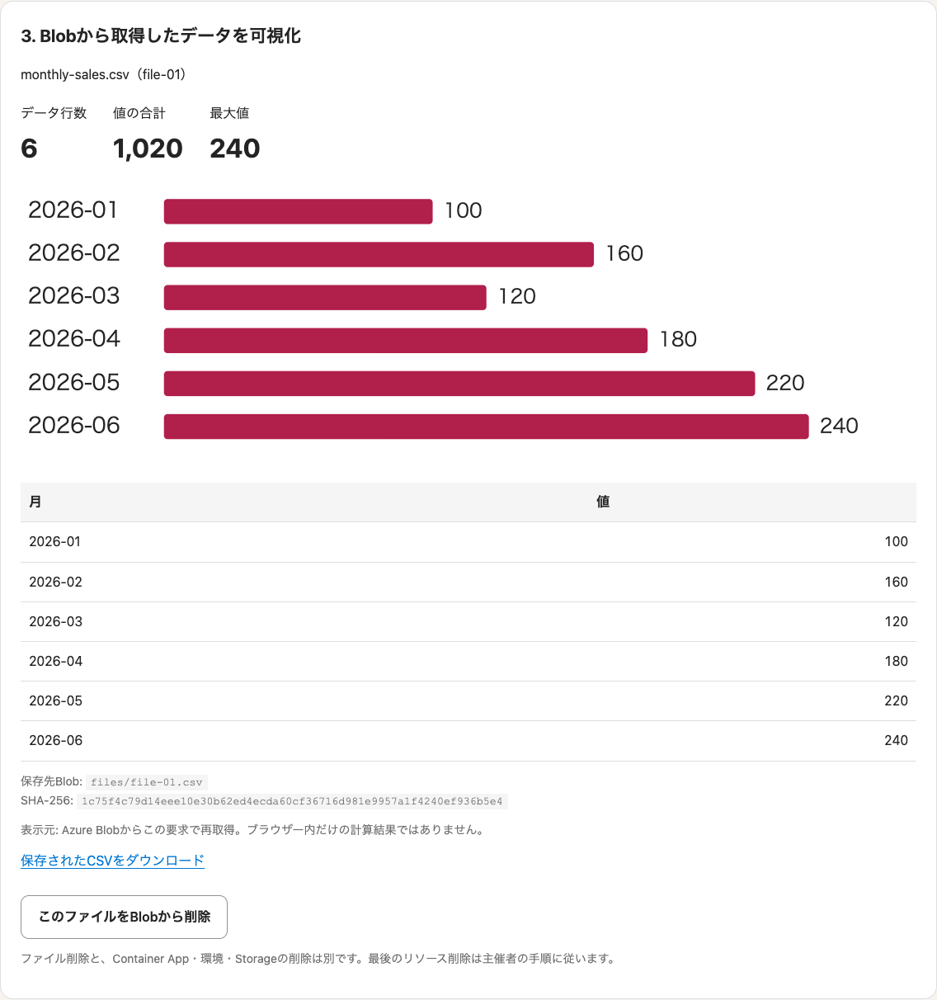
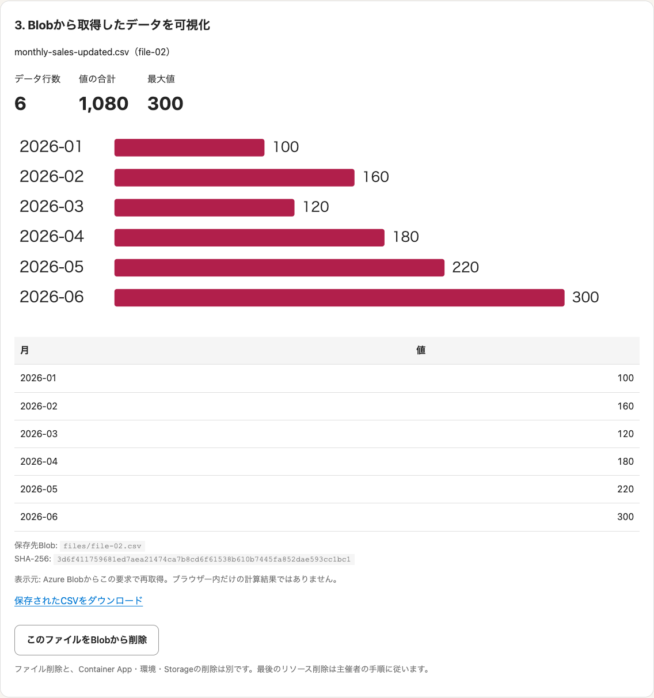
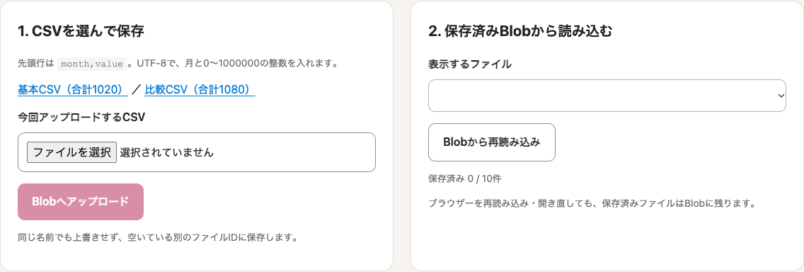
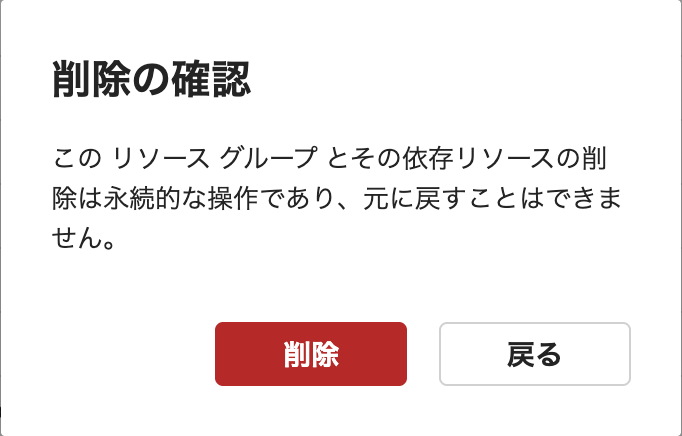

# 第4回 — 自分のアプリからBlobに保存し、表とグラフで見る

アプリからCSVをBlobに保存し、保存したデータを表とグラフで表示します。
ページを開き直してもデータが残ることや、別のCSVを保存したときの違いを確認します。

**第4回の座学後に、Microsoftから付与されたAzureサブスクリプションで取り組んでください。**
RG、Storage、アプリ用のID、ネットワーク、ACR、Container Appを作成し、終了時には削除します。講師による環境の事前準備はありません。
アプリのソースと設定ファイルは教材に同梱しています。コードを書く必要はなく、配布ファイルを使って環境を構築します。

進め方: 座学後の自習。第1〜3回のリソースは不要  
目安: **120〜150分＋削除待ち30分程度**。初回のビルド・ネットワーク作成で長くなることがあります  
操作: Azure Portal、ブラウザーのCloud Shell（Bash）、作ったアプリ。PCにDockerを入れる必要はありません  
更新日: 2026-11-04 ／ [共通の始め方と名前](../self-study.md) ／ [実施記録](run-through.md)

> 練習には同梱の架空CSVだけを使います。仕事のデータ、個人情報、秘密情報はアップロードしないでください。
> Blobの公開アクセスとアカウントキーは使わず、アプリのマネージドIDで読み書きします。
> IP制限は、ログイン認証の代わりではありません。本番のアプリでは利用者の認証とデータの分離も必要です。

この回は、**Portalで空のRGを作成 → Cloud Shellで配布スクリプトを実行 → Portalで設定確認 → アプリでCSV操作**の順です。
StorageやPrivate EndpointをPortalで手動作成する手順ではありません。Task 6の画像は、配布ファイルで作ったリソースを確認する画面です。
画像の名前・ファイルIDは撮影時の例です。自分の値へ読み替える箇所は、各手順で示します。

## 目次

- [始める前の準備と費用](#始める前の準備と費用)
- [今日作るものと名前](#今日作るものと名前)
- [Exercise 1: RGと作業場所を用意する](#exercise-1-rgと作業場所を用意する)
- [Exercise 2: 保存先とアプリを作る](#exercise-2-保存先とアプリを作る)
- [Exercise 3: 保存して、開き直して比べる](#exercise-3-保存して開き直して比べる)
- [Exercise 4: 自分のリソースを片付ける](#exercise-4-自分のリソースを片付ける)
- [完了チェックと振り返り](#完了チェックと振り返り)
- [困ったとき](#困ったとき)

## 始める前の準備と費用

- [ ] Microsoftから付与されたサブスクリプションにサインインできる。
- [ ] RGと今回のリソースを自分で作成・削除できる。
- [ ] 新しいBlobコンテナーとACRで、アプリのIDへRBACロールを割り当てられる。
- [ ] 個人識別名を決め、費用の扱い、利用期限、問い合わせ先を控えた。
- [ ] Japan Eastで今回のサービスを使え、必要なプロバイダーが登録されている。
- [ ] PCのブラウザーからPortalとHTTPSのアプリを開ける。
- [ ] 同梱の架空CSVだけを使う。

**Contributorだけでは、通常ロール割り当てはできません。** 第4回ではデータへの権限も設定するので、その許可が必要です。
権限が足りない場合は、今回作るBlobコンテナーとACRへのロール割り当てが必要であることを付与元に伝えてください。
権限の問題を避けるために、ポリシーを解除したりStorageのキーを使ったりしないでください。

必要なプロバイダーは`Microsoft.App`、`Microsoft.Network`、`Microsoft.Storage`、`Microsoft.ManagedIdentity`、`Microsoft.ContainerRegistry`、`Microsoft.CloudShell`です。
Portalの**サブスクリプション→リソースプロバイダー**で確認できます。未登録のものは、付与された許可の範囲で登録します。登録できなければ付与元に相談してください。

料金はCSVの容量だけでは決まりません。Container Apps、Storageの操作、ACRとビルド、Private Endpoint、Private DNS、
VNet統合で作られるロードバランサーやIPも費用の対象です。
公開小売価格の参考値は、ACR Basicが$0.1666/日、Private Endpointが$0.01/時、Hot LRS保存が$0.02/GB・月でした（2026-10-12、USD）。
実際の請求額は、契約、無料枠、保存期間、転送量、税などによって変わります。この参考値は実習費用の見積もりや上限額ではありません。
始める前に終了時刻を決めてください。途中でやめる場合も、作成済みのRGは削除します。

## 今日作るものと名前



ブラウザーはアプリに接続します。Blobへの保存と読み込みは、アプリが行います。
Container Appsの「コンテナー」はアプリを実行するもの、Blobの「コンテナー」はファイルをまとめるものです。
名前は同じですが、役割は異なります。

`ksaito73`は個人識別名の例です。[共通ルール](../self-study.md)で決めた自分の名前に置き換えます。

| 作るもの | 名前の例・役割 |
| --- | --- |
| RG | `rg-hol04-ksaito73`。自分でPortalから作る |
| Container App | `ca-hol04-ksaito73`。CSVを受け取るアプリ |
| Container Apps環境 | `cae-hol04-ksaito73`。アプリの実行場所 |
| マネージドID | `id-hol04-ksaito73`。アプリがAzureへ接続するID |
| VNet | `vnet-hol04-ksaito73`。アプリとBlobの専用経路 |
| Private Endpoint | `pe-hol04-ksaito73-blob`。Blobへつなぐ入口 |
| Storage | `st04ksaito73...`。個人識別名＋重複を避ける文字列を自動生成 |
| ACR | `acr04ksaito73...`。自分でビルドしたイメージの保存先 |
| Blobコンテナー | `uploads`。このアプリのCSVだけを保存 |
| Private DNS | `privatelink.blob.core.windows.net`。指定名なので変えない |

アプリは64 KiB以内・1〜24行のCSVを10件まで保存します。
アップロード後、アプリはBlobからCSVを読み込み、その内容を表とグラフに表示します。ブラウザー内に残ったデータを表示するだけではありません。
CSVはファイルとして保存します。SQLやRedisは使いません。

## Exercise 1: RGと作業場所を用意する

### Task 1 — 付与されたサブスクリプションと名前を確認する（5分）

1. [Azure Portal](https://portal.azure.com/)へ、案内されたアカウントでサインインします。
2. **サブスクリプション**を検索し、Microsoftから付与されたものの名前を確認します。
3. この回ではコマンドにも指定するので、概要の**サブスクリプションID**を手元に控えます。教材や提出物には載せません。
4. 個人識別名と`rg-hol04-自分の識別名`を控えます。前回の続きから再開する場合は、保存した作業記録を復元します。

### Task 2 — 自分の空のRGを作る（5分）

1. **リソースグループ→作成**を開きます。
2. 付与サブスクリプション、`rg-hol04-自分の識別名`、許可された**Japan East**を選びます。
3. **タグ**タブで次の3行を入力します。名前と値は別の欄です。

   | 名前 | 値 |
   | --- | --- |
   | `Purpose` | `AzureHandsOn` |
   | `Session` | `04` |
   | `Participant` | 自分の識別名 |

4. **確認および作成→作成**をクリックし、自分のRGの概要を開きます。
5. 中が空で、名前とタグが自分のものだと確認します。

後の手順で使うスクリプトは、このRGの名前とタグを確認します。初回の実行では、空でないRGや他の参加者のRGを変更しない仕組みになっています。

### Task 3 — 配布ファイルをCloud Shellに入れる（5〜10分）

1. [第4回の作成ファイル一式](assets/handson04-self-study.zip)をPCへダウンロードします。
   **HTML版のこのリンクを使ってください。** PDF自体にはZIPは入っていません。
2. Portal上部の **Cloud Shell**（`>_`のアイコン）を開き、**Bash**を選びます。アイコンが見えない場合は、上部の**その他のポータル ツール**を開いて探します。
3. 初めて使う場合は、**ストレージ アカウントは不要です／No storage account required**を選び、付与サブスクリプションを選択して**適用**を押します。**既存のプライベート仮想ネットワークを使用する**は選びません。`[ ~ ]$`などの入力待ちの行が表示されるまで待ちます。
4. **Manage files／ファイルの管理→Upload／アップロード**から、ZIPをアップロードします。
5. Cloud Shellの入力欄に、次をコピーしてEnterを押します。

```bash
unzip handson04-self-study.zip
cd handson04-self-study
```

一度に貼り付ける場合も、2行とも実行されたことを確認します。最後の入力待ちの行で`pwd`を実行し、末尾が`/handson04-self-study`になっていれば次へ進みます。
「No such file」「cannot find」と出た場合は進まず、ZIPのアップロード先とファイル名を確認します。ファイル名に`(1)`などが付いていたら、実際の名前に合わせてください。

Cloud Shellはブラウザー内の作業場所です。PCのターミナルや、前の回のVMには入力しません。
ZIPにはアプリのソース、Bicepの設定、`setup_lab.py`が入っています。イメージのビルドとAzure環境の作成は、これから行います。

このCloud Shellは一時セッションです。閉じたり再起動したりすると、ファイルが消えます。
処理を待っている間でも、20分程度操作がないと終了する場合があります。後の手順に従い、作業記録を各段階でダウンロードしてください。

### Task 4 — 自分の作成先とPCのIPを記録する（5分）

1. **PCのブラウザーの別タブ**で[IPv4を確認するページ](https://api4.ipify.org/)を開き、数字を手元に控えます。
   Cloud Shellで調べるIPは別になることがあるので、ここはPCのブラウザーで確認します。
2. 次の3か所を自分の値に置き換え、Cloud Shellへ入力します。

```bash
python3 setup_lab.py init \
  --subscription "自分のサブスクリプションID" \
  --id "ksaito73" \
  --client-ip "PCのブラウザーで確認したIPv4"
```

`ksaito73`も自分の識別名へ置き換えます。日本語の説明部分を残したまま実行しないでください。
出力の「今回の対象」に、控えたRG名と識別名が表示されていることを確認します。
アプリへのアクセスは、ここで指定したIPだけに制限します。IPが変わった場合は作業を止めて設定を確認し、すべてのIPからのアクセスは許可しないでください。

**作業記録の保存:** この記録がないと、途中から再開できません。次の操作は、`init`・`prepare`・`build`・`deploy`がそれぞれ完了したあとに行います。

1. Cloud Shellの**ファイルの管理／Manage files → ダウンロード／Download**を開きます。
2. 入力欄の左側に`/home/自分のユーザー`が表示されている場合は、入力部分に`handson04-self-study/.lab04-state.json`だけを入れます。ホームフォルダーを二重に入力しません。左側に固定表示がない画面では、`pwd`で調べた場所に`/.lab04-state.json`を付けたフルパスを入力します。
3. **ダウンロード**を押し、右下の**ファイルのダウンロード**通知に出る`.lab04-state.json`のリンクもクリックします。通知が出ただけではPCへの保存は終わっていません。
4. PCのダウンロード先で、ファイルが保存されたことを確認します。ブラウザーによっては先頭の`.`が外れ、`lab04-state.json`という名前になります。各段階で最新版を保存し、前の記録と取り違えないでください。

記録には名前・ID・IP・実行番号が入りますが、キーやトークンは入りません。手元で保管し、提出しません。

**Cloud Shellを開き直すとき:** Task 3と同じようにZIPをアップロード・展開して作業フォルダーへ移動します。PCに保存した最新の記録を**ファイルの管理 → アップロード**で戻します。アップロード通知の**宛先**を確認してください。宛先がホームフォルダーなら、次のコマンドで記録を作業フォルダーへコピーします。

```bash
cp ~/lab04-state.json .lab04-state.json
```

上は、PCでの保存名が`lab04-state.json`だった場合です。先頭の`.`や`(1)`などが付いている場合は、コピー元を実際の名前へ置き換えます。コピー元が`lab04-state(1).json`なら、`cp ~/"lab04-state(1).json" .lab04-state.json`です。コピー先の`.lab04-state.json`は変えません。
`ls -l .lab04-state.json`で記録があることを確認してから、中断した段階の`prepare`・`build`・`deploy`を再実行します。**再開時に`init`は実行しません。** 記録を戻せない場合は先へ進まず、「困ったとき」を確認してください。

## Exercise 2: 保存先とアプリを作る

### Task 5 — Storage、ID、ネットワーク、実行環境を作る（15〜30分）

```bash
python3 setup_lab.py prepare
```

スクリプトはARMの事前チェックとwhat-if（変更内容の事前確認）を実行し、今回のRG内の新規作成だけであることを確認してから展開します。
作成するのは、Storage、uploadsコンテナー、マネージドID、ACR、VNet、Private Endpoint、DNS、Container Apps環境です。

マネージドIDには、**uploadsコンテナーだけ**のStorage Blob Data Contributorと、**自分のACRだけ**のAcrPullを割り当てます。
Storageは非公開、Shared Keyと匿名アクセスも無効です。環境はConsumptionだけ、ログ保存先は追加しません。

名前の一覧と「基盤を作成しました」が出るまで待ちます。
待ち時間の上限でコマンドが終了した場合は、同じ`prepare`を再実行します。作業記録を基に、実行中のデプロイの状況を確認できます。別のRGでやり直す必要はありません。
完了後に`.lab04-state.json`をもう一度保存します。
コマンドを入力しただけ、またはリソース名が途中まで出た状態は完了ではありません。**完了メッセージが出て、入力待ちの行に戻るまで**、別の`build`や`deploy`を入力しません。

### Task 6 — 作ったリソースをPortalで見る（10分）

1. Cloud Shellを最小化し、**自分のRG→概要**を更新します。
2. 名前に自分の識別名を含むアプリ用ID、VNet、環境、Storage、ACR、Private Endpointを探します。
3. Storageの**構成／Configuration**で、匿名アクセスとShared Keyを使わない設定を確認します。
4. **ネットワーク**で、公開ネットワークが無効、Blob用Private Endpointが承認済みであることを見ます。
5. 自分のRGに戻り、`id-hol04-自分の識別名`を開きます。左メニューの**Azure ロールの割り当て**を開き、付与サブスクリプションを選びます。今回のuploadsコンテナーとACRへの2件の割り当てを確認します。**アクセス制御（IAM）**は、このID自体を管理できる人を見る別の画面なので、取り違えないでください。

確認する場所と期待値を、次の表にまとめます。**ここでは設定を変更せず、スクリプトが作った値を読むだけ**です。

| 自分のリソースで開く画面 | 確認項目 | 期待する値 |
| --- | --- | --- |
| Storage → 構成 | 安全な転送を必須にする | 有効 |
| Storage → 構成 | Blob／コンテナーの匿名アクセス | 無効 |
| Storage → 構成 | ストレージアカウントキーへのアクセス | 無効（Shared Keyを使わない） |
| Storage → 構成 | Azure portalでMicrosoft Entra認可を既定にする | 有効 |
| Storage → 構成 | TLSの最小バージョン | 1.2 |
| Storage → ネットワーク | パブリックネットワークアクセス | 無効 |
| Storage → ネットワーク → プライベート エンドポイント | 今回の`pe-hol04-...-blob` | 接続状態は承認済み／Approved |
| アプリ用ID → Azure ロールの割り当て | ストレージ BLOB データ共同作成者／Storage Blob Data Contributor | リソース名の末尾が`/default/uploads`、種類が`Microsoft.Storage/storageAccounts/blobServices/containers` |
| アプリ用ID → Azure ロールの割り当て | AcrPull | リソース名が自分のACR、種類がContainer registry |

Storageアカウント直下の**アクセス制御（IAM）**では、下位のuploadsコンテナーだけに付けたロールは表示されません。上のID側の画面で確認します。
表示に時間がかかる場合は**最新の情報に更新**を押します。それでも見えない場合は、付与サブスクリプションと読み取り権限を付与元に確認します。

**次の画像は、配布ZIPで実際に作ったリソースの確認画面です。設定を変更したり、作成・追加ボタンを押したりする必要はありません。** 名前は検証時の例なので、自分のものへ読み替えます。



同じ**構成**画面を下へスクロールし、**Azure portal で Microsoft Entra 認可を既定にする**が有効、TLSが1.2であることも確認します。
Entra認可の既定設定は、Portalで使う認可方式を選ぶものです。Shared Keyの無効化や、アプリ用IDのRBAC割り当てを代わりに行う設定ではありません。





公開ネットワークを無効にしたStorageへアプリから接続するには、Private Endpoint（PE）、DNS、VNet統合も必要です。



**Create private endpoint／作成**は押しません。PCからPrivate Endpointへの接続経路は用意していないため、PortalではBlobの内容を直接開けない場合があります。ファイルの操作には、後で展開するアプリを使います。



### Task 7 — 自分のACRでアプリをビルドする（5〜15分）

Cloud Shellに戻り、次を実行します。

```bash
python3 setup_lab.py build
```

配布されたソースを自分のACRへ送り、Azure上でLinuxのイメージをビルドします。PCでDockerを動かす必要はありません。
「ビルド…が完了しました」が出たら、作業記録をもう一度保存します。

ビルドの完了前にコマンドが終了した場合は、同じ`build`を再実行します。記録された実行番号（runId）の状況を確認するため、ビルドが重複して起動することはありません。
失敗した場合は、ACRの**Tasks→Runs**で対象の実行を確認してください。ソースや作業記録を失った場合は、同名のリソースへ上書きせず、[困ったとき](#困ったとき)を参照してください。
ビルドは受け付けられたものの実行番号を記録できなかった場合は、ACRで同じイメージタグのビルドが成功していることを確認し、
`python3 setup_lab.py build --resume-run 実行番号`で作業記録に登録します。指定した実行のタグが今回のタグと一致しなければ、スクリプトは処理を中止します。

### Task 8 — Container Appを展開する（5〜15分）

```bash
python3 setup_lab.py deploy
```

ビルドしたイメージをdigest（イメージを一意に識別する値）で指定し、Container Appを作成します。アプリはマネージドIDでACRからイメージを取得します。
設定は0.25 vCPU／0.5 GiB、最小0・最大1レプリカです。ブラウザーからはHTTPSで接続し、アプリへの転送先はポート8080です。アクセスはTask 4のIPだけに制限します。
Storageのキーや接続文字列は入力しません。

表示された**自分のアプリURL**を手元へ控え、ブラウザーの別タブで開きます。
`deploy`完了後も、上の「作業記録の保存」で最新版を保存してください。アプリURLも記録に追加されています。
マネージドIDの権限が反映されるまで、時間がかかる場合があります。アプリを開けたら、次の手順でCSVの保存と読み込みを確認します。

## Exercise 3: 保存して、開き直して比べる

### Task 9 — 自分のアプリとサンプルを開く（5分）

1. URLで「CSVをBlobに保存」する画面が開くことを見ます。
2. 「ローカルテスト用・Azureには保存しません」と出ていないことを確認します。出ていたら別の画面なので、作成先を見直します。
3. 保存済み0件、または今回自分で保存したファイルだけがあることを見ます。
4. アプリの**基本CSV**と**比較CSV**のリンクからファイルを保存します。
   画像上の表示は**基本CSV（合計1020）／比較CSV（合計1080）**です。リンクを開くとPCへダウンロードされます。自分のブラウザーの保存先を確認してください。


自分のURLはTask 8で作ったものです。講師からアプリURLを受け取る必要はありません。
資料にも[基本CSV](app/blob_viz/samples/monthly-sales.csv)、[比較CSV](app/blob_viz/samples/monthly-sales-updated.csv)を同梱しています。
Excelで保存し直さず、そのまま使ってください。

| 確認値 | 基本CSV | 比較CSV |
| --- | --- | --- |
| データ行数（ヘッダーを除く） | 6 | 6 |
| 合計 | 1020 | 1080 |
| 最大値 | 240 | 300 |
| 違い | — | 6月の240を300へ変更 |

### Task 10 — 基本CSVを保存し、表とグラフを見る（5分）

1. ファイル入力で`monthly-sales.csv`を選び、**Blobへアップロード**を一回クリックします。
   **1. CSVを選んで保存 → 今回アップロードするCSV → ファイルを選択**を押し、PCの保存先から選んで**開く**を押します。OSやブラウザーによってはボタン名が異なります。選んだファイル名が表示されてからアップロードします。
2. 保存と表示が終わるまで待ち、ファイルIDを控えます。
3. **6行・合計1020・最大240**を確認します。
4. 表の100、160、120、180、220、240と、6本の棒を見比べます。
5. 表示元がAzure Blobであること、Blob名とSHA-256が出ることを確認します。



画像の`file-01`は例です。手元に表示されたファイルIDを選んでください。
小さい画面ではグラフの部分を横にスクロールでき、下の表でも値を読めます。
保存成功後に表示が失敗した場合は、再アップロードを繰り返さず一覧を再読み込みします。

### Task 11 — ダウンロードと開き直しを試す（5分）

1. **保存されたCSVをダウンロード**をクリックし、元の6行と一致することを見ます。
2. **Blobから再読み込み**をクリックします。
3. ページ自体も開き直し、同じファイルIDを選びます。可能なら別のプライベートウィンドウも使います。
   選ぶ場所は**2. 保存済みBlobから読み込む → 表示するファイル**です。PCの広い画面では右側、小さい画面ではアップロード欄の下にあります。最初のファイル名とIDを選び、**Blobから再読み込み**を押します。もう一度アップロードする操作ではありません。
4. 6行・1020・240が同じであることを確かめます。

Blobに保存したファイルを、ページを開き直した後も読み込めることを確認する手順です。
[以前の検証時の画面](assets/app/03-reopened.png)も参考にしてください。

### Task 12 — 比較CSVを保存し、元のファイルと比べる（5分）

1. `monthly-sales-updated.csv`をBlobへアップロードし、別のファイルIDになったことを見ます。
   **1. CSVを選んで保存**の**ファイルを選択**で比較CSVを選び直し、**Blobへアップロード**を押します。ブラウザーの「保存」操作だけでは、Blobには保存されません。
2. 6月が300、合計1080、最大300であることを確認します。
3. 最初のIDへ戻し、合計1020、最大240のままであることを確かめます。



同名でも別の空きIDに保存するので、元のCSVは上書きされません。選ぶときはファイル名とIDの両方を見ます。

### Task 13 — 違う列名のCSVが保存されないことを試す（5分）

1. [列名が違うCSV](app/blob_viz/samples/invalid-columns.csv)を使います。先頭行が`date,total`のサンプルです。
2. 保存済み件数を控えてから、そのCSVをアップロードします。
3. 「先頭行はmonth,valueの2列にしてください」というエラーを見ます。
4. 一覧を読み直し、件数が増えていないことを確認します。


受け付けるのはUTF-8（BOM可）、64 KiB以内・1〜24行、2000〜2099年の重複しない月、0〜1000000の整数です。
負数、小数、式、追加列は受け付けません。試すのはこの架空の小さいサンプルだけにします。

## Exercise 4: 自分のリソースを片付ける

### Task 14 — 保存したファイルをアプリから削除する（5分）

1. 自分が保存したファイル名とIDを選び、**このファイルをBlobから削除**をクリックします。
2. 確認画面の対象を読んで削除します。
3. 比較CSVも同様に削除し、開き直して保存済み0件を確かめます。



削除時にはETagを使い、表示してからファイルが変更されていないことを確認します。変更を知らせるメッセージが出た場合は、一覧を再読み込みしてください。
ファイルを削除しても、アプリ・ACR・Storageは残ります。次の手順で削除します。

### Task 15 — 自分のRGを削除する（5〜30分以上）

1. Portalで**自分のRG**を開き、付与サブスクリプション、RG名、`Participant`タグを控えと照合します。
2. 中のStorage、ACR、ID、VNet、PE、DNS、環境、アプリが、今回自分で作ったものだけだと確認します。
3. **リソース グループの削除**をクリックします。削除対象が自分のRGだけであることと、一覧のリソース名を確認し、自分のRG名を入力して**削除**を押します。
4. 続けて**削除の確認**が表示された場合は、取り消せない操作であることを読み、今回のRGが対象であることを確かめて、もう一度**削除**を押します。最初のボタンを押しただけでは、削除は始まっていません。
5. 通知で処理状況を確認します。途中で作成に失敗した場合も、この片付けは必要です。



**削除は取り消せません。** 共有・業務用・他人のRGは選びません。
自分の環境が作った`ME_...`の管理用RGは、環境削除に伴って片付きます。直接編集・削除する操作はしません。
削除には20分以上かかることがあります。開始通知だけで完了にせず、次の一覧まで確認してください。

### Task 16 — RG・アプリ・環境が消えたことを確認する（5分）

1. **リソースグループ**一覧を更新し、自分のRG名で検索します。
2. **RGが表示されない**ことを確認します。
3. **Container Apps**と**Container Apps環境**、StorageとACRの一覧でも、自分の名前のリソースがないことを確認します。
4. Cloud Shellの記録が残っていれば、次も実行します。

```bash
python3 setup_lab.py check-cleanup
```

このコマンドは、作業記録にある実習用RGと管理用RGが削除されたことを確認します。
まだ残っている場合は通知を確認し、時間を置いて一覧を更新してください。権限やロックのエラーは付与元に相談し、解消後に削除を再開します。
削除が終わるまでは「未完了」と記録してください。請求画面の0円表示ではなく、対象リソースが一覧からなくなったことをもって完了とします。

## 完了チェックと振り返り

- [ ] Microsoftから付与されたサブスクリプションを使った。
- [ ] 個人識別名のRGを自分で作り、Participantタグを付けた。
- [ ] Storage・ID・権限・ネットワーク・ACR・環境を自分で作った。
- [ ] 配布ソースを自分のACRでビルドし、自分のContainer Appへ展開した。
- [ ] 基本CSVはBlobから読み直した結果が6行・1020・240だった。
- [ ] ダウンロードと開き直し後も、同じファイルを確認できた。
- [ ] 比較CSVは1080・300、元のCSVは1020・240のままだった。
- [ ] 列名の違うCSVは拒否され、保存件数が増えなかった。
- [ ] 自分のファイルを削除した。
- [ ] 自分のRGを削除し、アプリ・環境・Storage・ACRが残っていないことを確認した。

実施結果、未完了のTask、CSVの確認値、削除状況、操作で迷った箇所を提出してください。実際のURL・IP・IDや作業記録ファイルは含めないでください。
アプリの画面表示までなのか、CSVの保存・再読み込みまで確認できたのかが分かるように記録します。

**問い1:** ブラウザー、アプリ、Blobは、それぞれどのような役割でしたか。  
**問い2:** アプリのIDに与えるデータの操作権限を、uploadsコンテナーだけに限定したのはなぜですか。  
**問い3:** ファイルを削除した後も、どのリソースが残っていましたか。

## 困ったとき

| 止まったところ | 次に確認すること |
| --- | --- |
| RGを作成できない／ロールを割り当てられない | サブスクリプションと権限を確認してください。Contributorだけでは、通常ロールを割り当てられません。 |
| プロバイダー未登録・Policy・Quotaのエラー | プロバイダーの登録状況、許可されたリージョン、クォータを確認します。必要な権限がない場合は付与元に相談してください。 |
| Cloud ShellでZIPが見つからない | Manage filesからアップロード済みか確認してください。展開後は、`cd handson04-self-study`で作業フォルダーに移動します。 |
| 一時セッションを閉じて作業記録が消えた | Task 4の「Cloud Shellを開き直すとき」に従い、ZIPを展開し直し、最新の記録を作業フォルダーの`.lab04-state.json`へ戻してください。アップロード先とファイル名を確認し、既存RGに対してinitをやり直さないでください。 |
| 作業記録をダウンロードできない | 入力欄にホームフォルダーが固定表示されていないか確認します。固定表示がある場合の入力は`handson04-self-study/.lab04-state.json`です。通知内のファイルリンクを押し、PCへの保存完了も確認してください。 |
| 作業記録を保存する前に失った | Portalで作成済みのリソースを確認してください。重複して作成せず、今回のRGを削除してから最初からやり直します。 |
| prepareが失敗した | 今回のRGのデプロイ詳細でエラーを確認してください。別のRGや公開Storageで代用しないでください。 |
| buildの受付状況が分からない／失敗した | ACRのTasks→Runsで実行結果を確認してください。成功していて実行番号だけが未記録の場合は、`build --resume-run 実行番号`で記録に登録します。失敗した場合は原因を記録し、続行できなければRGを削除してください。 |
| アプリURLで403が返る | PCの現在のIPv4と、アプリのイングレスのIP制限を確認してください。IPが変わっていた場合は、今回のアプリのclassroom規則を現在のIPv4（/32）に置き換えます。すべてのIPからのアクセスは許可しないでください。 |
| Storageへのアクセスが拒否される | アプリのマネージドID、コンテナー単位のRBAC、権限の反映状況、Private EndpointとDNSを確認してください。 |
| PortalからBlobを開けない | PCにはPrivate Endpointへの接続経路がないため、そのままで問題ありません。アプリから確認し、キーやSASは発行しないでください。 |
| 保存は成功したが表示に失敗した | 一覧を再読み込みしてください。アップロードを繰り返す必要はありません。 |
| 削除が進まない | 通知と、今回のRG・環境の状態を確認してください。管理用RGは直接削除せず、付与元に相談します。 |

## Microsoft公式の補足

- [一時Cloud Shellを始める](https://learn.microsoft.com/azure/cloud-shell/get-started/ephemeral)
- [Cloud ShellのUpload／Download](https://learn.microsoft.com/azure/cloud-shell/use-the-shell-window)
- [ACRでのイメージビルド](https://learn.microsoft.com/azure/container-registry/container-registry-quickstart-task-cli)
- [Blobデータの認証と認可](https://learn.microsoft.com/azure/storage/blobs/authorize-access-azure-active-directory)
- [Container AppsのマネージドID](https://learn.microsoft.com/azure/container-apps/managed-identity)
- [StorageのPrivate Endpoint](https://learn.microsoft.com/azure/storage/common/storage-private-endpoints)
- [Container AppsのVNet統合と管理用リソース](https://learn.microsoft.com/azure/container-apps/custom-virtual-networks)
