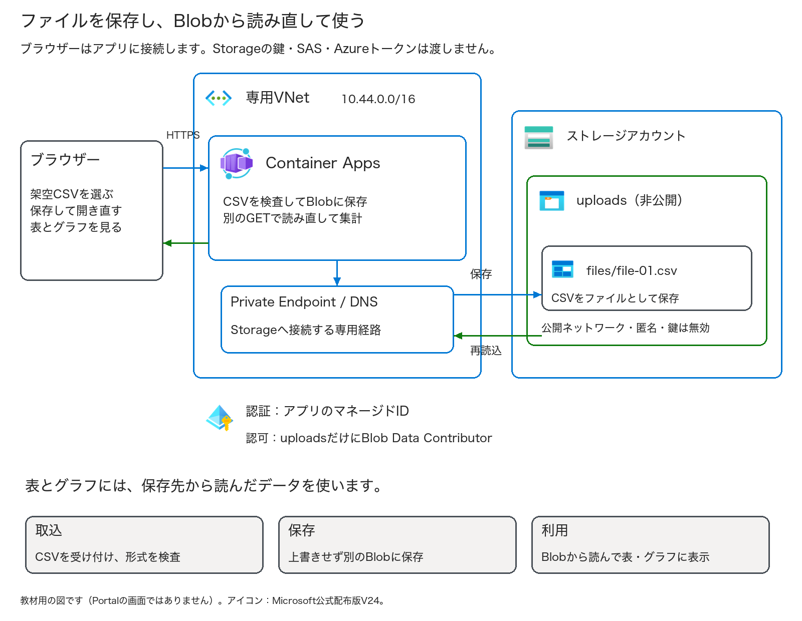
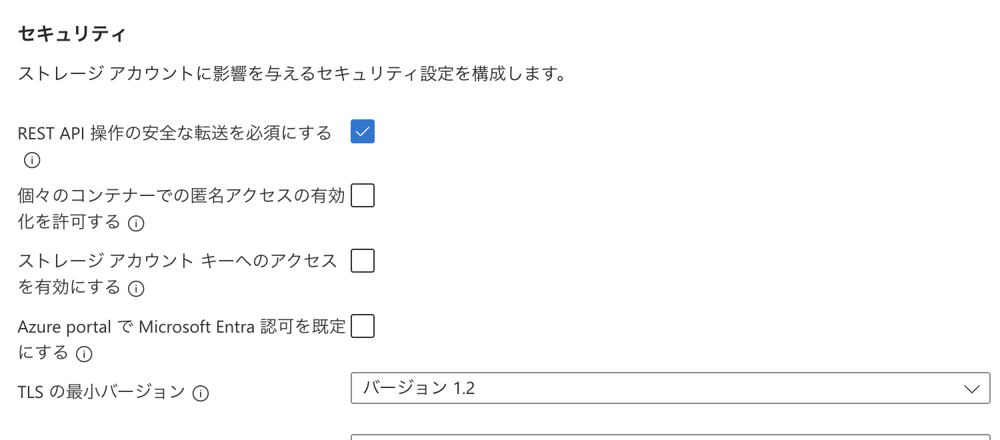
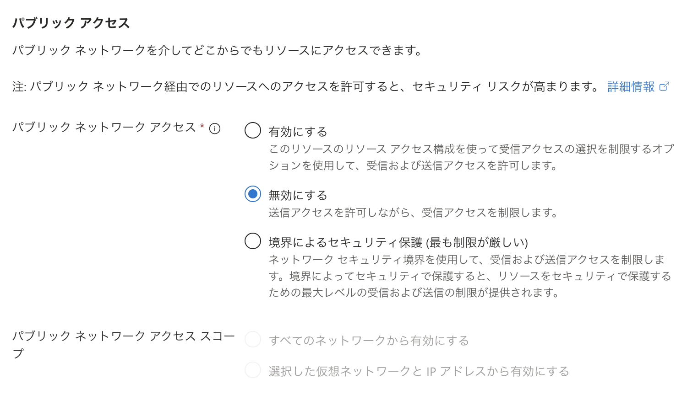
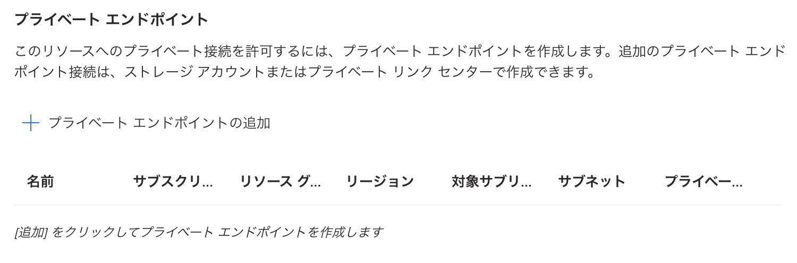
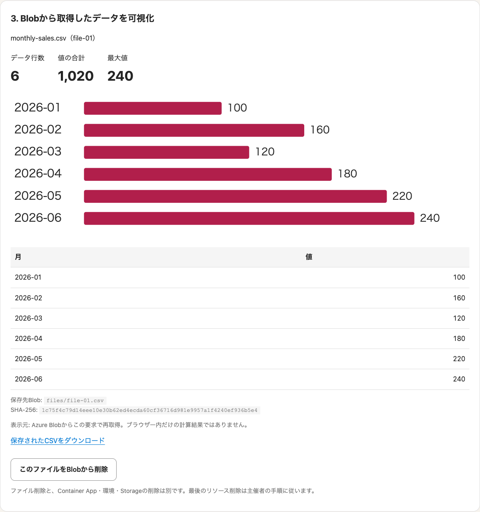
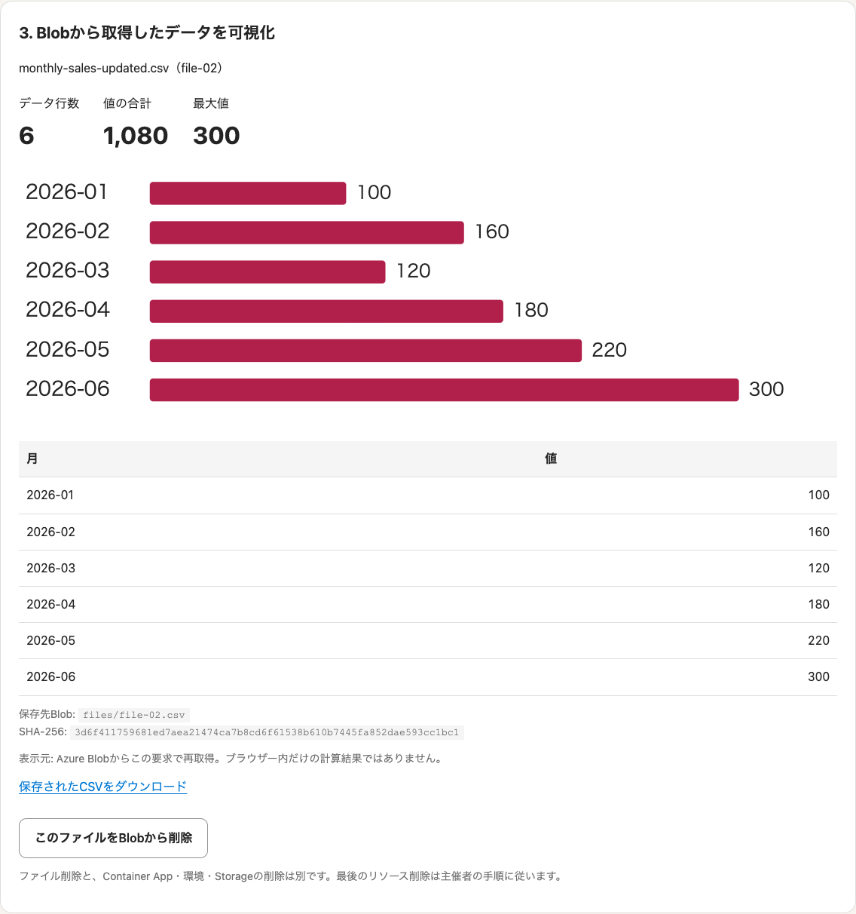
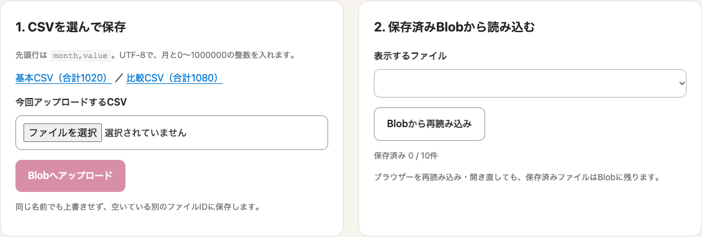

# 第4回 — 自分のアプリからBlobに保存し、表とグラフで見る

第4回の座学が終わったら、保存先とアプリを自分で作ってみましょう。
CSVをアップロードしたあと、Blobから読み直した内容を表とグラフで見ます。開き直しても残っているか、別のCSVを保存すると何が変わるかも試します。

**使うのはMicrosoftから付与されたAzureサブスクリプションだけです。**
講師が作ったアプリやStorageはありません。自分のRG、Storage、アプリ用のID、ネットワーク、ACR、Container Appを作り、最後に自分で削除します。
アプリのソースと設定ファイルは教材に入っています。コードを書く課題ではなく、配布ファイルを使って自分の環境へ展開する課題です。

進め方: 座学後の自習。第1〜3回のリソースは不要  
目安: **120〜150分＋削除待ち30分程度**。初回のビルド・ネットワーク作成で長くなることがあります  
操作: Azure Portal、ブラウザーのCloud Shell（Bash）、作ったアプリ。PCにDockerを入れる必要はありません  
更新日: 2026-10-13 ／ [共通の始め方と名前](../self-study.md) ／ [実施記録](run-through.md)

> 練習には同梱の架空CSVだけを使います。仕事のデータ、個人情報、秘密情報はアップロードしないでください。
> Blobの公開アクセスとアカウントキーは使わず、アプリのマネージドIDで読み書きします。
> IP制限は、ログイン認証の代わりではありません。本番のアプリでは利用者の認証とデータの分離も必要です。

以前の確認では実Azureへの保存とアプリ操作まで試してあります。今回追加した自分で作る手順の確認状況は、実施記録に分けて載せています。
写真は以前の動作確認で撮ったものです。名前や一部の案内文が違っていても、本文の設定と確認値を使ってください。

## 目次

- [始める前の準備と費用](#始める前の準備と費用)
- [今日作るものと名前](#今日作るものと名前)
- [Exercise 1: RGと作業場所を用意する](#exercise-1-rgと作業場所を用意する)
- [Exercise 2: 保存先とアプリを作る](#exercise-2-保存先とアプリを作る)
- [Exercise 3: 保存して、開き直して比べる](#exercise-3-保存して開き直して比べる)
- [Exercise 4: 自分のリソースを片付ける](#exercise-4-自分のリソースを片付ける)
- [完了チェックと振り返り](#完了チェックと振り返り)
- [困ったとき](#困ったとき)

## 始める前の準備と費用

- [ ] Microsoftから付与されたサブスクリプションにサインインできる。
- [ ] RGと今回のリソースを自分で作成・削除できる。
- [ ] 新しいBlobコンテナーとACRで、アプリのIDへRBACロールを割り当てられる。
- [ ] 個人識別名を決め、費用の扱い、利用期限、問い合わせ先を控えた。
- [ ] Japan Eastで今回のサービスを使え、必要なプロバイダーが登録されている。
- [ ] PCのブラウザーからPortalとHTTPSのアプリを開ける。
- [ ] 同梱の架空CSVだけを使う。

**Contributorだけでは、通常ロール割り当てはできません。** 第4回ではデータへの権限も設定するので、その許可が必要です。
不足している場合は付与元へ、今回のBlobコンテナーとACRにロールを割り当てたいと伝えてください。講師が代わりに環境を作る前提ではありません。
ポリシーを解除したり、Storageの鍵へ切り替えたりして進めることはしません。

必要なプロバイダーは`Microsoft.App`、`Microsoft.Network`、`Microsoft.Storage`、`Microsoft.ManagedIdentity`、`Microsoft.ContainerRegistry`、`Microsoft.CloudShell`です。
Portalの**サブスクリプション→リソースプロバイダー**で確認できます。未登録のものは、付与された許可の範囲で登録します。登録できなければ付与元に相談してください。

料金はCSVの容量だけでは決まりません。Container Apps、Storageの操作、ACRとビルド、Private Endpoint、Private DNS、
VNet統合で作られるロードバランサーやIPも費用の対象です。
公開小売価格の参考値は、ACR Basicが$0.1666/日、Private Endpointが$0.01/時、Hot LRS保存が$0.02/GB・月でした（2026-10-12、USD）。
契約、無料枠、保持、転送、税などで変わるので、実習の請求額や上限ではありません。
作り始める前に終える時刻を決め、途中でやめる場合も作成済みのRGを片付けましょう。

## 今日作るものと名前



ブラウザーはアプリに接続します。Blobへの保存と読み込みは、アプリが行います。
Container Appsの「コンテナー」はアプリを実行するもの、Blobの「コンテナー」はファイルをまとめるものです。
同じ言葉ですが、別の役割だと覚えておきましょう。

`ksaito73`は個人識別名の例です。[共通ルール](../self-study.md)で決めた自分の名前に置き換えます。

| 作るもの | 名前の例・役割 |
| --- | --- |
| RG | `rg-hol04-ksaito73`。自分でPortalから作る |
| Container App | `ca-hol04-ksaito73`。CSVを受け取るアプリ |
| Container Apps環境 | `cae-hol04-ksaito73`。アプリの実行場所 |
| マネージドID | `id-hol04-ksaito73`。アプリがAzureへ接続するID |
| VNet | `vnet-hol04-ksaito73`。アプリとBlobの専用経路 |
| Private Endpoint | `pe-hol04-ksaito73-blob`。Blobへつなぐ入口 |
| Storage | `st04ksaito73...`。個人識別名＋重複を避ける文字列を自動生成 |
| ACR | `acr04ksaito73...`。自分でビルドしたイメージの保存先 |
| Blobコンテナー | `uploads`。このアプリのCSVだけを保存 |
| Private DNS | `privatelink.blob.core.windows.net`。指定名なので変えない |

アプリは64 KiB以内・1〜24行のCSVを10件まで保存します。
表とグラフは、別のGETでBlobを再取得してから表示します。アップロード中のタブ内のデータだけを描いているわけではありません。
CSVはファイルとして保存し、SQLやRedisは作りません。

## Exercise 1: RGと作業場所を用意する

### Task 1 — 付与されたサブスクリプションと名前を確認する（5分）

1. [Azure Portal](https://portal.azure.com/)へ、案内されたアカウントでサインインします。
2. **サブスクリプション**を検索し、Microsoftから付与されたものの名前を確認します。
3. この回ではコマンドにも指定するので、概要の**サブスクリプションID**を手元に控えます。教材や提出物には載せません。
4. 個人識別名と`rg-hol04-自分の識別名`を控えます。すでに作った自分のRGなら、記録を戻して途中から再開します。

### Task 2 — 自分の空のRGを作る（5分）

1. **リソースグループ→作成**を開きます。
2. 付与サブスクリプション、`rg-hol04-自分の識別名`、許可された**Japan East**を選びます。
3. **タグ**に`Purpose=AzureHandsOn`、`Session=04`、`Participant=自分の識別名`を入れます。
4. **確認および作成→作成**をクリックし、自分のRGの概要を開きます。
5. 中が空で、名前とタグが自分のものだと確認します。

次の配布スクリプトは、このRGの名前とタグを確認してから実行します。空でないRGや、他人のRGには上書きしません。

### Task 3 — 配布ファイルをCloud Shellに入れる（5〜10分）

1. [第4回の作成ファイル一式](assets/handson04-self-study.zip)をPCへダウンロードします。
   **HTML版のこのリンクを使ってください。** PDF自体にはZIPは入っていません。
2. Portal上部の **Cloud Shell**（`>_`のアイコン）を開き、**Bash**を選びます。
3. 初めて使う場合は、**No storage account required／ストレージアカウントは不要**を選び、付与サブスクリプションで開始します。
4. **Manage files／ファイルの管理→Upload／アップロード**から、ZIPをアップロードします。
5. Cloud Shellの入力欄に、次をコピーしてEnterを押します。

```bash
unzip handson04-self-study.zip
cd handson04-self-study
```

Cloud Shellはブラウザー内の作業場所です。PCのターミナルや、前の回のVMには入力しません。
ZIPにはアプリのソース、Bicepの設定、`setup_lab.py`が入っています。配布済みイメージや、作成済みのAzure環境は入っていません。

このCloud Shellは一時セッションです。閉じたり再起動したりすると、ファイルが消えます。
長い待ち時間でも20分程度操作がないと終了する場合があるので、あとで説明する作業記録を各段階でダウンロードしておきます。

### Task 4 — 自分の作成先とPCのIPを記録する（5分）

1. **PCのブラウザーの別タブ**で[IPv4を確認するページ](https://api4.ipify.org/)を開き、数字を手元に控えます。
   Cloud Shellで調べるIPは別になることがあるので、ここはPCのブラウザーで確認します。
2. 次の3か所を自分の値に置き換え、Cloud Shellへ入力します。

```bash
python3 setup_lab.py init \
  --subscription "自分のサブスクリプションID" \
  --id "ksaito73" \
  --client-ip "PCのブラウザーで確認したIPv4"
```

`ksaito73`も自分の識別名へ置き換えます。日本語の説明部分を残したまま実行しないでください。
「今回の対象」に自分のRGと識別名が出たら、次へ進みます。
このIPだけをアプリの入口に許可します。IPが変わった場合は作業を止めて確認し、全IP許可に広げません。

**作業記録の保存:** Cloud Shellで`pwd`を入力して、今のフォルダーの場所を控えます。
Manage files→Downloadから、その場所の`.lab04-state.json`をPCへ保存してください。
例は`/home/自分のユーザー/handson04-self-study/.lab04-state.json`です。記録には名前・ID・IP・実行番号が入りますが、キーやトークンは入りません。手元で保管し、提出しません。

## Exercise 2: 保存先とアプリを作る

### Task 5 — Storage、ID、ネットワーク、実行環境を作る（15〜30分）

```bash
python3 setup_lab.py prepare
```

スクリプトがARMの事前チェックとwhat-ifを行い、今回のRG内の新規作成だけだと確認してから展開します。
自分の操作で、Storage、uploadsコンテナー、マネージドID、ACR、VNet、Private Endpoint、DNS、Container Apps環境を作ります。

マネージドIDには、**uploadsコンテナーだけ**のStorage Blob Data Contributorと、**自分のACRだけ**のAcrPullを割り当てます。
Storageは非公開、Shared Keyと匿名アクセスも無効です。環境はConsumptionだけ、ログ保存先は追加しません。

名前の一覧と「基盤を作成しました」が出るまで待ちます。
もし待ち時間で止まっても、同じ`prepare`は記録したデプロイの続きを確認します。別のRGを作ってやり直さないでください。
完了後に`.lab04-state.json`をもう一度保存します。

### Task 6 — 作ったリソースをPortalで見る（10分）

1. Cloud Shellを最小化し、**自分のRG→概要**を更新します。
2. 名前に自分の識別名を含むアプリ用ID、VNet、環境、Storage、ACR、Private Endpointを探します。
3. Storageの**構成／Configuration**で、匿名アクセスとShared Keyを使わない設定を確認します。
4. **ネットワーク**で、公開ネットワークが無効、Blob用Private Endpointが承認済みであることを見ます。
5. アプリ用IDに付いた権限の範囲が、今回のuploadsコンテナーとACRであることを見ます。表示できなければ、通知と付与権限を確認します。



写真は同じ設定項目がある**作成前のフォーム**です。自分の稼働中のStorageは、そのリソースの構成から確認します。



公開ネットワークを無効にしただけでは、アプリはつながりません。自分が作ったPE・DNS・VNet統合も必要です。



この写真ではまだ追加前なので一覧は空です。自分のStorageでは、`pe-hol04-...-blob`ができているかを見ます。
PortalでBlobの内容を直接開けない場合もあります。PCにはPEへの経路を作っていないため、ファイルの操作は次のアプリから行います。

### Task 7 — 自分のACRでアプリをビルドする（5〜15分）

Cloud Shellに戻り、次を実行します。

```bash
python3 setup_lab.py build
```

配布されたソースを自分のACRへ送り、Azure上でLinuxのイメージをビルドします。PCでDockerを動かす必要はありません。
「ビルド…が完了しました」が出たら、作業記録をもう一度保存します。

処理中のまま戻ってきた場合も、同じ`build`は記録したrunIdを確認し、別のビルドは起動しません。
失敗した場合は、ACRの**Tasks→Runs**でその実行を確認します。ソースや記録を失った場合は、勝手に同名へ上書きせず、[困ったとき](#困ったとき)を見てください。
受付後に実行番号だけが記録できなかった場合は、自分のACRで同じイメージタグの成功した実行を確認し、
`python3 setup_lab.py build --resume-run 実行番号`で回収できます。スクリプトは自分のタグと一致しない実行を拒否します。

### Task 8 — Container Appを展開する（5〜15分）

```bash
python3 setup_lab.py deploy
```

今ビルドしたイメージのdigestを指定し、マネージドIDでACRから取得するアプリを自分のRGへ作ります。
0.25 vCPU／0.5 GiB、最小0・最大1、HTTPS・ポート8080、Task 4のIPだけ許可する設定です。
Storageのキーや接続文字列は入力しません。

表示された**自分のアプリURL**を手元へ控え、ブラウザーの別タブで開きます。
マネージドIDの権限が反映されるまで、少し待つ場合があります。作成できたことだけで終わらず、次から実際にCSVを保存してみましょう。

## Exercise 3: 保存して、開き直して比べる

### Task 9 — 自分のアプリとサンプルを開く（5分）

1. URLで「CSVをBlobに保存」する画面が開くことを見ます。
2. 「ローカルテスト用・Azureには保存しません」と出ていないことを確認します。出ていたら別の画面なので、作成先を見直します。
3. 保存済み0件、または今回自分で保存したファイルだけがあることを見ます。
4. アプリの**基本CSV**と**比較CSV**のリンクからファイルを保存します。


自分のURLはTask 8で作ったものです。講師からアプリURLを受け取る必要はありません。
資料にも[基本CSV](app/blob_viz/samples/monthly-sales.csv)、[比較CSV](app/blob_viz/samples/monthly-sales-updated.csv)を同梱しています。
Excelで保存し直さず、そのまま使ってください。

| 確認値 | 基本CSV | 比較CSV |
| --- | --- | --- |
| データ行数（ヘッダーを除く） | 6 | 6 |
| 合計 | 1020 | 1080 |
| 最大値 | 240 | 300 |
| 違い | — | 6月の240を300へ変更 |

### Task 10 — 基本CSVを保存し、表とグラフを見る（5分）

1. ファイル入力で`monthly-sales.csv`を選び、**Blobへアップロード**を一回クリックします。
2. 保存と表示が終わるまで待ち、ファイルIDを控えます。
3. **6行・合計1020・最大240**を確認します。
4. 表の100、160、120、180、220、240と、6本の棒を見比べます。
5. 表示元がAzure Blobであること、Blob名とSHA-256が出ることを確認します。



写真の`file-01`は例です。自分が保存したIDを選んでください。
小さい画面ではグラフの部分を横にスクロールでき、下の表でも値を読めます。
保存成功後に表示が失敗した場合は、再アップロードを繰り返さず一覧を再読み込みします。

### Task 11 — ダウンロードと開き直しを試す（5分）

1. **保存されたCSVをダウンロード**をクリックし、元の6行と一致することを見ます。
2. **Blobから再読み込み**をクリックします。
3. ページ自体も開き直し、同じファイルIDを選びます。可能なら別のプライベートウィンドウも使います。
4. 6行・1020・240が同じであることを確かめます。

タブ内に一時的に置いたデータではなく、Blobへ保存したファイルを読み直せているかを見る手順です。
以前の[開き直しの実画面](assets/app/03-reopened.png)も記録しています。

### Task 12 — 比較CSVを保存し、元のファイルと比べる（5分）

1. `monthly-sales-updated.csv`を保存し、別のファイルIDになったことを見ます。
2. 6月が300、合計1080、最大300であることを確認します。
3. 最初のIDへ戻し、合計1020、最大240のままであることを確かめます。



同名でも別の空きIDに保存するので、元のCSVは上書きされません。選ぶときはファイル名とIDの両方を見ます。

### Task 13 — 違う列名のCSVが保存されないことを試す（5分）

1. [列名が違うCSV](app/blob_viz/samples/invalid-columns.csv)を使います。先頭行が`date,total`のサンプルです。
2. 保存済み件数を控えてから、そのCSVをアップロードします。
3. 「先頭行はmonth,valueの2列にしてください」というエラーを見ます。
4. 一覧を読み直し、件数が増えていないことを確認します。


受け付けるのはUTF-8（BOM可）、64 KiB以内・1〜24行、2000〜2099年の重複しない月、0〜1000000の整数です。
負数、小数、式、追加列は受け付けません。試すのはこの架空の小さいサンプルだけにします。

## Exercise 4: 自分のリソースを片付ける

### Task 14 — 保存したファイルをアプリから削除する（5分）

1. 自分が保存したファイル名とIDを選び、**このファイルをBlobから削除**をクリックします。
2. 確認画面の対象を読んで削除します。
3. 比較CSVも同様に削除し、開き直して保存済み0件を確かめます。



削除は表示時のETagが一致する場合だけ行います。変更されていると出たら一覧を読み直してください。
ファイルが消えても、アプリやACR、Storageはまだ残っています。次でそれらも片付けます。

### Task 15 — 自分のRGを削除する（5〜30分以上）

1. Portalで**自分のRG**を開き、付与サブスクリプション、RG名、`Participant`タグを控えと照合します。
2. 中のStorage、ACR、ID、VNet、PE、DNS、環境、アプリが、今回自分で作ったものだけだと確認します。
3. **リソースグループの削除**をクリックし、対象を読み、自分のRG名を入力して削除します。
4. 通知で処理状況を確認します。途中で作成に失敗した場合も、この片付けは必要です。

**削除は取り消せません。** 共有・業務用・他人のRGは選びません。
自分の環境が作った`ME_...`の管理用RGは、環境削除に伴って片付きます。直接編集・削除する操作はしません。
削除には20分以上かかることがあります。開始通知だけで完了にせず、次の一覧まで確認してください。

### Task 16 — RG・アプリ・環境が消えたことを確認する（5分）

1. **リソースグループ**一覧を更新し、自分のRG名で検索します。
2. **RGが表示されない**ことを確認します。
3. **Container Apps**と**Container Apps環境**、StorageとACRの一覧でも、自分の名前のリソースがないことを確認します。
4. Cloud Shellの記録が残っていれば、次も実行します。

```bash
python3 setup_lab.py check-cleanup
```

自分のRGと、その環境が作った管理用RGの消失を、記録した名前で確認します。
まだ残っていれば、通知と少し時間を置いた一覧を見ます。権限やロックのエラーは付与元へ相談し、解消後に自分で削除を再開します。
削除が終わるまでは「未完了」と記録してください。請求画面の0円表示ではなく、リソースの消失で判断します。

## 完了チェックと振り返り

- [ ] Microsoftから付与されたサブスクリプションを使った。
- [ ] 個人識別名のRGを自分で作り、Participantタグを付けた。
- [ ] Storage・ID・権限・ネットワーク・ACR・環境を自分で作った。
- [ ] 配布ソースを自分のACRでビルドし、自分のContainer Appへ展開した。
- [ ] 基本CSVはBlobから読み直した結果が6行・1020・240だった。
- [ ] ダウンロードと開き直し後も、同じファイルを確認できた。
- [ ] 比較CSVは1080・300、元のCSVは1020・240のままだった。
- [ ] 列名の違うCSVは拒否され、保存件数が増えなかった。
- [ ] 自分のファイルを削除した。
- [ ] 自分のRGを削除し、アプリ・環境・Storage・ACRが残っていないことを確認した。

提出するのは、どこまでできたか、止まったTask、確認値、削除状況、迷った場所です。実際のURL・IP・IDや記録ファイルは提出しません。
「画面を開けた」と「保存して読み直せた」は分けて記録しましょう。

**問い1:** ブラウザー、アプリ、Blobは、それぞれ何をしたか。  
**問い2:** なぜアプリのIDへ、uploadsだけのデータ権限を付けたか。  
**問い3:** ファイルを削除しても、何が残っていたか。

## 困ったとき

| 止まったところ | 次に確認すること |
| --- | --- |
| RGやロールを作れない | 付与サブスクリプションと権限。Contributorだけではロール割り当てはできない |
| プロバイダー未登録・Policy・Quota | 未登録、許可地域、クォータを確認し、権限がなければ付与元へ相談する |
| Cloud ShellのZIPが見つからない | Manage filesでアップロードしたか、`unzip`後に正しいフォルダーへ移ったかを確認する |
| 一時セッションを閉じて記録が消えた | ZIPをもう一度展開し、PCに保存した`.lab04-state.json`を同じフォルダーへアップロードする。既存RGでinitをやり直さない |
| 記録を保存せず、途中で失った | Portalで作成済みのものを確認する。重複構築せず、今回の自分のRGを削除してから新しく始める |
| prepareが失敗した | 自分のRGのデプロイ詳細で、その処理を確認する。別のRGや公開Storageへ切り替えない |
| buildが受付不明・失敗 | Tasks→Runsで今回の実行を確認する。番号未記録の成功実行だけresume-runで回収する。失敗なら原因を記録し、続行できなければRGを片付ける |
| アプリURLが403 | PCの現在のIPv4と、アプリのイングレスのIP制限を確認する。IPが変わっていたら、自分のアプリのclassroom規則を現在のIPv4一つ（/32）へ置き換える。全IPへ広げない |
| Storageへのアクセス拒否 | 自分のアプリID、コンテナー単位RBAC、反映待ち、PE/DNSを確認する |
| PortalからBlobを開けない | PCはPE経路外なので想定される。アプリで確認し、鍵・SASを発行しない |
| 保存成功だが表示に失敗 | 一覧を読み直す。保存を連打しない |
| 削除が進まない | 通知と自分のRG・環境を確認。管理用RGを直接削除せず、付与元へ相談する |

## Microsoft公式の補足

- [一時Cloud Shellを始める](https://learn.microsoft.com/azure/cloud-shell/get-started/ephemeral)
- [Cloud ShellのUpload／Download](https://learn.microsoft.com/azure/cloud-shell/use-the-shell-window)
- [ACRでのイメージビルド](https://learn.microsoft.com/azure/container-registry/container-registry-quickstart-task-cli)
- [Blobデータの認証と認可](https://learn.microsoft.com/azure/storage/blobs/authorize-access-azure-active-directory)
- [Container AppsのマネージドID](https://learn.microsoft.com/azure/container-apps/managed-identity)
- [StorageのPrivate Endpoint](https://learn.microsoft.com/azure/storage/common/storage-private-endpoints)
- [Container AppsのVNet統合と管理用リソース](https://learn.microsoft.com/azure/container-apps/custom-virtual-networks)
