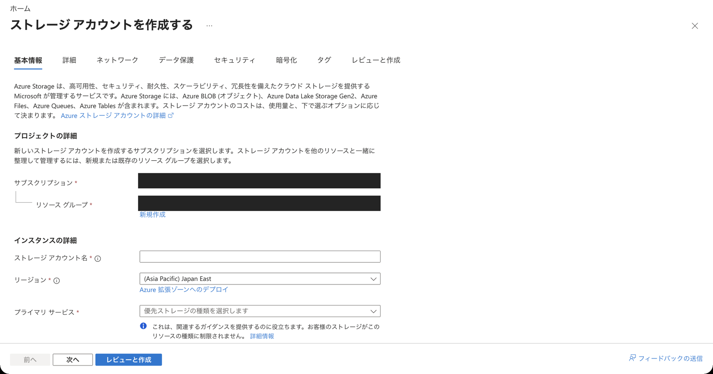

# 第4回 — 講師用の準備と進め方

関連資料: [参加者用手順書](guide.md) ／ [実施記録](run-through.md) ／ [画面の更新方法](screenshots.md)

## 共有座学との対応

[共有PowerPoint「第4回 データの取込・保存・利用」](https://onedrive.cloud.microsoft/:p:/a@3zg9r5sp/S/cQref0TpLCUhQ72-PRXHY-wCEgUCtSQSauCAie_SnRlGuaJaDg)の内容をWorkIQで確認しています。
表の見出しとページ番号は、2026-10-12に取得した要約から整理したものです。版番号は未確認なので、開催前に当日の資料と照合してください。
共有ファイル自体は編集・再アップロードしていません。

| 共有資料のページ・見出し | 実習で取り上げること |
| --- | --- |
| 6「トークトレ on Azure」 | アプリの実行とファイル保存を別サービスに分ける。今回の構成は学習用で、お客様の想定構成を再現・実装したものではない |
| 62「マネージドID」 | アプリのIDを使い、ブラウザーへStorageの鍵を配らない |
| 63〜65「Azure Blob Storageとは」「Storage Accountに含まれるもの」 | アカウント → uploadsコンテナー → files/file-01.csvというBlob |
| 70「ネットワーク構成」 | Storageは公開無効、VNet内のPE経路。基本操作はアプリのHTTPS入口 |
| 71「Blob Storage上のデータへの接続」 | アプリがSDKで保存し、別要求で再取得する |
| 72「アクセス制御（認証）」／73「アクセス制御（認可）」 | MIでのEntra認証、Blob Data Contributor、管理とデータの権限の違い |
| 26「Azure SQL Database概要」 | 今回はCSVをファイルとしてBlobに保存し、SQLへ表を作る課題とは区別 |

共有資料には、今回使うアップロードやグラフのサンプルはありません。アプリと準備手順は、このハンズオン用に作っています。

導入の説明例:

> 今日はCSVをアップロードして、Blobに保存してみます。
> 表とグラフは、保存したあとにBlobから読み直して表示します。アップロードしたタブを開いている間だけ見えるのではなく、保存先に残ったデータを使っています。
> ページを開き直したり、別のCSVを入れたりして、その違いを見てみましょう。

## 開催前に用意しておくこと

1. 人数分の専用環境を用意するか、認証とデータ分離を備えた共有環境にするかを決めます。この手順とテンプレートは専用環境向けです。
2. 使う契約、費用の負担者、期間、提出先、質問窓口、削除担当を決めておきます。
3. 講師がRG、ネットワーク、Storage、ACR、MI、Container Appsを管理できるか調べます。RBACロールの割り当てには別の権限が必要で、Contributorだけでは付与できません。
4. Microsoft.App、Microsoft.Network、Microsoft.Storage、Microsoft.ManagedIdentity、Microsoft.ContainerRegistryの登録と、ポリシー・クォータを確認します。
5. アプリのIngressには、主催者が承認した講師・受講者のIPだけを許可します。`0.0.0.0/0`には広げません。
6. 授業と同じネットワークから、保存・読み直し・表とグラフ・削除まで一度通して試します。
7. 初学者に手順書だけで試してもらい、保存と表示の違い、ファイル名とID、合計・最大値、開き直し、削除対象を見分けられるか見ます。
8. ファイル容量以外に、PE、DNS、ACR、VNet統合のLB/IP、追加サービスも含めて、人数分の費用を見積もります。

## 準備する専用リソース

| リソース | 学習用の設定 |
| --- | --- |
| RG | 自分専用。所有・課題・受講者のタグを付ける |
| Storage | StorageV2、Standard LRS、Hot、TLS1.2、HTTPS、Shared Keyと匿名アクセス無効、公開ネットワーク無効 |
| Blobコンテナー | `uploads`、private |
| MI | User-assigned。アプリと検証用Jobに割り当てる |
| Storage RBAC | **uploadsコンテナーだけ**へStorage Blob Data Contributor |
| ACR | Basic、adminとanonymous pull無効。AcrPullをこのRegistryだけへ割当 |
| VNet | 専用。例:10.44.0.0/16 |
| Container Apps用区画 | infrastructure、10.44.0.0/27、Microsoft.App/environmentsへ委任 |
| PE用区画 | private-endpoints、10.44.1.0/24 |
| PE/DNS | blobのPE、privatelink.blob.core.windows.net、専用VNetへのリンク |
| Container Apps環境 | workload profiles型・Consumptionのみ、VNet統合、ログ保存なし |
| アプリ | 同梱アプリのビルド済みdigest。HTTPS8080、許可IP限定、0.25 vCPU/0.5 GiB、最小0/最大1 |

ここで使うのはworkload profiles型の環境です。/27とサブネットの委任は、その環境向けの設定なので、旧型のConsumption-only環境と混ぜないでください。
StorageのSDK接続先は通常の `https://アカウント.blob.core.windows.net` です。DNSがPEのIPを返すため、コードのURLを `privatelink` 付きに変える必要はありません。

データの権限を付ける相手は、参加者ではなくアプリのMIです。範囲もStorageアカウント全体ではなく、uploadsコンテナーだけにします。
ブラウザーはアプリに接続するので、StorageのCORSやSAS発行は不要です。
Portalを開ける権限があっても、Blobを読む権限やPEへの経路がなければ、端末から一覧を読むことはできません。

これはStorageの作成前の画面です（2026-10-12）。講師が開く入口の参考として掲載しています。
撮影したPortalと検証用CLIは別の契約だったため、この画面からは設定・作成していません。
作成前のセキュリティとネットワークの入力欄を追加撮影しました。稼働中の設定、MI/RBAC、PE/DNSは、まだ[撮影できていない一覧](screenshots.md)に残しています。

Storageのセキュリティと公開ネットワークの入力欄は、今回追加した[参加者用の参考画面](guide.md#保存先の設定を画面で見る参考)でも説明しています。
これらも作成前のフォームで、稼働中の設定や、MI/RBAC・PE/DNSを通した接続の確認は別に必要です。

Private Endpointの追加は、**ネットワーク**タブの下にあります。ここでは入口だけを撮影したため、一覧は空です。
公開アクセスを無効にするだけで接続準備が終わるわけではありません。Blob用のPE、DNS、アプリのVNet統合を用意し、実際に読み書きできるところまで試してください。

## 環境を作るためのファイル

アプリは `app/` にあり、FlaskとAzure Blob SDKを使っています。グラフはSVGで描き、SQL、pandas、外部CDNは使いません。
配布する3つのCSVは `app/blob_viz/samples/` にあります。

| 段階 | 資産 | 実施すること |
| --- | --- | --- |
| 基盤準備 | `infra/handson04-base.bicep`、`handson04-resources.bicep` | compile、subscription validate、what-if、承認範囲だけ展開 |
| イメージ | `app/Dockerfile`、requirements | 通常Docker buildを検証。制約があれば署名/TLSを弱めずACR build。runIdとdigestを保存 |
| アプリ | `infra/handson04-app.bicep` | digestを指定してgroup validate・what-if後に展開 |
| 独立読取 | `infra/handson04-verification-job.bicep` | 同じVNet内の短命Jobで実Blob bytes/SHA/private DNSを検証 |
| 終了 | 対象・タグ・一覧を確認 | 専用RG削除とサービス管理RGの片付けを確認 |

パスはリポジトリルート基準です。

IaC、Docker、Jobの操作は講師側の準備で、参加者には求めません。
テンプレートには、開催用に新しく作るRG・stem・許可IP・所有マーカーを指定します。既存RGにはそのまま実行せず、CLIの既定値にも頼らず、サブスクリプションを明示してください。
接続の問題をStorageのキーや接続文字列、SASで回避する手順は追加しません。
検証に使った環境は削除済みなので、そのURLを配っても使えません。開催時には、主催者が承認した専用環境とネットワークを新しく用意します。

アプリに必要な環境変数は `AZURE_STORAGE_ACCOUNT` と、MIの `AZURE_CLIENT_ID` です。
Client IDは識別子で、パスワードではありません。ただし、実際のIDは教材や提出物に転載しないでください。
CSRFはセッションごとに用意しています。Cold startや再起動でセッションが変わり、操作が止まったらページを再読み込みします。

ACR buildでは、`app/Dockerfile` とビルドContextを同じ基準の絶対パスで指定します。実行場所によって、CLIが別の相対パスを探すことがあるためです。
runIdを控え、Queuedのままならその実行を追います。追加のビルドや基盤の作り直しは行いません。
展開するときはタグだけでなく、実際にビルドしたイメージのdigestを指定します。

## アプリのデータ設計

保存するのは64 KiB以内、1〜24行で、重複しない月と整数を持つCSVです。
`files/file-01.csv` から `file-10.csv` までの空き枠を使い、`overwrite=False` で条件付き作成します。同時に保存した場合やレプリカが変わった場合も、既存データを上書きせず10件までに収めます。
ファイル名、スキーマ、SHAはBlobのメタデータに保存します。

表示にはPOSTで受け取ったバイト列を使いません。別のGETで `get_blob_properties` と条件付きの `download_blob` を呼び、サイズ・SHAを調べてからCSVを集計します。
基本CSVの6行・1020・240は、ここで計算した結果です。
削除も表示時のETagと一致する場合だけ行うので、古い画面から別の版を消すことを防げます。
入力・接続・権限のエラーは要求ID付きで表示します。エラー時に空のデータを返したり、Cloud設定の不足をメモリー保存へ自動で切り替えたりはしません。設定が欠けていれば起動時にエラーになります。

## 60分の進行

| 経過 | 内容 | 確認すること |
| --- | --- | --- |
| 0〜5分 | ゴール・専用環境・架空データ | データと権限・経路の分担 |
| 5〜10分 | サンプルと画面 | Azureに接続した専用アプリであること |
| 10〜20分 | 基本CSVの保存・可視化 | 6行・1020・240、Blob読取 |
| 20〜30分 | ダウンロードと開き直し | 同じバイト／保存の持続 |
| 30〜40分 | 別CSVとの比較 | 1080・300、基本は不変 |
| 40〜45分 | 無効CSV | 件数が増えない |
| 45〜55分 | ファイル削除・終了引継ぎ | 自分の対象と削除担当 |
| 55〜60分 | 振り返り | 取込・保存・利用、管理とデータの権限 |

RGの削除は授業後に追っても構いませんが、処理中のものは未完了として担当者を決めます。
サービスが管理する `ME_...` は手動で編集・削除せず、環境の削除に伴って片付いたかを主催者が確認してください。
