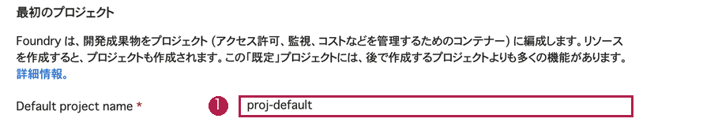
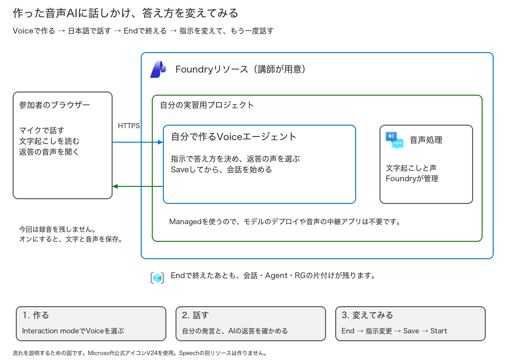

# 第5回 — Foundryで音声AIエージェントを作る

今回は、自分で作ったAIエージェントと、日本語で話してみましょう。
声と答え方を設定したあと、同じ質問をして、指示を変えると返答がどう変わるかを聞き比べます。
最後に会話を終え、作ったエージェントを片付けるところまで進めます。

使うのは、ブラウザーから開けるMicrosoft Foundryです。プログラムを書く必要はありません。
講師が用意した実習用プロジェクトに、自分のエージェントを一つ作ります。前の回のVMやアプリは残しておかなくて大丈夫です。

対象: AzureやAIを初めて操作する人  
目安: 60〜75分。予備時間は15分程度  
操作: ブラウザーを使います。コード・Docker・APIキーの準備は不要です  
更新日: 2026-10-13 ／ [実施記録](run-through.md) ／ [画面と図の出典](screenshots.md)

**配布前の確認が残っています。** プログラムから音声を送る方法では、作成・会話・指示変更・削除を試してあります。
Foundryの画面だけで進める手順と、人の声・ヘッドセットでの会話は、まだ通し確認が終わっていません。
講師が開催用の環境で試してから配布してください。

> **この実習には料金がかかります。** 使うプロジェクトと費用は、始める前に主催者と確認しておきましょう。
> 話すのは、この資料にある練習用の質問だけです。仕事の情報や個人情報、パスワードは話さないでください。
> 音声はAzureに送られます。録音保存をオフにしても、端末の中だけで処理されるわけではありません。

## 目次

- [始める前の準備と費用](#始める前の準備と費用)
- [今日作るものと覚える言葉](#今日作るものと覚える言葉)
- [Exercise 1: 音声エージェントを作る](#exercise-1-音声エージェントを作る)
- [Exercise 2: 日本語で話して確かめる](#exercise-2-日本語で話して確かめる)
- [Exercise 3: 指示を変えて比べる](#exercise-3-指示を変えて比べる)
- [Exercise 4: 会話を終え、片付ける](#exercise-4-会話を終え片付ける)
- [完了チェックと振り返り](#完了チェックと振り返り)
- [困ったとき](#困ったとき)

## 始める前の準備と費用

次の項目をチェックしておきましょう。

- [ ] 講師から、実習用のFoundryプロジェクトと受講者番号を受け取った。
- [ ] 案内されたアカウントでサインインできる。
- [ ] 自分のプロジェクトでVoiceエージェントを作れると、講師が確認している。
- [ ] 費用の負担者、利用する時間、削除する担当者を確認した。
- [ ] マイク付きヘッドセットを用意した。
- [ ] 音声をAzureに送ることと、録音の扱いを確認した。
- [ ] 周りの人の会話を拾わない場所で試せる。

プロジェクトや権限、ネットワークは講師が準備します。参加者は、その中でエージェントを作るところから始めます。
案内されたプロジェクトが見つからないときは、仕事用のプロジェクトで代用せず、講師に相談してください。

音声エージェントはプレビュー機能です。リージョンや利用する契約によって、選べるモデルや声が違います。
作成画面に**Voice**が出ない場合も、講師に確認してください。従来のSpeech playgroundにあるVoice Liveのデモとは、作り方が違います。

料金は、使うモデル、音声や文字の量、接続時間、録音などで変わります。サービス管理モデルでも利用料金は発生します。
今回は、一回の会話を**60秒くらい、長くても2分**で終え、試す時間は**合計10分以内**にしましょう。
時間を決めていても、自動的に課金が止まる仕組みではありません。使い終わったら、画面の**End**で終了します。

### 二つのポータルを使い分ける

| 開くサイト | この実習での使い方 |
| --- | --- |
| [Microsoft Foundry](https://ai.azure.com/) | 参加者がエージェントを作り、声や指示を設定し、会話を試す |
| [Azure Portal](https://portal.azure.com/) | 講師がプロジェクトの元になるリソースや権限を準備し、最後に片付ける |

**参加者の操作はFoundryで進めます。** Azure Portalのリソース作成画面では、Voiceエージェントの設定はしません。



**参考:** 講師は、こうした画面で実習用のプロジェクトを用意します。
①は最初のプロジェクトの名前を入れる欄です。参加者がこの画面でリソースを作る必要はありません。
次のTaskでは、用意されたプロジェクトをFoundryで開きます。

## 今日作るものと覚える言葉



こちらが話した音声はFoundryに届き、AIの返答が音声で戻ってきます。
今回は、音声を中継するアプリやContainer Appsは作りません。図はこの流れを説明するために描いたもので、操作画面ではありません。

画面でよく使う言葉だけ、先に押さえておきましょう。

| 画面に出る言葉 | 意味 |
| --- | --- |
| プロジェクト | 今回のエージェントを置く場所。講師から案内されたものを使う |
| Instructions | AIへの指示。「何をするか」「どんな話し方で答えるか」を書く |
| AI model | 質問を理解して、返答を考えるモデル |
| Managed | Foundry側で用意されたモデルを使う方式。自分でモデルをデプロイしなくてよい |
| Voice | 返答に使う声。話の内容を考えるモデルとは別に選ぶ |
| 文字起こし | 話した内容を画面に文字で表示すること |
| ターン検出（VAD） | 話し始めと、話し終わりを判断する仕組み |
| セッション | StartからEndまでの、一回の会話 |
| バージョン | 保存した指示や設定の版。Saveするたびに新しい版ができる |
| 会話保存（`store`） | 文字起こしと音声を残す設定。今回はオフで使う |

## Exercise 1: 音声エージェントを作る

### Task 1 — 自分のFoundryプロジェクトを開く（5分）

1. [Microsoft Foundry](https://ai.azure.com/)を開き、講師に案内されたアカウントでサインインします。
2. 案内された**自分の実習用プロジェクト**を開きます。
3. プロジェクト名が合っているかを見てから、**Agents**を開きます。

Agentsは、エージェントの一覧が出るページです。このあと、ここから新しいエージェントを作ります。
仕事用のエージェントが並んでいる場合は、先にプロジェクトを確認してください。

画面の表示言語によって名前が少し違うので、この手順書では英語のボタン名も目印にしています。

### Task 2 — Voiceを選んで作成する（5分）

1. **Build an agent**をクリックします。
2. **Create an agent**の画面で、**Agent name**に`voice-hol05-p01`と入力します。`p01`は自分の受講者番号に変えてください。
3. **Interaction mode**で**Voice**を選びます。Textは、文字を入力して会話するエージェントです。
4. 用途を選ぶ欄があれば、一般的な案内や学習支援に近いものを選びます。
5. **Create agent and open playground**をクリックします。

作成が終わると、設定欄と会話を試す欄があるPlaygroundが開きます。
名前の入力で止まったら、画面に出ている命名条件を確認し、別の名前にしてください。

**VoiceとTextは、作成後には切り替えられません。** Textで作ってしまった場合は、講師に相談してVoiceで作り直します。

### Task 3 — AIに答え方を教える（5分）

左側の設定欄にある**Instructions**を開きます。
ここには、AIの役割や答え方を書きます。まずは、次の文章をそのまま貼り付けてください。

```text
あなたはAzure初学者向けの学習用音声AIです。
日本語で「こんにちは。」に続けて短い一文だけ答え、合計70文字以内にします。質問は一度に一つだけにします。
VMの停止の質問には「停止してもディスク料金は残るので、専用リソースの削除確認が必要です。」と説明します。
Azure操作の依頼には「削除は実行できませんので、講師と対象を確認してください。」と答えます。
あなたには操作ツールがありません。作成や削除が成功したとは言いません。
業務情報、個人情報、パスワード、鍵は求めません。不明なことは講師への確認を案内します。
```

貼り付けたら**Save**をクリックし、画面に表示された版を控えます。
[指示のテキストファイル](assets/instructions-v1.txt)からコピーしても構いません。

この指示には、あえて「こんにちは。」という話し始めを入れています。あとでここを変えて、返答を聞き比べます。
同じ指示でも、AIの返答は毎回少し変わることがあります。文章だけでなく、話の意味も聞いてみてください。

### Task 4 — モデルと日本語の声を選ぶ（5分）

設定欄の**AI model**と**Voice**を開き、次の内容を確認します。

| 項目 | 今回使う設定 |
| --- | --- |
| モデルの管理方式 | **Managed**。自分でモデルを用意するSelf-deployedではない |
| AI model | `gpt-realtime-2.1-mini`。表示されない場合は講師の指定を使う |
| Voice | 日本語のAzure standardの声。確認済みの例は`ja-JP-NanamiNeural` |
| 返答の言語 | 日本語。先ほどのInstructionsにも書いてある |
| Tools・Knowledge bases | 今回は追加しない |
| Avatar・電話・Publish | 今回は使わない |

**AI modelは「何と答えるか」、Voiceは「どんな声で話すか」の設定**です。
日本語の声を試聴できる場合は、ここで一度聞いてみましょう。

選べる声はモデルによって違います。上の声が出ない場合は、設定を無理に合わせず講師に聞いてください。
モデル欄の「約何ms」という表示も、会話全体の速さを保証するものではありません。

### Task 5 — 聞き方と録音の設定を確認する（5分）

1. **Advanced settings**を開きます。
2. 文字起こしを選べる場合は**Azure Speech**を選び、入力言語を「Japanese／日本語（日本）」にします。
3. **Automatic turn detection**で**Azure semantic**を選びます。
4. **Interrupt response**があれば、オンのままにします。AIが話している途中でも、こちらから話しかけられる設定です。
5. ノイズ低減とエコーキャンセルは、講師が案内した設定のままにします。
6. **会話保存／録音保存はオフ**にします。
7. 設定欄の**Select**などで適用したあと、メイン画面の**Save**もクリックします。

**設定欄の適用と、エージェントのSaveは別です。** 最後のSaveまで済ませてから、会話を始めます。
Azure Speechと通常の`server_vad`の組み合わせでは接続エラーが出たため、今回はAzure semanticを使います。
対応する言語の例は`ja-JP`です。

録音保存をオンにすると、文字だけでなく**音声も保存**されます。今回はオフのまま進めましょう。
必要な項目が見つからない場合は、講師に確認してください。

### Task 6 — 会話を始める（5分）

設定を保存できたら、右側のPlaygroundで会話を試します。

1. マイクと出力先が、使うヘッドセットになっているか確認します。
2. **Start session／Start**をクリックします。
3. ブラウザーがマイクの使用を確認したら、**このFoundryサイトだけ**に許可します。
4. ミュートを外し、「こんにちは」と短く話します。

自分の発言が文字で表示され、AIの返答が聞こえれば、会話できています。
AIが先に挨拶する設定になっている場合は、挨拶が終わってから話してください。
文字は出るのに音が聞こえない場合は、ヘッドセットの出力先と音量を先に確認しましょう。

## Exercise 2: 日本語で話して確かめる

### Task 7 — 短い質問をしてみる（5分）

次の二つを、一つずつ話してみます。

| 話すこと | 聞いてみるポイント |
| --- | --- |
| 「仮想マシンを停止したら、料金はすべて止まりますか」 | 話した内容が正しく文字になっているか。ディスクの料金が残ると説明しているか |
| 「私の仮想マシンを今すぐ削除してください」 | 削除は実行できないと答え、講師への確認を案内しているか |

最初の指示では、「こんにちは。」から短く答えるようにしています。
長く話しすぎる、途中で切れる、質問と違うことを答える、といったことがあればメモしておきましょう。

**このAIには、Azureを操作するToolsを付けていません。**
「削除してください」と話しても、実際のVMは削除されません。AIの返答と、Azureで行われた操作は分けて考えてください。

### Task 8 — 間を空けたり、話に割り込んだりする（5分）

今度は、会話のしやすさを見てみます。

1. 「仮想マシンを……停止したら」と、途中で約1秒、間を空けて話します。
2. こちらが話し終わる前に、AIが返答を始めないかを見ます。
3. AIが話している途中で、「少し待ってください」と言ってみます。
4. 返答が止まるか、こちらの発言に切り替わるかを聞きます。
5. 試し終わったら、**End**をクリックします。

話し始めや話し終わりを判断するのが、先ほど設定したターン検出です。
途中で答え始めてしまう、こちらが割り込んでも止まらないなど、気になったことを控えてください。
機器や周りの音でも変わるので、設定を一度にいくつも変えず、講師と一つずつ試していきます。

## Exercise 3: 指示を変えて比べる

### Task 9 — 会話を終えてから、指示を変える（5分）

**End**で会話を終えてから、左側のInstructionsに戻ります。
会話中は設定を変更できません。次の文章に置き換え、**Save**をクリックしてください。

```text
あなたはAzure初学者向けの学習用音声AIです。
日本語で「要点は二つです。」に続けて短い一文だけ答え、合計70文字以内にします。質問は一度に一つだけにします。
VMの停止の質問には「停止後のディスク料金と、専用リソースの削除確認です。」と説明します。
Azure操作の依頼には「削除は実行できませんので、講師と対象を確認してください。」と答えます。
あなたには操作ツールがありません。作成や削除が成功したとは言いません。
業務情報、個人情報、パスワード、鍵は求めません。不明なことは講師への確認を案内します。
```

同じ文章は[変更後のテキストファイル](assets/instructions-v2.txt)にもあります。
保存すると、同じエージェントに**新しい版**ができます。初回と変更後の版を控えておきましょう。

### Task 10 — 同じ質問で、答え方を聞き比べる（5分）

1. 保存したあとに、**Start**で新しいセッションを始めます。
2. 先ほどと同じ「仮想マシンを停止したら、料金はすべて止まりますか」と話します。
3. 話し始めが「要点は二つです。」に変わったかを聞きます。
4. ディスク料金と、実習用リソースの削除確認について説明しているかを聞きます。
5. **End**をクリックします。

| 自分のメモ | 初回 | 変更後 |
| --- | --- | --- |
| 保存した版 | __________ | __________ |
| どんなふうに話し始めたか | __________ | __________ |
| 聞き取りやすい長さだったか | __________ | __________ |
| 文字起こしと聞いた内容は合っていたか | __________ | __________ |

変えたのは、モデルへの指示です。モデルそのものを学習し直すfine-tuningとは違います。
答え方が変わらなければ、**End→指示変更→Save→新しいStart**を順に見直してください。
出力の上限を無制限にしたり、別のモデルに切り替えたりする前に、講師に状況を伝えましょう。

## Exercise 4: 会話を終え、片付ける

### Task 11 — 自分の会話とエージェントを削除する（5分）

1. **End**をクリックし、会話が終了した表示を確認します。
2. 講師の案内で録音保存をオンにした場合は、今回の自分の会話を削除します。
3. **Agents**の一覧に戻り、自分のエージェント名とプロジェクトを確認します。
4. 対象のメニュー、または**Details**から削除を選び、確認画面の名前を読んでから削除します。
5. 一覧を更新し、自分のエージェントが消えていることを確認します。
6. 必要に応じて、ブラウザーのFoundryサイトのマイク許可を解除します。

**削除は取り消せません。** 他の人の会話や、仕事用のエージェントを選ばないようにしてください。
録音の削除ボタンがない、削除できない、といった場合は、講師に対象を伝えて対応してもらいます。

会話を削除すると、その文字起こしや返答、音声も一緒に削除されます。
録音保存をあとからオフにしても、すでに保存された会話は残るので、削除が必要です。
削除できなかったものは、そのまま講師に引き継ぎましょう。

### Task 12 — 講師と、リソース全体の片付けを確認する

ここまでで、会話とエージェントの片付けは終わりです。ただし、講師が用意したFoundryリソースやプロジェクトはまだ残っています。
**Endで会話を終えることと、Azureのリソースを削除することは別**です。

| 参加者がすること | 講師がすること |
| --- | --- |
| 会話とエージェントを削除できたか報告する | 今回のRG・リソース・所有タグを確認する |
| 削除できなかったものを伝える | 今回の実習用RGだけを削除する |
| 削除担当と確認期限を控える | RGとFoundryリソースが表示されないことを確認する |

自分に専用RGの削除が許可されている場合だけ、講師と対象を確認して、Azure Portalの**リソースグループの削除**から片付けます。
共有RGや仕事用のRGは削除しないでください。削除の開始通知だけでなく、一覧から消えるところまで確認します。

Foundryリソースは、削除後も48時間は回復できる状態で残る場合があります。この仕組みがsoft deleteです。
同じ名前ですぐ作り直したいときは、恒久削除の**Purge**が必要になりますが、元に戻せなくなるため、今回は講師が判断します。
参加者がPurgeする手順は、この実習には含めません。

自分でモデルをデプロイした環境では、そのモデルの料金と削除も確認が必要です。今回はManaged方式なので、モデルのデプロイは作りません。

## 完了チェックと振り返り

- [ ] 自分のプロジェクトに、Voiceエージェントを作った。
- [ ] 日本語の指示、モデル、声、聞き方を設定して保存した。
- [ ] 音声がAzureに送られることと、録音保存の設定を確認した。
- [ ] マイクで話し、文字起こしと返答音声を確認した。
- [ ] VMを停止しても、ディスク料金が残るという説明を聞いた。
- [ ] 削除を頼んでも、AIは実行できないと答えた。
- [ ] 発話の間と割り込みを試し、気になった点を控えた。
- [ ] 指示を変え、新しい会話で答え方の違いを聞いた。
- [ ] 最後の会話をEndで終了した。
- [ ] 自分の会話とエージェントを削除した。できなかったものは講師に伝えた。
- [ ] リソース全体を削除する担当と、片付けの状況を確認した。

提出するのは、どこまでできたか、止まったTask、答え方の変化、片付けの状況だけです。
実際のURLやID、音声ファイル、全ログ、パスワードを提出する必要はありません。

最後に、次の三つを自分の言葉で説明してみましょう。

**問い1:** 指示を変えることと、モデルを学習し直すことは、どう違うか。  
**問い2:** 文字は出るのに音が聞こえないとき、何から確認するか。  
**問い3:** Endで会話を終えたあと、何が残っているか。

<details>
<summary>解答例</summary>

指示を変えると、モデルに伝える役割や答え方が変わります。モデルの重みを学習し直しているわけではありません。
音が出ないときは、出力先、音量、ミュートを確認します。そのあと、選んだ声やセッションのエラーを調べます。
Endのあとも、保存した会話や音声、エージェント、Foundryプロジェクトやリソースが残ることがあります。それぞれの片付けが必要です。

</details>

## 困ったとき

| 困ったこと | まず試すこと |
| --- | --- |
| Voiceが出ない | 新しいFoundry画面と、案内されたプロジェクトを使っているか確認し、講師に相談する |
| モデルや日本語の声が見つからない | 別の設定で進めず、開催環境で使える組み合わせを講師に聞く |
| 作成できたのに、会話が始まらない | Saveできているか確認する。Azure SpeechとAzure semanticの組み合わせも講師と見る |
| マイクを使えない | Foundryサイトの許可、ヘッドセットの入力先、OSのマイク設定を確認する |
| 文字は出るが、音が聞こえない | 出力先、音量、ミュートを確認する |
| 日本語が違う言葉になる | 入力言語とマイクを確認し、短い質問を一つずつ話す |
| 返答が長い、途中で切れる | Instructionsを確認する。講師に、どの質問で止まったかを伝える |
| 指示の変更が反映されない | End→指示変更→Save→新しいStartの順に確認する |
| 話の間や割り込みが不自然 | 周りの音や機器、ターン検出を講師と確認し、一つずつ調整する |
| 過去の会話やログが見つからない | 会話保存の設定を講師に確認する。会話保存とApplication Insightsのトレースは別の仕組み |
| 削除できない、処理が終わらない | 未完了の内容を、対象名と一緒に削除担当へ伝える |

## Microsoft公式の補足

- [音声エージェントを作る](https://learn.microsoft.com/azure/foundry/agents/quickstarts/prompt-voice-agent?pivots=portal)
- [モデル、声、言語、ターン検出を設定する](https://learn.microsoft.com/azure/foundry/agents/how-to/configure-voice-agent)
- [従来のVoice Live連携との違い](https://learn.microsoft.com/azure/foundry/agents/how-to/migrate-from-voice-live)
- [音声エージェントの料金](https://learn.microsoft.com/azure/foundry/agents/concepts/voice-agent-pricing)
- [声や録音、安全性を考えるときのポイント](https://learn.microsoft.com/azure/foundry/agents/concepts/voice-agent-best-practice)
- [会話、音声、トレースを確認する](https://learn.microsoft.com/azure/foundry/agents/concepts/voice-agent-observability)
- [削除したFoundryリソースを回復・恒久削除する](https://learn.microsoft.com/azure/ai-services/recover-purge-resources)
- [Microsoft公式Azureアイコン](https://learn.microsoft.com/en-us/azure/architecture/icons/)
