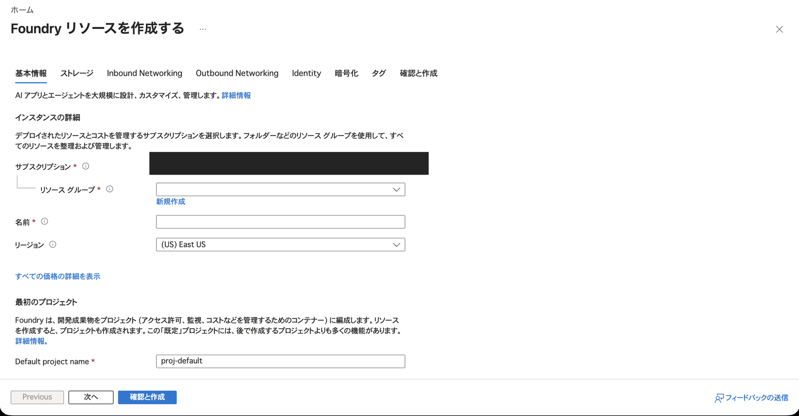
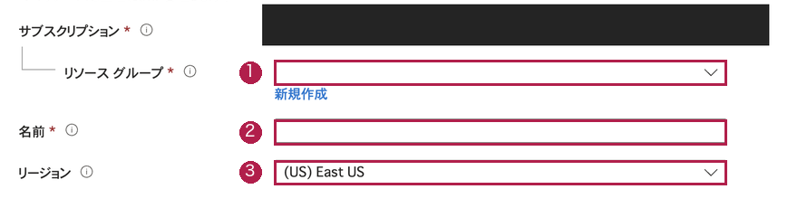

# 第5回 — 講師向けの準備と進め方

[参加者用の手順書](guide.md) ／ [実施記録](run-through.md) ／ [画面と図の出典](screenshots.md)

## この回で体験してもらうこと

最後の回では、参加者に自分の音声AIエージェントを作ってもらいます。
日本語で話したあと、指示を変えて同じ質問をし、「声を選ぶこと」と「答え方を決めること」の違いを見ていきます。
会話を終え、エージェントを片付けるところまでを一つの実習にしています。

使うのは、新しいFoundryのAgents画面で作るVoiceエージェントです。APIでの種別は`kind: voice`になります。
従来のTextエージェントへVoice Liveを接続する方式や、Speech playgroundの会話デモとは手順が違います。
参加者にコードを書いてもらう必要はなく、Container AppsやDocker、ACRも用意しません。

以前の第5回は「音声ファイルの処理とログの観察」を想定していましたが、今回は音声エージェントの作成を中心にしています。
座学の「音声・AI連携」からつなげてください。第5回の共有座学URLはまだ受け取っていないので、スライドのページ番号は載せていません。

## 先に用意しておくもの

一人ずつ、実習用のFoundryプロジェクトを用意します。
案内するのは、使うアカウント、プロジェクト名、受講者番号、利用時間、費用の負担者、質問窓口、片付けの担当です。
仕事用のエージェントと同じ一覧で作業しないように、実習の場所を分けておきましょう。

| 準備すること | 授業前に試しておくこと |
| --- | --- |
| Voiceプレビュー | 参加者のアカウントでBuild an agentを開き、Interaction modeにVoiceが出る |
| 権限 | 対象プロジェクトでエージェントを作り、会話し、削除できる |
| モデルと声 | 案内するモデルと日本語の声を選び、実際に返答が聞こえる |
| 文字起こしとターン検出 | 日本語のAzure SpeechとAzure semanticで会話を始められる |
| 端末とネットワーク | 同じ会場・ブラウザーで接続でき、マイクと出力先を選べる |
| 録音の扱い | 音声送信の説明、保存の有無、同意、閲覧者、削除方法が決まっている |
| 費用 | 人数と試す時間を含めて見積もり、誰が負担するか決まっている |
| 終了時の対応 | 削除に失敗した参加者から、対象を引き継ぐ担当者がいる |

モデルカタログに載っていても、そのプロジェクトでVoiceとして使えるとは限りません。
授業で使うアカウントで、**作成から短い会話まで一度試す**のが確実です。
Voiceが出なければ、地域、契約、プレビューの利用条件を確認します。Textで作って代わりに進めることはしません。

参加者の権限は、例えばプロジェクト単位の**Foundry User**で用意します。旧名のAzure AI Userが表示される場合もあります。
Azureリソースを管理する権限と、Foundryでエージェントを扱う権限は別です。
Foundryリソースの作成、ロール割り当て、プロジェクト内の操作は、それぞれ必要な許可を確認してください。全員にOwnerを付ける必要はありません。

ネットワークの許可は、主催者が決めた範囲に絞ります。つながらないときも、全IPに開放したり、認証を外したりする前に原因を調べます。
閉域の環境を使う場合は、授業で使う端末からそこへ接続できることを先に確認してください。

## 確認に使った設定

今回、動作確認に使った設定は次のとおりです。参加者の環境で同じ項目が選べるか、開催前に見直してください。

| 項目 | 設定 |
| --- | --- |
| Foundryリソース | `AIServices`、S0、Entra認証。配置先はJapan East |
| プロジェクト | 実習用に新しく用意 |
| モデル | サービス管理の`gpt-realtime-2.1-mini` |
| 声 | Azure standardの`ja-JP-NanamiNeural` |
| 入力 | Azure Speechによる文字起こし、日本語のAzure semantic VAD |
| 出力の上限 | 512トークン。聞こえる返答は短い二文にする |
| 会話保存 | 通常は`store=false`。保存の確認をする会話だけオン |
| ツールや知識 | 追加なし。Azureを操作する機能は付けない |
| ネットワーク | 確認用端末のIPv4だけ許可し、それ以外は拒否 |

Japan Eastは公式の対応表にありますが、利用できるモデルや声は契約でも変わります。
また、データの処理場所はリソースの配置先だけでは判断できません。必要な条件はサービスの提供条件で確認してください。

今回は、電話、アバター、本人の声の複製、Custom voice、Teamsへの公開は扱いません。
本番で使う場合の認証、複数利用者の分離、保持、評価、SLAは、この実習とは別に設計する必要があります。

## Azure Portalで準備する場所

参加者が操作するのはFoundryですが、その元になるリソースや権限はAzure Portalで準備できます。

この画像は、2026-10-12に開いた**作成前の画面**です。
エージェントのInstructionsやVoiceを設定する画面ではありません。
既定のリージョンも、動作確認に使ったJapan Eastとは違うので、画面例の値ではなく開催用の設定を使ってください。

撮影に使ったアカウントは、動作確認用のAzure CLIと別の契約につながっていたため、このフォームからリソースは作っていません。
エージェントの作成・設定・会話で使う画面は、[画面資料](screenshots.md)にまとめています。

### リソース名とリージョン

全体画像では入力欄が小さいので、同じ画面の必要な部分を大きくしました。

①は今回使う専用RG、②はFoundryリソースの名前、③は配置するリージョンです。
画像は作成前の既定値なので、③のEast USをそのまま使うのではなく、開催用に決めた設定を選んでください。
サブスクリプション名は隠しています。参加者に渡す案内は、実際に確認した契約・プロジェクトを使います。

### 最初のプロジェクト

①が最初のプロジェクト名です。参加者がFoundryで開く場所と、AzureのRGが別のものだと説明するときに使えます。
ここで決めるのはプロジェクトの名前で、エージェントの名前やVoiceではありません。
二枚とも、上の作成前の画面から切り出した画像です。別の操作段階を撮ったものではありません。

## 75分の進め方

最初に「今回はAzureを操作するAIではなく、Azureについて答える学習用AIを作る」と伝えておくと、削除を頼む質問の意図が分かりやすくなります。

| 時間 | 進める内容 | 参加者に聞いてみること |
| --- | --- | --- |
| 0〜10分 | プロジェクトを開き、Voiceを作る | 自分の実習用プロジェクトになっているか |
| 10〜25分 | 指示、モデル、声、聞き方を設定する | モデルと声の違いは分かるか。Saveまで済んだか |
| 25〜40分 | 短い質問を二つ話す | 自分の発言は文字になったか。返答は聞こえたか |
| 40〜45分 | 間を空ける、割り込む、Endする | 会話しにくかったところはあるか |
| 45〜55分 | 指示を変え、同じ質問をする | 話し始めや説明はどう変わったか |
| 55〜65分 | 会話とエージェントを片付ける | 自分の対象だけを削除できたか |
| 65〜75分 | 振り返りと片付けの報告 | Endのあとに何が残るか説明できるか |

マイクや音が出ないところで止まった場合は、モデルの設定より先に、入力先・出力先・ミュート・ブラウザーの許可を見ます。
エコーを避けるために、会場ではマイク付きヘッドセットを使うのがおすすめです。

## つまずきやすかったところ

**文字起こしとターン検出の組み合わせ**

Azure Speechと通常のserver VADでは、エージェントの作成ができても会話開始後にエラーが出ました。
Azure semantic VADと日本語の設定に変えて、音声の往復を確認しています。
作成画面が終わったところだけでなく、短い質問を一つ話すところまで確認してください。

**返答の長さと上限**

初めの指示では返答が約20秒になり、200トークンの上限に達して途中で止まる例もありました。
短い指示にしただけでも、音が返る前に上限に達することがありました。
今回はStandard miniモデル、512トークンの上限、短い答えを具体的に書いた指示の組み合わせで、約7〜8.5秒の返答になっています。
トークン数は、耳で聞く文章の文字数と一対一ではありません。

**変更が反映されない**

設定欄のSelectと、メイン画面のSaveは別です。
また、会話中には設定を変えられません。**End→指示変更→Save→新しいStart**を、参加者と順に見てください。

## 録音とログ

基本課題では録音保存をオフにし、会話中の文字と音で確認します。
録音を残す場合は、何のために残すか、誰が見られるか、いつ削除するかを先に決め、参加者に説明してください。
`store=true`にすると、文字起こしだけでなく音声も保存されます。
あとから保存をオフにしても、以前の会話は消えません。

会話保存とApplication Insightsのトレースは、別の仕組みです。今回は監視用のリソースを新しく作る必要はありません。
発展課題で使う場合は、ログの閲覧権限、記録する内容、保持期間、費用を確認します。
文章の評価だけでは、発音、反響、雑音、割り込みのしやすさは分からないので、実際の機器で聞く確認も残してください。

## 費用と片付け

Managedはモデルの運用を省ける方式で、無料という意味ではありません。
モデル、音声の入力・出力、文字起こし、音声合成、録音などを含めて、参加人数分の費用を見積もります。
会話を合計10分以内にするのは、使いすぎを避けるための目安です。課金上限を設定する操作ではありません。

片付けは次の順に進めます。

1. 全員がEndで会話を終える。
2. 保存した場合は、今回の自分の会話を削除する。
3. 自分のエージェントを削除する。
4. 講師が、対象の契約・専用RG・所有タグ・中のリソースを確認する。
5. 今回の専用RGを削除し、一覧から消えたことを確認する。

Foundryリソースがsoft deleteで残っている場合は、RGの残存と分けて確認します。
同名を再利用するためにPurgeが必要なら、今回の対象を照合し、許可を得た担当者が行ってください。恒久削除なので元には戻せません。

## 準備や再確認に使うファイル

| ファイル | 内容 |
| --- | --- |
| `infra/handson05-base.bicep` | 新しい専用RGを作るテンプレート |
| `infra/handson05-resources.bicep` | Foundryリソース、プロジェクト、プロジェクト単位のFoundry Userを用意する |
| `assets/instructions-v1.txt`／`instructions-v2.txt` | 参加者が貼り付ける、初回と変更後の指示 |
| `verification/requirements.txt` | 講師がプログラムで確認するときのSDK |
| `verification/voice_checks.py` | 音声の形式や、返答が最後まで返ったかを確認する補助コード |
| `assets/voice-validation.json` | 音声の往復、文字起こし、指示変更、会話の削除の記録 |
| `assets/live-validation.json` | リソースや権限、削除完了の記録 |

IaCのパスはリポジトリルート、その他は第5回のフォルダーからの相対パスです。
テンプレートには、開催用のRG名、リソース名、プロジェクト名、所有タグ、利用者のObject ID、許可するIPv4を渡します。
実行前にcompile、ARM validate、what-ifで変更先を確認してください。CLIの既定RGやグローバル設定を変える必要はありません。

前回の確認ではAzure AI Projects 2.8.0を使いました。
`VoiceAgentDefinition`と`beta.voice_agents.realtime`を使うと、音声を送って確認できます。
Voiceのプレビューを使うため、クライアントの`allow_preview=True`も必要です。
詳しくは[補助検証の説明](verification/README.md)と[公式Quickstart](https://learn.microsoft.com/azure/foundry/agents/quickstarts/prompt-voice-agent?pivots=python)を参照してください。
接続にはEntra認証を使い、キーやトークンは参加者に配りません。

**前回の検証用環境は削除済みです。** 開催時は新しい実習用プロジェクトを用意してください。
参加者用の指示文は、音声の往復を確認したものをそのまま載せています。説明文の推敲に合わせて、確認済みの指示や返答の記録を書き換えることはしていません。
