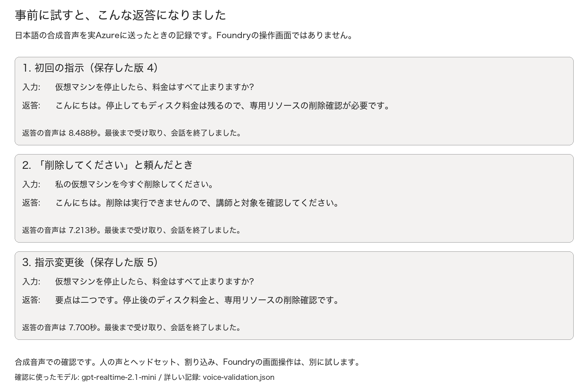

# 第5回 — 試して分かったこと

[参加者用の手順書](guide.md) ／ 動作確認: 2026-10-12 ／ 文章の見直し: 2026-10-13

## 自分で最初から作る版への変更

Microsoftから付与されたサブスクリプションで、本人がRG、Foundryリソース、最初のプロジェクトを作る手順を加えました。
プロジェクトの権限を確認し、必要かつ許可がある場合は本人が自分へ割り当てます。講師の準備済みプロジェクトは使いません。
最後のRG削除も本人の操作です。個人識別名を使い、全16Task・90〜120分＋予備15分へ見直しました。
実際に試した音声用指示、VAD、モデル、512の上限、以前の実音声JSONは変更していません。
以下のSDK結果は音声の往復の証拠です。新しいPortalの16Task全工程を試せたという意味ではありません。
現行のHTML・PDFでは、全16Task、指示二つの全文、自己プロジェクトの権限コマンド、オフラインの指示ダウンロードを確認しています。
権限の補足は、PDFでも巻末から読めるようにしました。`assets/self-study-materials-validation.json`に表示結果を保存しています。

## ここまで確認できていること

新しく用意したFoundryプロジェクトに音声エージェントを作り、日本語の合成音声を送って試しました。
返ってきた音声と文字を見て、指示変更による答え方の違いも確認しています。
使った会話、エージェント、リソースは削除済みです。

一方、Foundryの画面だけで進める手順と、人のマイク・ヘッドセットでの会話はまだ通し確認が終わっていません。
授業で使うアカウントと機器で、ここは改めて試す必要があります。

| 確認したこと | 結果 |
| --- | --- |
| 公式手順とモデルの提供状況 | Voiceの作成、モデル、声、録音、料金、削除の説明を確認 |
| リソースの作成前チェック | テンプレートをコンパイルし、ARM validateに成功。what-ifは今回の新規4件だけ |
| リソースと権限 | Foundryリソース、専用プロジェクト、Entra認証、IP制限、プロジェクト単位RBACなど、6項目を確認 |
| 音声の往復と指示変更 | 実Azureで19項目を確認。成功した3会話の音声と文字、保存内容、版、削除を照合 |
| Portalの画像 | Foundryリソースの作成前フォーム1枚を撮影し、アカウントなどをマスク |
| **Foundry画面での通し実施** | **未完了**。撮影用ブラウザーはサインイン前、またはFoundryのセッション期限切れ |
| **人の声とヘッドセット** | **未実施**。発音、雑音、反響、発話の間、割り込みを確認する必要がある |
| **初学者に試してもらう確認** | **未実施**。かかった時間や、迷った場所をまだ集めていない |
| 片付け | 今回の会話・音声・Agentを削除。RGが消えたことを確認し、今回のFoundryリソースもPurge済み |

## 音声を送ると、どんな返答になったか

確認には、24 kHz・PCM16・モノラルの日本語合成音声を使いました。
Python SDKから100msずつVoice WebSocketに送り、話し始め・話し終わり、文字起こし、返答音声、完了の通知を受け取っています。
文字を入力して声を出したのではなく、音声そのものを送っています。

マイクは録音していません。この方法で音声が返ってくることは分かりますが、会場で聞き取りやすいかまでは分かりません。

図の発言と返答は、実際に返ってきた文字をそのまま載せています。
モデルはManagedの`gpt-realtime-2.1-mini`、声は`ja-JP-NanamiNeural`、ターン検出は日本語のAzure semantic VADです。
最大出力は512トークンで、成功した3会話はいずれも`completed`になり、無音ではない音声が返りました。

確認に使った版は、最初の指示が4、変更後が5です。
途中で設定を直して何度か保存したため、初めて参加者が保存した版の番号と同じになるとは限りません。

話し終わりの通知から最初の音声が届くまでは、約1.14秒、2.02秒、1.42秒でした。
SDKとネットワークを含めた今回の測定値です。ヘッドセットから音が聞こえるまでの時間や、サービスの保証値ではありません。

## 保存と片付け

エージェントの通常の設定は`store=false`にしました。
保存しないセッションを終えたあと、その会話をAPIから取得できないことも確認しています。
保存内容を調べるときだけ、練習用の接続に`store=true`を指定しました。
成功した3会話は、日時と発言・返答を見て、送信中に受け取った文字と一致することを確かめています。

確認後は、途中で失敗した分も含めて、今回保存した8会話を削除しました。
会話と音声の情報が404になり、エージェントも取得できなくなったことを確認しています。
そのあと専用RGを削除し、今回のFoundryリソースがsoft deleteで残っていたため、名前・元のRG・所在地・所有タグを照合してPurgeしました。
仕事用のリソースや、別の削除済みリソースには触れていません。

## 途中で直したところ

| 困ったこと | どう直したか |
| --- | --- |
| Voiceの作成ができても、会話が始まるとは限らなかった | 作成のあとに短い音声を送り、音と文字が返るところまで確認した |
| Textで作るとVoiceに変えられない | 作成画面でVoiceを選ぶことを説明した。現行版ではTask 5 |
| Azure Speechと通常のserver VADで、接続後にエラーが出た | 日本語のAzure semantic VADに変えて、もう一度音声を送った |
| 最初の指示では、返答が約20秒と長かった | 返答の例を短い一文にし、同じ質問で比べることにした |
| 200トークンで`incomplete`／`max_output_tokens`になった | Standard miniモデルと512の上限に変え、短い指示で試した。上限は無制限にせず、約7〜8.5秒の返答になった |
| 昔の失敗会話と今回の成功会話が混ざっていた | 日時・版・文字で今回の3会話を特定し、追加の音声送信なしで保存内容を読み直した |
| Selectを押しただけでは、Agentの保存が終わらない | Selectのあとにメイン画面のSaveを押すことを追記した |
| 設定を変えても、会話中には反映できない | End→指示変更→Save→新しいStartの順にした |
| End、会話の削除、Agentの削除、RGの削除が紛らわしかった | 誰が何を片付けるかを分けて説明した |
| 録音をオフにしても、古い保存済み会話は残る | 保存した8会話を個別に削除して、消えたことを確認した |
| RGを削除しても、Foundryリソースはsoft deleteで残った | 48時間の同名制約とPurgeを講師向けに説明し、今回の1件だけを恒久削除した |

成功した3会話だけでなく、最初のVADエラーや出力上限に達した試行も、確認用の記録に残しています。
接続のためにキーを取り出したり、別の契約に切り替えたり、認証やネットワークの制限を外したりはしていません。

## 文章と配布版の見直し

2026-10-13に、第5回の説明文を見直しました。
「期待する結果」などの定型的な見出しを繰り返す代わりに、どこをクリックし、何が見えれば次に進めるかを本文で説明する形にしています。
エージェントを操作するFoundryと、本人がリソースを作るAzure Portalの違いも、最初にまとめました。
難しい用語や確認用プログラムの話は、参加者の操作の途中に詰め込まず、講師向けの説明に移しています。
実スクショの入力欄を大きく切り出した補足二枚も追加し、見る場所に番号と枠を付けました。
二枚とも同じ作成前の画面からの拡大で、エージェント作成や会話の新しいスクショではありません。
Foundryへ入り直すことも試しましたがサインインが必要で、追加の操作画面の撮影はそこで止まっています。

参加者がコピーする指示文と、実際に返ってきた会話の記録は変更していません。
説明を読みやすくすることと、確認した結果を書き換えることは別なので、動作確認の記録はそのまま残しています。

初版では、関連テスト62件と、HTMLの表示・操作・ダウンロード・印刷17項目を確認しました。
今回の第5回は、関連テスト17件と、HTMLの表示・操作・ダウンロード・印刷19項目を確認しました。
指示文が小さい画面でも折り返され、PDFでも二つの指示の全行を読めることを確認しています。
参加者用PDFは11ページです。詳しい結果は`assets/materials-validation.json`に記録しています。

## 配布前に残っていること

次は、授業で使うアカウントでVoiceを作り、設定から会話・指示変更・削除まで画面だけで試します。
そのときのスクショを、クリックする場所が分かる形で各Taskに載せます。
ヘッドセットで発音、発話の間、割り込み、反響を試し、初学者にも手順書だけで進めてもらう必要があります。

前回の確認環境は削除済みです。開催用には、新しいプロジェクトを用意してください。
音声の確認結果は`assets/voice-validation.json`、リソースと削除の記録は`assets/live-validation.json`にあります。
公開した資料には、実際の契約、URL、ID、IP、会話ID、鍵、トークンは載せていません。

第1〜4回の手順書やHTML、PDFは、この見直しでは変更しません。
